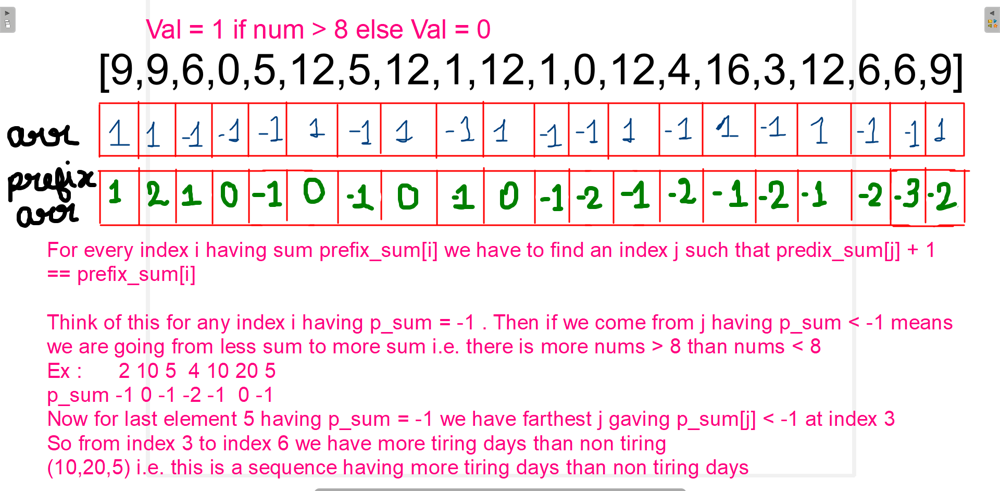

# PYTHON | AS INTERVIEWER WANTS |EXPLAINED WITH PICTURE | FAST | HASHMAP + PREFIX_SUM |

**Author:** reaper_27
**Votes:** 8
**Link:** [https://leetcode.com/problems/longest-well-performing-interval/solutions/2183607/](https://leetcode.com/problems/longest-well-performing-interval/solutions/2183607/)

---

# EXPLANATION

**The idea is shown in the picture:**


```
Searching the j for every i can cost us O(n*n) which will cause TLE 
So we need to use hashmap here 

Now let us say sum is -1 
So if we get a j having sum - 3 it will still be increment positively same for sum = -2 
But if you observe carefully we can reach -3 only from -2 as we can have (+1 / -1 ) 
So the number prefix_sum[i] - 1 will always be farther than sum < prefix_sum[-1] 
This is why we always use prefix_sum[i] - 1

NOTE  if sum < prefix_sum[i]  - 1 exists : prefix_sum[i] - 1 will always exist as we can reach 
sum having sum < prefix_sum[i] - 1 by prefix_sum[i] - 1

Now all we need to do is to keep a dictionary of all indexes of first occurence of an element
TIME COMPLEXITY BECOMES O(n)
```


# CODE
```
class Solution:
    def longestWPI(self, hours: List[int]) -> int:
        n = len(hours)
        ans = 0
        prefix_sum = [0]*n
        d = {}
        for i in range(n):
            prefix_sum[i] = 1 if hours[i] > 8 else -1
            prefix_sum[i] += prefix_sum[i-1]
            if prefix_sum[i] > 0 : 
                ans = i + 1
            else:
                if prefix_sum[i] - 1 in d:
                    j = d[prefix_sum[i] - 1]
                    if i - j > ans: ans = i - j
            if prefix_sum[i] not in d: d[prefix_sum[i]] = i
        return ans
```