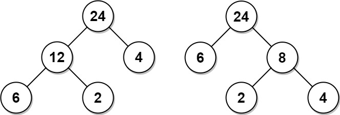
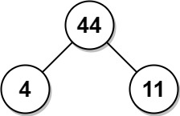

# [1130. Minimum Cost Tree From Leaf Values](https://leetcode.com/problems/minimum-cost-tree-from-leaf-values/)

| Category | Difficulty | Likes | Dislikes |
| :------: | :--------: | :---: | :------: |
| Algorithms | Medium | 4411 | 280 |

**Tags:** [`array`](https://leetcode.com/tag/array), [`dynamic-programming`](https://leetcode.com/tag/dynamic-programming), [`stack`](https://leetcode.com/tag/stack), [`greedy`](https://leetcode.com/tag/greedy), [`monotonic-stack`](https://leetcode.com/tag/monotonic-stack)

**Companies:** `google`, `mathworks`

## Description

Given an array `arr` of positive integers, consider all binary trees such that:

	- Each node has either `0` or `2` children;

	- The values of `arr` correspond to the values of each **leaf** in an in-order traversal of the tree.

	- The value of each non-leaf node is equal to the product of the largest leaf value in its left and right subtree, respectively.

Among all possible binary trees considered, return *the smallest possible sum of the values of each non-leaf node*. It is guaranteed this sum fits into a **32-bit** integer.

A node is a **leaf** if and only if it has zero children.

 

**Example 1:**


```

Input: arr = [6,2,4]
Output: 32
Explanation: There are two possible trees shown.
The first has a non-leaf node sum 36, and the second has non-leaf node sum 32.

```

**Example 2:**


```

Input: arr = [4,11]
Output: 44

```

 

**Constraints:**

	- `2 31).

---

**Links:** [Submissions](https://leetcode.com/problems/minimum-cost-tree-from-leaf-values/) | [Solutions](https://leetcode.com/problems/minimum-cost-tree-from-leaf-values/)
