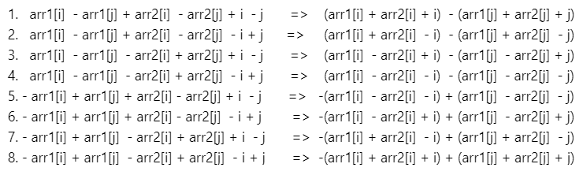

# c++, beats 100% (both time and memory), with algorithm and image

**Author:** goelrishabh5
**Votes:** 348
**Link:** [https://leetcode.com/problems/maximum-of-absolute-value-expression/solutions/340075/](https://leetcode.com/problems/maximum-of-absolute-value-expression/solutions/340075/)

---

|arr1[i] - arr1[j]| + |arr2[i] - arr2[j]| + |i - j| can be written as :




If we look carefully, 1 & 8 ; 2 & 7; 3 & 6; 4 & 5 are practically the same.
So , problem reduces to finding max of (1,2,3,4).
And in each 1,2,3,4, values in both brackets are same, so we simply find max(value in bracket) - min(value in bracket) for each. 
Then find max of values obtained from (1,2,3,4)

```
int fun(vector<int>& arr, int n) { 
        int max_sum = arr[0], min_sum = arr[0];  
        for (int i = 0; i < n; i++) { // Finding max and min sum value 
            max_sum=max(max_sum,arr[i]);
            min_sum=min(min_sum,arr[i]);
        } 
        return (max_sum-min_sum); 
    } 
    
    int maxAbsValExpr(vector<int>& arr1, vector<int>& arr2) {
        int n = arr1.size();
        vector<int> sum1(n,0),diff1(n,0),sum2(n,0),diff2(n,0);
        for(int i=0;i<n;i++) {
            sum1[i]=arr1[i]+arr2[i]+i;
            diff1[i]=arr1[i]-arr2[i]+i;
            sum2[i]=arr1[i]+arr2[i]-i;
            diff2[i]=arr1[i]-arr2[i]-i;
        }
        return max(max(fun(sum1,n),fun(diff1,n)),max(fun(sum2,n),fun(diff2,n)));        
    }
```