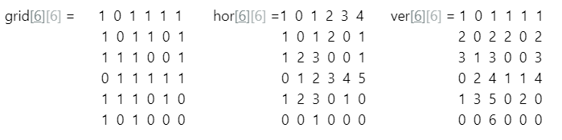
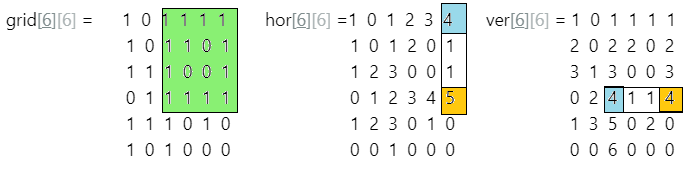

# c++, beats 100% (both time and memory) concise, with algorithm and image

**Author:** goelrishabh5
**Votes:** 264
**Link:** [https://leetcode.com/problems/largest-1-bordered-square/solutions/345265/](https://leetcode.com/problems/largest-1-bordered-square/solutions/345265/)

---

Create auxillary horizontal and vertical arrays first
For example : 


Then starting from bottom right,for every i,j ; we find small=min (ver[i][j], hor[i][j]) (marked in orange) , then look at all distances in [1,small] vertically in hor array and horizontally in ver array. If values(shown in blue) are greater than small and if small is greater than curr result, then we update result



```
 int findLargestSquare(vector<vector<int>>& mat) 
    { 
    int max = 0; int m = mat.size() , n = mat[0].size();
    vector<vector<int>> hor(m,vector<int> (n,0)) , ver(m,vector<int> (n,0));
   
    for (int i=0; i<m; i++) { 
        for (int j=0; j<n; j++) { 
            if (mat[i][j] == 1) 
            { 
                hor[i][j] = (j==0)? 1: hor[i][j-1] + 1;   // auxillary horizontal array
                ver[i][j] = (i==0)? 1: ver[i-1][j] + 1;  // auxillary vertical array
            } 
        } 
    } 
        
    for (int i = m-1; i>=0; i--) { 
        for (int j = n-1; j>=0; j--) { 
            int small = min(hor[i][j], ver[i][j]);  // choose smallest of horizontal and vertical value
            while (small > max) { 
                if (ver[i][j-small+1] >= small &&  hor[i-small+1][j] >= small)  // check if square exists with 'small' length
                    max = small; 
                small--; 
            } 
        } 
    } 
    return max*max; 
} 
    
    int largest1BorderedSquare(vector<vector<int>>& grid) {
        return findLargestSquare(grid); 
    }
```