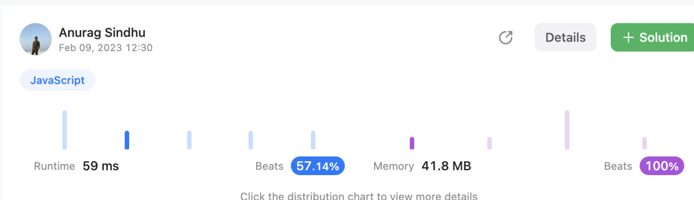

# ❇ Crisp n Clear👌 🏆O(N)❤️ Javascript❤️ Memory Beats👀100%🕕 Meaningful Vars✍️ 🔴❇ ✅ 👉 💪🙏

**Author:** anurag-sindhu
**Votes:** 1
**Link:** [https://leetcode.com/problems/decrease-elements-to-make-array-zigzag/solutions/3163231/](https://leetcode.com/problems/decrease-elements-to-make-array-zigzag/solutions/3163231/)

---

# Intuition
Find total cost if Odd Indexed has to be greater
Find total cost if Odd Indexed has to be greater
min cost out of both approaches gonna be the final output

# Approach
<!-- Describe your approach to solving the problem. -->

# Complexity
- Time complexity:
O(n)

- Space complexity:
O(1)

# Code
```
var movesToMakeZigzagEvenIndexed = function(nums) {
	let totalCost = 0;
	let previousValue = null;
	for (let index = 0; index < nums.length; index++) {
		if (index === 0) {
			previousValue = nums[index];
		} else if (index % 2 === 0) {
			const currentValue = nums[index];
			if (!(previousValue < currentValue)) {
				const tempTotalCost = previousValue - currentValue + 1;
				totalCost += tempTotalCost;
				previousValue = currentValue;
			} else {
				previousValue = nums[index];
			}
		} else {
			const currentValue = nums[index];
			if (!(previousValue > currentValue)) {
				const tempTotalCost = currentValue - previousValue + 1;
				totalCost += tempTotalCost;
				previousValue = currentValue - tempTotalCost;
			} else {
				previousValue = nums[index];
			}
		}
	}
	return totalCost;
};

var movesToMakeZigzagOddIndexed = function(nums) {
	let totalCost = 0;
	let previousValue = null;
	for (let index = 0; index < nums.length; index++) {
		if (index === 0) {
			previousValue = nums[index];
		} else if (index % 2 === 0) {
			const currentValue = nums[index];
			if (!(previousValue > currentValue)) {
				const tempTotalCost = currentValue - previousValue + 1;
				totalCost += tempTotalCost;
				previousValue = currentValue - tempTotalCost;
			} else {
				previousValue = nums[index];
			}
		} else {
			const currentValue = nums[index];
			if (!(previousValue < currentValue)) {
				const tempTotalCost = previousValue - currentValue + 1;
				totalCost += tempTotalCost;
				previousValue = currentValue;
			} else {
				previousValue = nums[index];
			}
		}
	}
	return totalCost;
};

var movesToMakeZigzag = function(nums) {
	const fromOdd = movesToMakeZigzagOddIndexed(nums);
	const fromEven = movesToMakeZigzagEvenIndexed(nums);
	const finalResponse = Math.min(fromOdd, fromEven);
	return finalResponse;
};
```

