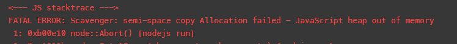
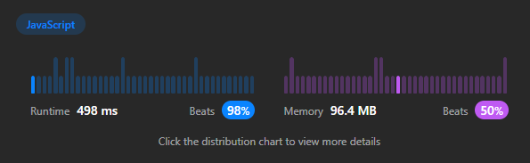

# [JS] | Beats 98% 🚀 | Stuck on runtime errors? read this detailed approach

**Author:** gabrielfcipriano
**Votes:** 7
**Link:** [https://leetcode.com/problems/snapshot-array/solutions/3625837/](https://leetcode.com/problems/snapshot-array/solutions/3625837/)

---

# Intuition
The fisrt thought is to create an array and fill it with zeros. DON'T DO THAT, as it will probably lead to memory-related runtime errors becouse of many copies (snapshots):


reading the description carefully gives us a hint:
> `SnapshotArray(int length)` initializes an array-like data structure with the given length. Initially, each element equals 0.

two important insights on this quote:
***array-like data structure***: It dont have to be an array. As we will not be iterating over the array, and only acccessing indexes directly, we could use a hash-map-like structure, such as a pure js object, where the index is the key that holds a value
***"Initially, each element equals 0"***: - DOOON'T. It does't has to be. As we will be using a key-value data structure, the absense of a value in our data structure can be seen as an empty space, so we return `0` when `data[idx] === undefined`.

# Approach
Even doing the optimizations above, you can still fall into one or another runtime error. This could happen if you are **always** copying the current data when `snap()` is called.

You have to copy *only* when the data changed between an `snap()` call and another. 

When `snap()` is called without `set()` in between, the new snapshot will be the same as the previous one, so it can just point to the last snapshot doing something like `snaps.push(snaps[snaps.length-1])`, instead of copying the current data.

We will track changes with a simple flag `hasChanges`, that we sets to true everytime that `set()` is called.

So lets go to the code:


# Code
```
var SnapshotArray = function(length) {
    this.curr = {};
    this.snaps = [];
    this.hasChanges = false;
};

SnapshotArray.prototype.set = function(idx, val) {
    this.curr[idx] = val;
    this.hasChanges = true;
};

SnapshotArray.prototype.snap = function() {
    if (this.hasChanges || this.snaps.length  === 0) {
        this.snaps.push({...this.curr});
    } else {
        this.snaps.push(this.snaps[this.snaps.length - 1])
    }
    this.hasChanges = false;
    return this.snaps.length - 1;
};

SnapshotArray.prototype.get = function(idx, snap_id) {
    return this.snaps[snap_id][idx] || 0
};
````



