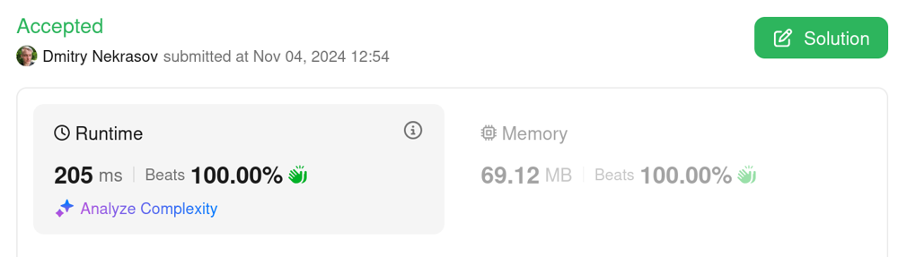

# Simple RMQ solution, beats 100% 🚀

**Author:** DmitryNekrasov
**Votes:** 0
**Link:** [https://leetcode.com/problems/online-majority-element-in-subarray/solutions/6005591/](https://leetcode.com/problems/online-majority-element-in-subarray/solutions/6005591/)

---

# Complexity
- Time complexity: $$O(log^2(n))$$

- Space complexity: $$O(n)$$

# Code
```kotlin []
class MajorityChecker(private val a: IntArray) {
    private val indices = Array(a.max() + 1) { mutableListOf<Int>() }

    init {
        for ((index, value) in a.withIndex()) {
            indices[value] += index
        }
    }

    inner class Range(private val left: Int, private val right: Int, val majority: Int, val count: Int) {
        operator fun plus(other: Range): Range {
            if (count == 0) return other
            if (other.count == 0) return this
            if (other.left - right != 1 && left - other.right != 1) throw UnsupportedOperationException()
            val newLeft = min(left, other.left)
            val newRight = max(right, other.right)
            val countMajority = indices.count(majority, newLeft, newRight)
            val countOtherMajority = indices.count(other.majority, newLeft, newRight)
            return Range(newLeft, newRight, if (countMajority > countOtherMajority) majority else other.majority, max(countMajority, countOtherMajority))
        }
    }

    inner class RMQ {
        private val tree = Array<Range?>(a.size * 4) { null }  // value -> count

        init {
            build(1, 0, a.lastIndex)
        }

        private fun build(v: Int, tl: Int, tr: Int) {
            if (tl == tr) {
                tree[v] = Range(tl, tr, a[tl], 1)
            } else {
                val tm = (tl + tr) / 2
                build(v * 2, tl, tm)
                build(v * 2 + 1, tm + 1, tr)
                tree[v] = tree[v * 2]!! + tree[v * 2 + 1]!!
            }
        }

        private fun query(v: Int, tl: Int, tr: Int, l: Int, r: Int): Range {
            if (l > r) return Range(0, 0, 0, 0)
            if (l == tl && r == tr) return tree[v]!!
            val tm = (tl + tr) / 2
            return query(v * 2, tl, tm, l, min(r, tm)) + query(v * 2 + 1, tm + 1, tr, max(l, tm + 1), r)
        }

        fun query(left: Int, right: Int): Pair<Int, Int> {
            val range = query(1, 0, a.lastIndex, left, right)
            return range.majority to range.count
        }
    }

    private val rmq = RMQ()

    fun query(left: Int, right: Int, threshold: Int): Int {
        return rmq.query(left, right).let { (value, count) -> if (count >= threshold) value else -1 }
    }

    companion object {
        private fun List<Int>.upperBound(target: Int, left: Int = 0, right: Int = size): Int {
            if (left >= right) return right
            val mid = left + (right - left) / 2
            return if (this[mid] >= target) upperBound(target, left, mid) else upperBound(target, mid + 1, right)
        }

        private fun List<Int>.lowerBound(target: Int, left: Int = 0, right: Int = size) =
            upperBound(target, left, right).let { it - if (it < size && this[it] == target) 0 else 1 }

        private fun List<Int>.count(left: Int, right: Int) = lowerBound(right) - upperBound(left) + 1

        private fun Array<out List<Int>>.count(target: Int, left: Int, right: Int) = this[target].count(left, right)
    }
}
```

