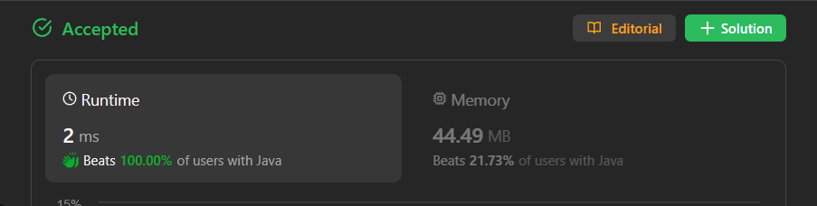

# ✅ Beats 100% - C++/Java/Python/JS - Counting Characters - Visualized Too

**Author:** lancertech6
**Votes:** 145
**Link:** [https://leetcode.com/problems/find-words-that-can-be-formed-by-characters/solutions/4352039/](https://leetcode.com/problems/find-words-that-can-be-formed-by-characters/solutions/4352039/)

---



# YouTube Video Explanation:

[https://youtu.be/u5vBaajqyzM](https://youtu.be/u5vBaajqyzM)
<!-- **If you want a video for this question please write in the comments** -->

**\uD83D\uDD25 Please like, share, and subscribe to support our channel's mission of making complex concepts easy to understand.**

Subscribe Link: https://www.youtube.com/@leetlogics/?sub_confirmation=1

*Current Subscribers: 530*
*Subscribe Goal: 600 Subscribers*

---

# Example Explanation
Let's create a step-by-step explanation using tables:

### Step 1: Initialize Character Counts Array

| Character | a | b | c | d | ... | z |
|-----------|---|---|---|---|-----|---|
| Counts    | 1 | 2 | 0 | 3 | ... | 0 |

Initialize an array `counts` to store the count of each character in `chars`.

### Step 2: Update Counts Array

Iterate through each character in `chars` and update the counts.

| Character | a | b | c | d | ... | z |
|-----------|---|---|---|---|-----|---|
| Counts    | 2 | 3 | 1 | 4 | ... | 1 |

### Step 3: Check Words

For each word in `words`, check if it can be formed using the counts of characters in `chars`.

| Word  | canForm |
|-------|---------|
| "cat" | true    |
| "bt"  | false   |
| "hat" | true    |
| "tree"| false   |

### Step 4: Calculate Lengths

If a word can be formed, add its length to the result.

| Word  | canForm | Length |
|-------|---------|--------|
| "cat" | true    | 3      |
| "bt"  | false   | 0      |
| "hat" | true    | 3      |
| "tree"| false   | 0      |

### Step 5: Calculate Result

Return the sum of lengths.

\\[3 + 0 + 3 + 0 = 6\\]

This gives the final result.

---

# Intuition
<!-- Describe your first thoughts on how to solve this problem. -->
The goal is to find the sum of lengths of strings that can be formed using the characters from the given string `chars`. We need to check for each string in `words` if it can be formed from the characters in `chars`. 

# Approach
<!-- Describe your approach to solving the problem. -->
1. Initialize an array `counts` to store the count of each character in `chars`.
2. Iterate through each character in `chars` and update the counts.
3. For each string in `words`, check if it can be formed using the counts of characters in `chars`.
4. If a string can be formed, add its length to the result.
5. Return the final result.

# Complexity
- Let `m` be the total number of characters in all words, and `n` be the number of words.
- The time complexity is O(m + n), where m is the length of the `chars` string, and n is the length of the `words` array.
- The space complexity is O(1) as the size of the array (26 for lowercase English letters) is constant.

# Code
```java []
class Solution {
    public int countCharacters(String[] words, String chars) {
        int[] counts = new int[26];
        // Step 1: Initialize Character Counts Array
        for(int i=0;i<chars.length();i++)
        {
            counts[chars.charAt(i)-'a']++;
        }
        int res =0 ;
        // Step 3: Check Words
        for(String s : words)
        {
            if(canForm(s,counts))
                // Step 4: Calculate Lengths
                res+=s.length();
        }
        return res;
    }

    boolean canForm(String word, int[] counts)
    {
        int[] c = new int[26];
        // Step 2: Update Counts Array
        for(int i =0;i<word.length();i++)
        {
            int x = word.charAt(i)-'a';
            c[x]++;
            if(c[x] > counts[x])
                return false;
        }
        return true;
    }
}
```
```C++ []
class Solution {
public:
    int countCharacters(vector<string>& words, string chars) {
        vector<int> counts(26, 0);
        
        // Step 1: Initialize Character Counts Array
        for (char ch : chars) {
            counts[ch - 'a']++;
        }

        int result = 0;

        // Step 3: Check Words
        for (const std::string& word : words) {
            if (canForm(word, counts)) {
                // Step 4: Calculate Lengths
                result += word.length();
            }
        }

        return result;
    }

    bool canForm(const std::string& word, std::vector<int>& counts) {
        std::vector<int> c(26, 0);

        // Step 2: Update Counts Array
        for (char ch : word) {
            int x = ch - 'a';
            c[x]++;
            if (c[x] > counts[x]) {
                return false;
            }
        }

        return true;
    }
};
```
```Python []
class Solution(object):
    def countCharacters(self, words, chars):
        counts = [0] * 26

        # Step 1: Initialize Character Counts Array
        for ch in chars:
            counts[ord(ch) - ord('a')] += 1

        result = 0

        # Step 3: Check Words
        for word in words:
            if self.canForm(word, counts):
                # Step 4: Calculate Lengths
                result += len(word)

        return result

    def canForm(self, word, counts):
        c = [0] * 26

        # Step 2: Update Counts Array
        for ch in word:
            x = ord(ch) - ord('a')
            c[x] += 1
            if c[x] > counts[x]:
                return False

        return True
        
```
```Javascript []
var countCharacters = function(words, chars) {
    const counts = new Array(26).fill(0);

    // Step 1: Initialize Character Counts Array
    for (const ch of chars) {
        counts[ch.charCodeAt(0) - 'a'.charCodeAt(0)]++;
    }

    let result = 0;

    // Step 3: Check Words
    for (const word of words) {
        if (canForm(word, counts)) {
            // Step 4: Calculate Lengths
            result += word.length;
        }
    }

    return result;

    function canForm(word, counts) {
        const c = new Array(26).fill(0);

        // Step 2: Update Counts Array
        for (const ch of word) {
            const x = ch.charCodeAt(0) - 'a'.charCodeAt(0);
            c[x]++;
            if (c[x] > counts[x]) {
                return false;
            }
        }

        return true;
    }
};
```

