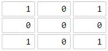
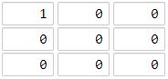

# [1162. As Far from Land as Possible](https://leetcode.com/problems/as-far-from-land-as-possible/)

| Category | Difficulty | Likes | Dislikes |
| :------: | :--------: | :---: | :------: |
| Algorithms | Medium | 4243 | 113 |

**Tags:** [`array`](https://leetcode.com/tag/array), [`dynamic-programming`](https://leetcode.com/tag/dynamic-programming), [`breadth-first-search`](https://leetcode.com/tag/breadth-first-search), [`matrix`](https://leetcode.com/tag/matrix)

**Companies:** `wix`, `amazon`, `microsoft`, `uipath`

## Description

Given an `n x n` `grid` containing only values `0` and `1`, where `0` represents water and `1` represents land, find a water cell such that its distance to the nearest land cell is maximized, and return the distance. If no land or water exists in the grid, return `-1`.

The distance used in this problem is the Manhattan distance: the distance between two cells `(x0, y0)` and `(x1, y1)` is `|x0 - x1| + |y0 - y1|`.

 

**Example 1:**


```

Input: grid = [[1,0,1],[0,0,0],[1,0,1]]
Output: 2
Explanation: The cell (1, 1) is as far as possible from all the land with distance 2.

```

**Example 2:**


```

Input: grid = [[1,0,0],[0,0,0],[0,0,0]]
Output: 4
Explanation: The cell (2, 2) is as far as possible from all the land with distance 4.

```

 

**Constraints:**

	- `n == grid.length`

	- `n == grid[i].length`

	- `1 <= n <= 100`

	- `grid[i][j]` is `0` or `1`

---

**Links:** [Submissions](https://leetcode.com/problems/as-far-from-land-as-possible/) | [Solutions](https://leetcode.com/problems/as-far-from-land-as-possible/)
