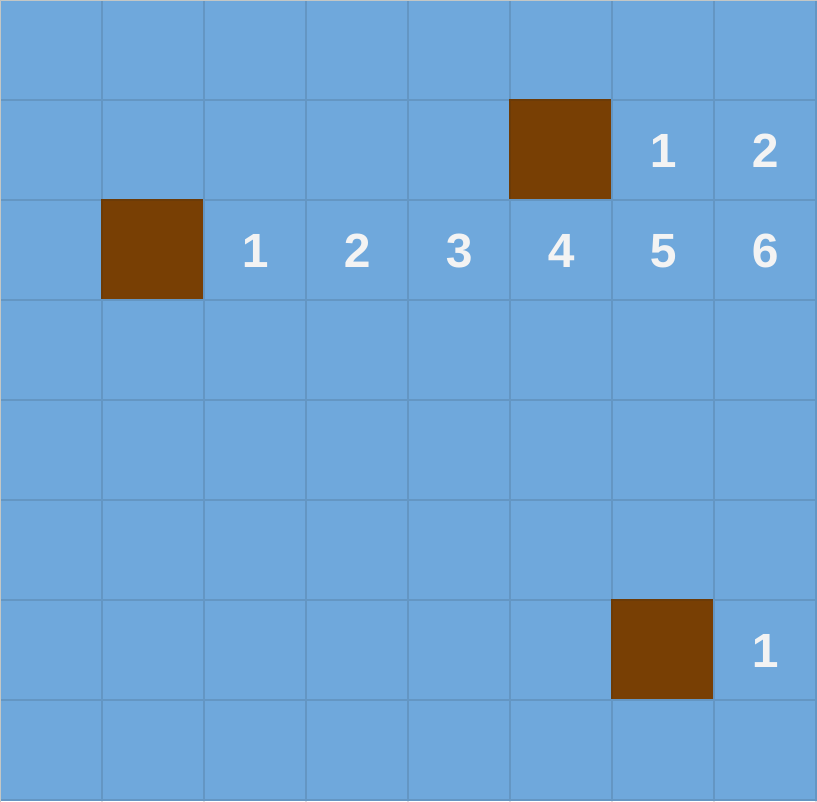
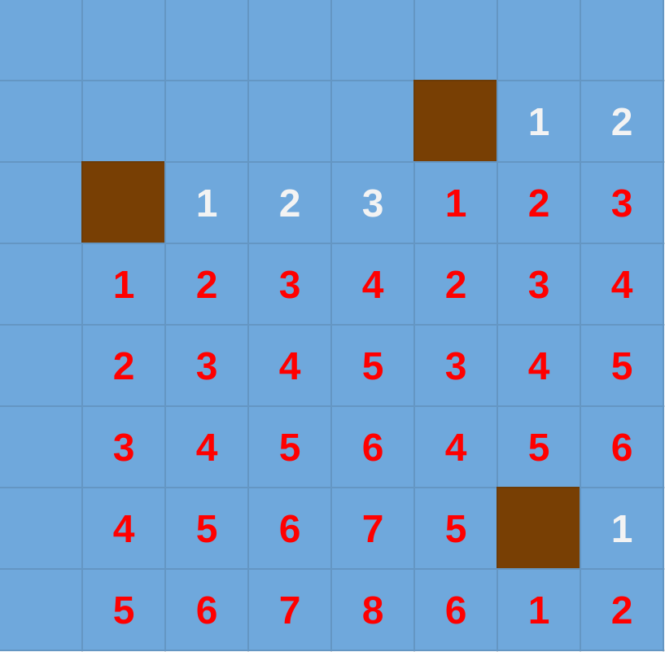
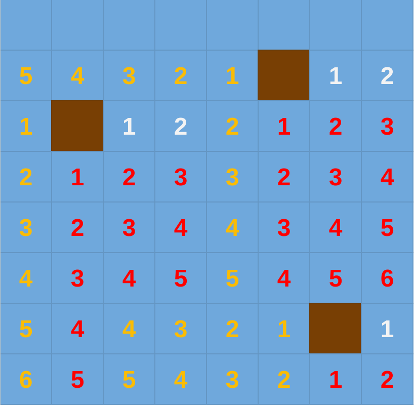
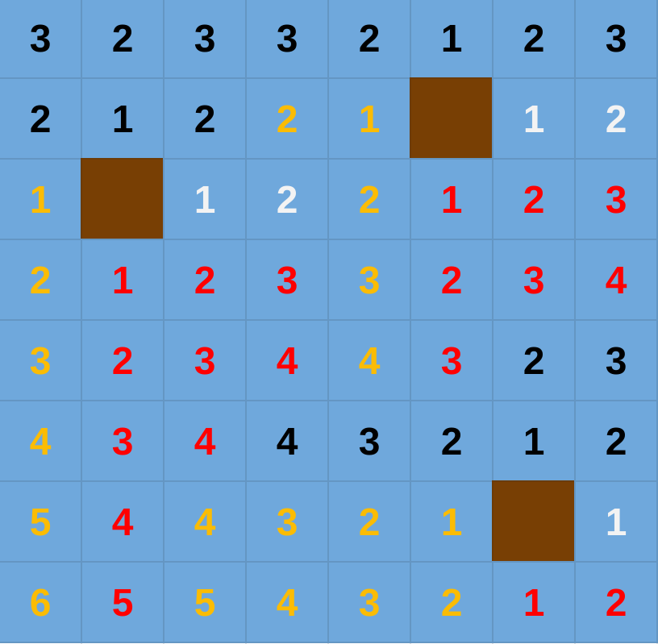

# Elixir - No BFS

**Author:** Aetherus
**Votes:** 0
**Link:** [https://leetcode.com/problems/as-far-from-land-as-possible/solutions/3640322/](https://leetcode.com/problems/as-far-from-land-as-possible/solutions/3640322/)

---

# Approach

For example, if you got this map


when the blue tiles are water tiles, the brown tiles are land tiles.

1. For each row, go from left to right and assign each water tile a number that represents the distance from this tile to its closest left side land. If there's no land on the left side, just leave it as is.
 


2. For each column, go from top to bottom and update the water tiles. If a water tile's previous tile (the tile above it) is a land tile, set number 1 to the current tile; if the previous tile has a number in it, and the current tile has no number, set previous + 1 to the current tile; if the current tile also has a number, set `min(previous + 1, current)` to the current tile; otherwise just leave it as is. The red numbers in the following image is newly set or updated in this run.




3. Go from right to left and do the same thing. The yellow numbers are newly set or updated in this run.



4. Then go from bottom to top. The black numbers are newly set or updated.



5. Finally, we can just take the largest number among all tiles.

# Complexity
- Time complexity: $$O(N \\log N)$$ where $$N$$ is the number of cells in the grid.
The $$\\log N$$ part comes from the HAMT nature of Elixir maps. 
<!-- Add your time complexity here, e.g. $$O(n)$$ -->

- Space complexity: $$O(N \\log N)$$
<!-- Add your space complexity here, e.g. $$O(n)$$ -->

# Code
```elixir
defmodule Solution do
  @spec max_distance([[0 | 1]]) :: pos_integer()
  def max_distance(grid) do
    n = length(grid)

    grid
    |> to_map()
    |> left_to_right_update(n)
    |> top_to_bottom_update(n)
    |> right_to_left_update(n)
    |> bottom_to_top_update(n)
    |> Map.values()
    |> Stream.reject(&is_atom/1)
    |> Enum.max(fn -> -1 end)
  end

  @typep tile() :: :land | :water | pos_integer()
  @typep coord() :: {pos_integer(), pos_integer()}
  @typep the_map() :: %{optional(coord()) => tile()}

  @spec to_map([[0 | 1]]) :: %{optional(coord()) => :land | :water}
  defp to_map(list_2d) do
    for {row, i} <- Stream.with_index(list_2d, 1),
        {val, j} <- Stream.with_index(row, 1),
        into: %{},
        do: {{i, j}, val == 1 && :land || :water}
  end

  @spec left_to_right_update(the_map(), pos_integer()) :: the_map()
  defp left_to_right_update(map, n) do
    for i <- 1..n,
        j <- 2..n,
        reduce: map do
      map -> update(map, {i, j}, map[{i, j}], map[{i, j - 1}])
    end
  end

  @spec right_to_left_update(the_map(), pos_integer()) :: the_map()
  defp right_to_left_update(map, n) do
    for i <- 1..n,
        j <- n-1..1//-1,
        reduce: map do
      map -> update(map, {i, j}, map[{i, j}], map[{i, j + 1}])
    end
  end

  @spec top_to_bottom_update(the_map(), pos_integer()) :: the_map()
  defp top_to_bottom_update(map, n) do
    for j <- 1..n,
        i <- 2..n,
        reduce: map do
      map -> update(map, {i, j}, map[{i, j}], map[{i - 1, j}])
    end
  end

  @spec bottom_to_top_update(the_map(), pos_integer()) :: the_map()
  defp bottom_to_top_update(map, n) do
    for j <- 1..n,
        i <- n-1..1//-1,
        reduce: map do
      map -> update(map, {i, j}, map[{i, j}], map[{i + 1, j}])
    end
  end

  @spec update(the_map(), coord(), tile(), tile()) :: the_map()

  # If current tile is land, do nothing
  defp update(map, _coord, :land, _), do: map

  # If previous tile is water and has not seen land, do nothing
  defp update(map, _coord, _, :water), do: map

  # If previous tile is land and current tile is water,
  # no matter if this tile has seen land before,
  # update its value to 1 (1 step from land)
  defp update(map, coord, _, :land), do: %{map | coord => 1}

  # If current tile is water and has not seen land,
  # and previous tile is water that has seen land,
  # then the current tile is 1 step farther to land than the previous tile
  defp update(map, coord, :water, prev), do: %{map | coord => prev + 1}

  defp update(map, _coord, curr, prev) when curr <= prev, do: map

  # If both current tile and previous tile are water tiles
  # that have seen land, ...
  defp update(map, coord, curr, prev), do: %{map | coord => prev + 1}
end
```