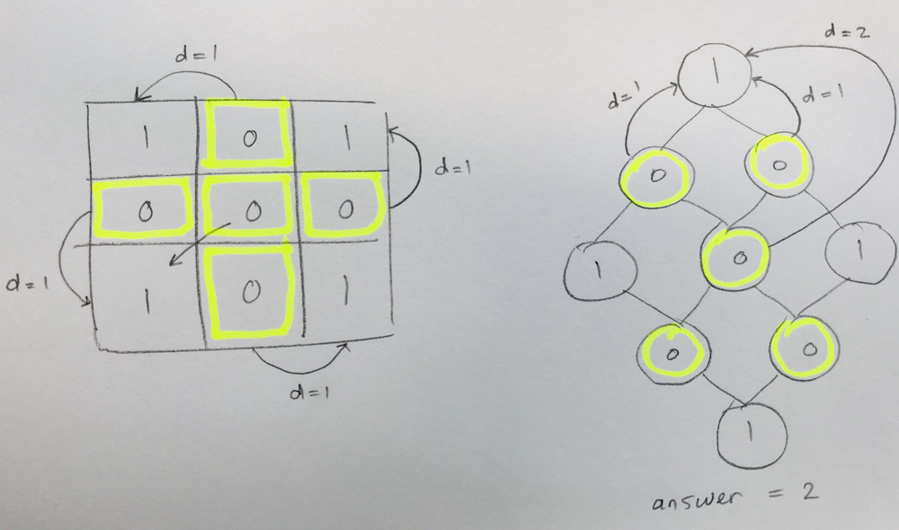
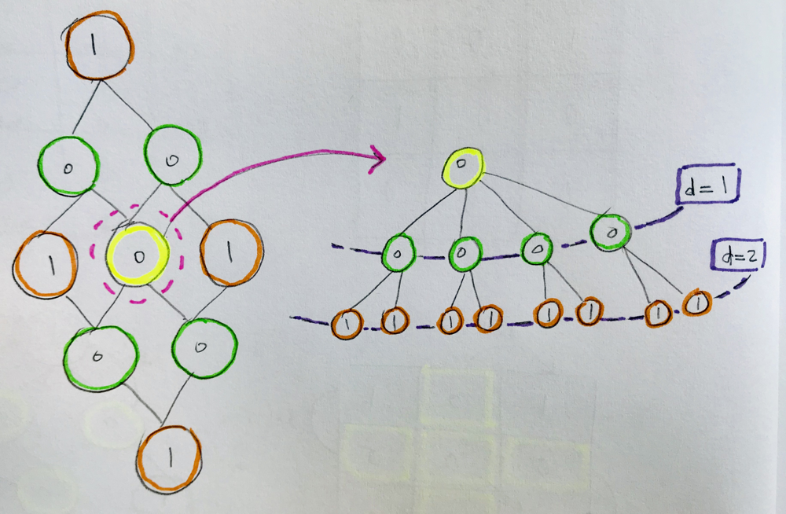
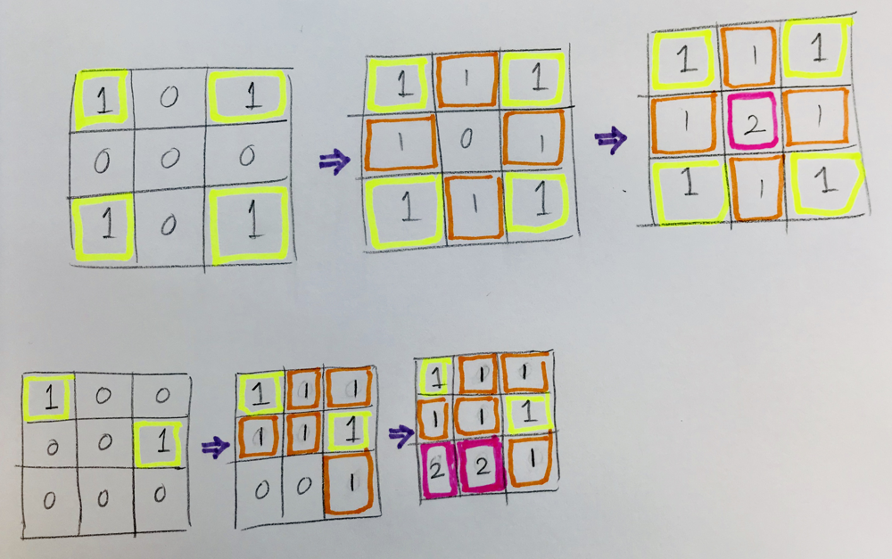

# BFS python two different approaches - explained, commented & visualized

**Author:** Hieroglyphs
**Votes:** 71
**Link:** [https://leetcode.com/problems/as-far-from-land-as-possible/solutions/364722/](https://leetcode.com/problems/as-far-from-land-as-possible/solutions/364722/)

---


**Approach 1(From water, find closest Land)**
- logic: 
	- For each sea cell, find the closest piece of land to that sea cell (because that's the fartherst you can get from land)
	- return the maximum of those CLOSEST distances to land
- steps:
	- iterate over the grid to find sea cells (cells = 0)
	- Apply bfs on those cells (pass those cells to a bfs helper)
	- in the bfs helper, as soon as you find a neighbouring land -> make record of dist -> and update a maxDistance variable
	- return maxDistance
- visuals:
	- 

	- 
	
- results:
	-  passed 34/35 test cases and went TLE on the last test case
	
- Code

	```
	'''
	Approach - 1 -
	'''
	def maxDistance(self, grid: List[List[int]]) -> int:
			from collections import deque
			# helper bfs #
			def bfs_closestLand(i,j):
				q = deque()
				q.append(((i,j), 0))
				visited = set()
				dirs = [(1,0), (-1,0), (0,1), (0,-1)]
				while q:
					node, d = q.popleft()
					x, y = node
					if grid[x][y] == 1:
						return d # return closest dist to a land
					visited.add(node)
					for dir in dirs:
						newX, newY = x+dir[0], y+dir[1]
						# bounds:
						if newX >= 0 and newX <= len(grid)-1 and \\
						newY >= 0 and newY <= len(grid[0])-1:
							# not seen:
							if (newX, newY) not in visited:
								q.append(((newX, newY), d+1))
				return -1

			# main logic #
			'''
			steps:
				- iterate over grid - netsed for loop
				- find cells = 0
				- run bfs on those cells to find out the CLOSEST land
				- return the max of all the CLOSEST dist of land to zeros
			'''
			maxDistance = 0
			lands = 0
			seas = 0
			for i in range(len(grid)):
				for j in range(len(grid[0])):
					if grid[i][j] == 0:
						maxDistance = max(maxDistance, bfs_closestLand(i,j))
						seas += 1
					else:
						lands += 1
			if seas >= 1 and lands >= 1:
				return maxDistance
			return -1
	```


**Approach 2 (From land, expand the search in parallel)**
- logic:
	- start your search from all land cells and expand in parallel, so to speak
	- As long as there are sea cells, keep investigating and BFS contunies to expand and d is incremented
- steps:
	- start from pieces of lands (enque all land cells)
	- investuiagte the neighbours, if neighbour cell is 0 (sea) (a.k.a not visited)  -> append neighboring cell to queue with an incremented d (d+1)
	- the neighbouring cells apened to queue could either be added to a visited set or mutated in the grid to mark them as unavailble
	- as soon as you pop from queue -> update max distance so far
	- return the max cell
- visuals:
	- 
	
- Code:

  ```
  def maxDistance(self, grid: List[List[int]]) -> int:
        visited = set()
        from collections import deque
        q = deque()
        for i in range(len(grid)):
            for j in range(len(grid[0])):
                if grid[i][j] == 1: # land
                    q.append((i,j))
                    
        # if all grid is land or all grid is sea -> invalid -> return -1:
        if len(q) == len(grid)*len(grid[0]) or len(q) == 0:
            return -1
        
        maxD = 0
        dirs = [(1,0), (-1,0), (0,1), (0,-1)]
        while q:
            for i in range(len(q)):
                node, d = q.popleft()
                x, y = node
                visited.add(node)
                maxD = max(maxD, d)

                for dir in dirs:
                    newX, newY = x+dir[0], y+dir[1]
                    # within bounds:
                    if newX >= 0 and newX <= len(grid)-1 and \\
                        newY >= 0 and newY <= len(grid[0])-1:
                            # not seen:
                            if (newX, newY) not in visited:
                                # is a sea cell
                                if grid[newX][newY] == 0:
                                    q.append((newX, newY))
                                    # mutate the grid
                                    grid[newX][newY] = d+1
        return maxD
	```

**Aprroach 3**
- Same approach 2 with minor modification yeilds faster runtime 700 ms
- using a variable to keep track of distance outside of the loop instead of enquing a tuple of ((x,y), d)

```
  def maxDistance(self, grid: List[List[int]]) -> int:
        visited = set()
        from collections import deque
        q = deque()
        for i in range(len(grid)):
            for j in range(len(grid[0])):
                if grid[i][j] == 1: # land
                    q.append((i,j))
                    
        # if all grid is land or all grid is sea -> invalid -> return -1:
        if len(q) == len(grid)*len(grid[0]) or len(q) == 0:
            return -1
        
        maxD = 0
        dirs = [(1,0), (-1,0), (0,1), (0,-1)]
        steps = -1
        while q:
            for i in range(len(q)):
                node = q.popleft()
                x, y = node
                visited.add(node)

                for dir in dirs:
                    newX, newY = x+dir[0], y+dir[1]
                    # within bounds:
                    if newX >= 0 and newX <= len(grid)-1 and \\
                        newY >= 0 and newY <= len(grid[0])-1:
                            # not seen:
                            if (newX, newY) not in visited:
                                # is a sea cell
                                if grid[newX][newY] == 0: 
                                    q.append((newX, newY))
                                    grid[newX][newY] = 1 # 1 has no significance -> it's just to indicate cell not available
            steps += 1
        return steps
               
```
    
