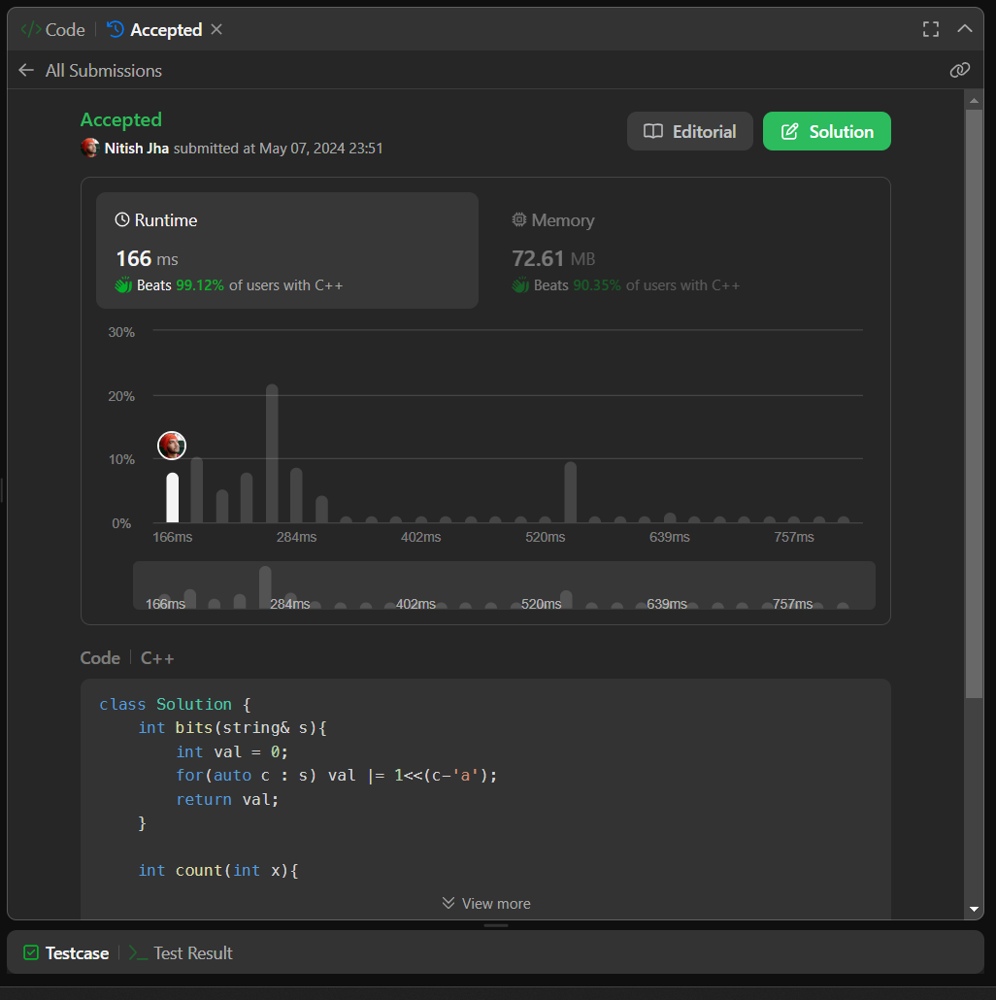

# C++ beats 100%

**Author:** deleted_user
**Votes:** 7
**Link:** [https://leetcode.com/problems/number-of-valid-words-for-each-puzzle/solutions/5188784/](https://leetcode.com/problems/number-of-valid-words-for-each-puzzle/solutions/5188784/)

---

C++ beats 100%




# Code
```
class Solution {
	int bits(string& s){
		int val = 0;
		for(auto c : s) val |= 1<<(c-'a');
		return val;
	}

	int count(int x){
		int cnt = 0;
		while(x){
			x &= x-1;
			cnt++;
		}
		return cnt;
	}

	int pack(int x, int i){
		int val = 0;
		while(i){
			int t = -x&x;
			if(i&1) val |= t;
			x -= t;
			i >>= 1;
		}
		return val;
	}
public:
	vector<int> findNumOfValidWords(vector<string>& words, vector<string>& puzzles) {
		unordered_map<int, int> hash;
		for(string& s : words){
			int val = bits(s);
			if (count(val) > 7) continue;
			if (hash.find(val) != hash.end()) hash[val]++;
			else hash[val]=1;
		}

		vector<int> res;
		for(string& s : puzzles){
			int first = 1<<(s[0]-'a');
			int target = bits(s)&~first;
			int cnt = 0;
			for(int i=0; i<(1<<6); i++){
				int val = pack(target, i) | first;
				auto it = hash.find(val);
				if(it != hash.end()) cnt += it->second;
			}

			res.push_back(cnt);
		}
		return res;
	}
};
```