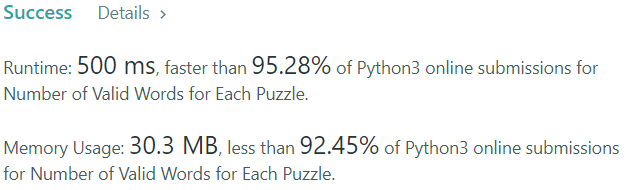

# [Python] Trie/Bitmasking Solutions with Explanation

**Author:** zayne-siew
**Votes:** 18
**Link:** [https://leetcode.com/problems/number-of-valid-words-for-each-puzzle/solutions/1567415/](https://leetcode.com/problems/number-of-valid-words-for-each-puzzle/solutions/1567415/)

---

### Approach 1: Trie

This approach is more intuitive for working with sets of words. Essentially, we can perform the following:

- Generate a Trie for all the given words in the input. (If you don't know what a Trie is or how it works, I suggest starting [here](https://medium.com/basecs/trying-to-understand-tries-3ec6bede0014).)

```python
class TrieNode:
	"""This class represents a node in a Trie."""
    def __init__(self, ch: Optional[str] = ''):
        self.ch = ch        # denotes the current character
        self.count = 0      # denotes how many words end here
        self.children = {}  # denotes possible next characters

class Trie:
	"""This class represents the Trie itself."""
    def __init__(self):
        self.root = TrieNode()
    
    def add(self, word: str) -> None:
		"""Adding words into the Trie in linear time."""
        node = self.root
        for ch in word:
            if ch not in node.children.keys():
                node.children[ch] = TrieNode(ch)
            node = node.children[ch]
        node.count += 1
```

- Perform DFS search for each word in the given puzzles to see how many words in the Trie match.

```python
class Trie:
	# as per ealier implementation...
    def search(self, word: str) -> int:
		"""DFS search for all words that are valid based on input."""
        def dfs(node: TrieNode, found: Optional[bool] = False) -> int:
			"""
			DFS algo search.
			:param node:  The current node being searched.
			:param found: Flag to indicate if the first character has been found (validity criteria).
			:returns:     The total number of valid words found.
			"""
            result = node.count*found  # if there are words here, add them only if first character is found
            for ch in word:
                if ch in node.children.keys():
					# traverse through all valid next characters to find valid words
                    result += dfs(node.children[ch], found or ch == word[0])
            return result
        return dfs(self.root)
```

This gives us the following (long) implementation:

```python
class TrieNode:
    def __init__(self, ch: Optional[str] = ''):
        self.ch = ch
        self.count = 0
        self.children = {}

class Trie:
    def __init__(self):
        self.root = TrieNode()
    
    def add(self, word: str) -> None:
        node = self.root
        for ch in word:
            if ch not in node.children.keys():
                node.children[ch] = TrieNode(ch)
            node = node.children[ch]
        node.count += 1
    
    def search(self, word: str) -> int:       
        def dfs(node: TrieNode, found: Optional[bool] = False) -> int:
            result = node.count*found
            for ch in word:
                if ch in node.children.keys():
                    result += dfs(node.children[ch], found or ch == word[0])
            return result
        return dfs(self.root)

class Solution:
    def findNumOfValidWords(self, words: List[str], puzzles: List[str]) -> List[int]:
        trie = Trie()
        for word in words:
            trie.add(word)
        return [trie.search(word) for word in puzzles]
```

As you can tell, the runtime and memory usage for the above solution isn't great (it barely passes both). [This post](https://leetcode.com/problems/number-of-valid-words-for-each-puzzle/discuss/371876/Detailed-Explanation-using-Trie-O(word_length-%2B-100*puzzle_length)) (with credit to [@Just__a__Visitor](https://leetcode.com/Just__a__Visitor/)) goes into much more detail as to why this is the case, if you are interested. It should also be noted that we can [implement the Trie more concisely](https://leetcode.com/problems/number-of-valid-words-for-each-puzzle/discuss/372368/Concise-python-trie-solution) (with credit to [@tclh123](https://leetcode.com/tclh123/)) which would significantly increase performance but still come out slow and less efficient overall. So, maybe Trie just isn't cut out for this problem after all.

---

### Approach 2: Bitmasking

This approach works by comparing masks instead of words, improving the comparison from O(mn) to O(1) time. The idea is that:

- We generate masks for each word, and for each puzzle subsequently.

```python
def mask(self, word: str) -> int:
	"""Generate mask for a given word."""
	result = 0
	for ch in word:
		result |= 1 << (ord(ch)-ord('a'))  # [a-z] constraint
	return result
```

- Iterating through each puzzle, we check if its mask matches any of the word masks. Then, we obtain the masks of each possible combination of letters in the puzzle, and check if those masks match.

For example, if the puzzle was 'abcdefg', its mask would be `1111111` (omitting leading `0`s). Then, if a word only used the letters 'a'-'d', we would expect its mask to be `0001111` which can be obtained from the puzzle mask by flipping the 'e', 'f' and 'g' bits off (i.e. denoting not in use).

There is a clever way of iterating through all possible mask combinations of a 7-letter puzzle: `(curr_mask-1) & original_mask`. This turns the toggled bits in the mask off iteratively from the rightmost bit to the leftmost bit, while preserving the untoggled bits of the original mask. For example:

```text
Puzzle: 'ejkmv'
                               v
          zyxwvutsrqponmlkjihgfedcba
Original: 00001001001001011000010000
-1:       00001001001001011000001111
&orig:    00001001001001011000000000
                               ^
Sub-puzzle: 'jkmv'
```

Note that the first letter of the puzzle has to be included in the words. Hence, to avoid toggling that letter off, we can generate the mask for the first letter and the rest of the puzzle word separately, and perform bitwise-OR afterward.

```python
class Solution:
    def mask(self, word: str) -> int:
        result = 0
        for ch in word:
            result |= 1 << (ord(ch)-ord('a'))
        return result

    def findNumOfValidWords(self, words: List[str], puzzles: List[str]) -> List[int]:
        word_count = Counter(self.mask(word) for word in words)
        result = []
        for puzzle in puzzles:
            original_mask, first = self.mask(puzzle[1:]), self.mask(puzzle[0])
            curr_mask, count = original_mask, word_count[first]
            while curr_mask:
                count += word_count[curr_mask|first]
                curr_mask = (curr_mask-1)&original_mask
            result.append(count)
        return result
```

---

### Final Result



Please upvote if this has helped you! Appreciate any comments as well :)