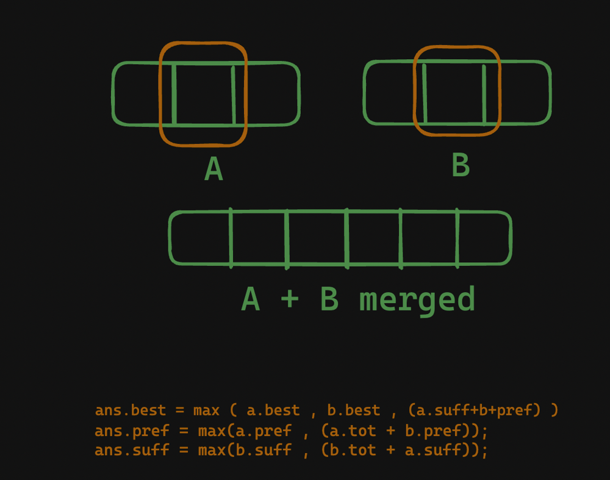

# Simple logic  with explanation ✅

**Author:** mynk28nv
**Votes:** 3
**Link:** [https://leetcode.com/problems/k-concatenation-maximum-sum/solutions/4189415/](https://leetcode.com/problems/k-concatenation-maximum-sum/solutions/4189415/)

---

# Approach
- First we compute the 
    - (best here )max subarray sum possible of single array given 
    - suffix sum max 
    - prefix sum max
    - and total sum of the array 
- now after computing we see that our merge array 's above 4 things will be 
    - there are 3 cases 1. a's max subarray sum is best , 2. b's is max , 3. half from a and half from b 
        - ans.best = max({a.best, b.best, (a.suffBest + b.prefBest)});
	
    - for prefix sum max we have 2 cases 1. a's is maximum , 2. we need to include whole a and then take prefix of b
	    - ans.prefBest = max(a.prefBest , (a.tot + b.prefBest));
	- Similar in the case of suffix 
	     - ans.suffBest = max(b.suffBest , (b.tot + a.suffBest));
	- total will be the sum of both arrays ans.tot = a.tot + b.tot;


- first merge two arrays then the merged array with ith array 



# Complexity
- Time complexity:
    O(n)

# Code
```
#define all(var)                      var.begin(), var.end()
int mod_add(int a, int b, int m) {a = a % m; b = b % m; return (((a + b) % m) + m) % m;}
const int mod = 1e9 + 7;
#define ll long long 
class Solution {
public:
	int n ;
	struct concatKarr {
		ll best  , suffBest  , prefBest, sum  , tot ;
		void build(vector<int> arr) {
			int n = arr.size();

            // total sum of array 
			tot = accumulate(all(arr), 0ll);

            // prefix best 
			prefBest = arr[0] , sum = arr[0];
			for (int i = 1 ; i < n ; i++) {
				sum += arr[i];
				prefBest = max(prefBest, sum );
			}

            // suffix best 
			suffBest = arr[n - 1] , sum = arr[n - 1];
			for (int i = n - 2 ; i >= 0 ; i--) {
				sum += arr[i];
				suffBest = max(suffBest, sum );
			}

            // by using kandane we find the max subarray sum 
			best = arr[0] , sum = arr[0];
			for (int i = 1 ; i < n ; i++) {
				sum += arr[i];
				best = max(best, sum );
				if (sum < 0 ) sum = 0;
			}

		}
	};

	concatKarr merge(concatKarr a , concatKarr b) {
		concatKarr ans ;

        //merge logic explained above 
		ans.best = max({a.best, b.best, (a.suffBest + b.prefBest)});
		ans.prefBest = max(a.prefBest , (a.tot + b.prefBest));
		ans.suffBest = max(b.suffBest , (b.tot + a.suffBest));
		ans.tot = a.tot + b.tot;

		return ans;
	}
	int kConcatenationMaxSum(vector<int>& arr, int k) {
		n = arr.size();
		concatKarr bb ;
		bb.build(arr);

		concatKarr ans = bb;
		for (int i = 1 ; i < k ; i++) {
			ans = merge(ans , bb);
		}

		return max(ans.best , 0ll)%mod;
	}

};

```