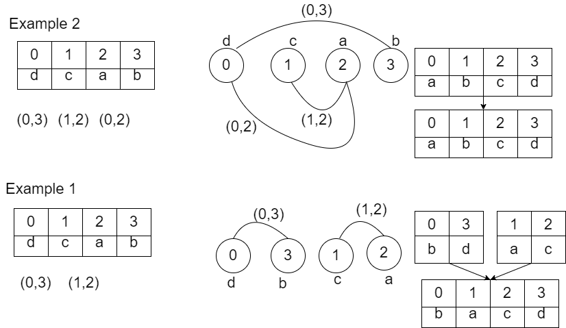

# C++ | graph , connected components | with pictures

**Author:** iMRC
**Votes:** 24
**Link:** [https://leetcode.com/problems/smallest-string-with-swaps/solutions/1985907/](https://leetcode.com/problems/smallest-string-with-swaps/solutions/1985907/)

---

consider each char **position** in string as a **vertex** ,
and **pairs** as **edges** of  the **graph**

**1**. Built the graph from  char positions (as vertices) and pairs (as edges)
**2**. Find all Connected Components
**3**. **Sort chars among connected components** and merge to create final output string
(why because, if u closely look at the connected components, pairs exists such way that **there exists a set of swaps** using pairs **for swapping any 2 chars** on the component, **so we can just sort all chars among the connected**  for getting the  lexicographically smaller one)




```
string smallestStringWithSwaps(string s, vector<vector<int>>& pairs) {
        int V = s.size();
        vector<vector<int>> graph(V);
        for(auto p: pairs) {
            graph[p[0]].push_back(p[1]);
            graph[p[1]].push_back(p[0]);
        }
        vector<bool> visit(V, false);
        vector<vector<int>> ConnCombs;
		/*finding connected componets*/
        for(int u = 0; u < V; ++u) {
            if(visit[u] == false) {
                vector<int> comb = getConnComb(graph, visit, u);
                ConnCombs.push_back(comb);
            }
        }
        /*Building output string from Computed connected components*/
        string output(s.size(),' ');
        for(auto &combPos: ConnCombs) {
            vector<char> combChars;
            for(auto pos: combPos) {
                combChars.push_back(s[pos]);
            }
            sort(combPos.begin(), combPos.end());
            sort(combChars.begin(), combChars.end());
            for(int i = 0; i < combPos.size(); ++i) {
                output[combPos[i]] = combChars[i];
            }
        }
        ////
        return output;
     }
```
```
/*DFS using stack to find connected vertices in the graph*/
vector<int> getConnComb(vector<vector<int>>& graph, vector<bool>& visit, int u) {
         vector<int> cmb;
         stack<int> S;
         S.push(u);
         visit[u] = true;
         cmb.push_back(u);
         while(!S.empty()) {
             int uu = S.top();
             S.pop();
             for(auto v: graph[uu]) {
                 if(visit[v] == false) {
                     visit[v] = true;
                     S.push(v);
                     cmb.push_back(v);
                 }
             }
         }
         return cmb;
     }
```
Complexity
* Time  : **O(NlogN + M)**, where N is length of string s, M is number of pairs.
* Space   : **O(N + M)**
OR
* Time  : **O(VlogV + E)**, where V is number of vertices, E is number of edges.
* Space   : **O(V + E)**

**Upvote if u liked :)**
