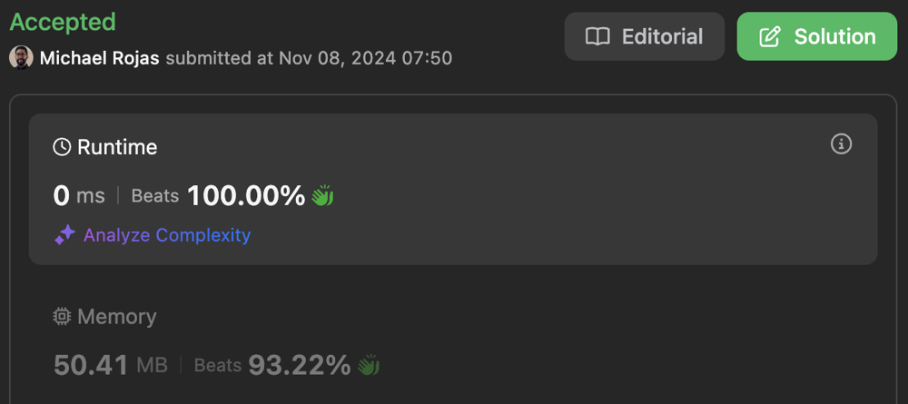

# 100% | 2 Solutions | Time: O(N) | Space: O(1)

**Author:** rojas
**Votes:** 0
**Link:** [https://leetcode.com/problems/intersection-of-three-sorted-arrays/solutions/5699848/](https://leetcode.com/problems/intersection-of-three-sorted-arrays/solutions/5699848/)

---

# Decomposition

- Time complexity: $$O(N)$$

- Space complexity: $$O(N)$$

[JavaScript](https://leetcode.com/problems/intersection-of-three-sorted-arrays/submissions/1446727545/)


```typescript []
function arraysIntersection(
    arr1: number[], 
    arr2: number[], 
    arr3: number[]
): number[] {
    return helper(helper(arr1, arr2), arr3);
};

function helper(arr1: number[], arr2: number[]): number[] {
    const N1 = arr1.length;
    const N2 = arr2.length;
    const out: number[] = [];
    
    let i = 0;
    let j = 0;
    while (i < N1 && j < N2) {
        if (arr1[i] < arr2[j]) {
            ++i;
        } else if (arr1[i] > arr2[j]) {
            ++j;
        } else {
            out.push(arr1[i]);
            ++i;
            ++j;
        }
    }
    
    return out;
}
```

```javascript []
function arraysIntersection(arr1, arr2, arr3) {
    return helper(helper(arr1, arr2), arr3);
};

function helper(arr1, arr2) {
    const N1 = arr1.length;
    const N2 = arr2.length;
    const out = [];
    
    let i = 0;
    let j = 0;
    while (i < N1 && j < N2) {
        if (arr1[i] < arr2[j]) {
            ++i;
        } else if (arr1[i] > arr2[j]) {
            ++j;
        } else {
            out.push(arr1[i]);
            ++i;
            ++j;
        }
    }
    
    return out;
}
```

# Three-way Comparison

- Time complexity: $$O(N)$$

- Space complexity: $$O(1)$$

[JavaScript](https://leetcode.com/problems/intersection-of-three-sorted-arrays/submissions/1446729068/)



```typescript []
function arraysIntersection(
    arr1: number[], 
    arr2: number[], 
    arr3: number[]
): number[] {
    const N1 = arr1.length;
    const N2 = arr2.length;
    const N3 = arr3.length;
    const out: number[] = [];
    
    let i = 0;
    let j = 0;
    let k = 0;
    while (i < N1 && j < N2 && k < N3) {
        if (arr1[i] < arr2[j]) {
            ++i;
        } else if (arr2[j] < arr3[k]) {
            ++j;
        } else if (arr1[i] > arr2[j] || arr2[j] > arr3[k]) {
            ++k;
        } else {
            out.push(arr1[i++]);
            ++j;
            ++k;
        }
    }
    
    return out;
}
```

```javascript []
function arraysIntersection(arr1, arr2, arr3) {
    const N1 = arr1.length;
    const N2 = arr2.length;
    const N3 = arr3.length;
    const out = [];
    
    let i = 0;
    let j = 0;
    let k = 0;
    while (i < N1 && j < N2 && k < N3) {
        if (arr1[i] < arr2[j]) {
            ++i;
        } else if (arr2[j] < arr3[k]) {
            ++j;
        } else if (arr1[i] > arr2[j] || arr2[j] > arr3[k]) {
            ++k;
        } else {
            out.push(arr1[i++]);
            ++j;
            ++k;
        }
    }
    
    return out;
}
```