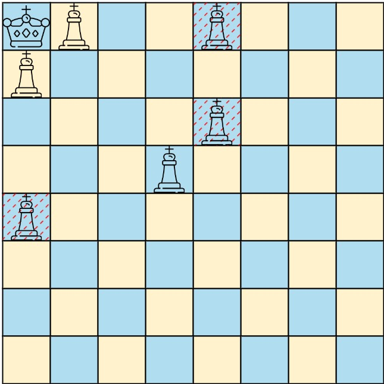

# [1222. Queens That Can Attack the King](https://leetcode.com/problems/queens-that-can-attack-the-king/)

| Category | Difficulty | Likes | Dislikes |
| :------: | :--------: | :---: | :------: |
| Algorithms | Medium | 996 | 154 |

**Tags:** [`array`](https://leetcode.com/tag/array), [`matrix`](https://leetcode.com/tag/matrix), [`simulation`](https://leetcode.com/tag/simulation)

**Companies:** `medianet`

## Description

On a **0-indexed** `8 x 8` chessboard, there can be multiple black queens and one white king.

You are given a 2D integer array `queens` where `queens[i] = [xQueen_i, yQueen_i]` represents the position of the `i^th` black queen on the chessboard. You are also given an integer array `king` of length `2` where `king = [xKing, yKing]` represents the position of the white king.

Return *the coordinates of the black queens that can directly attack the king*. You may return the answer in **any order**.

 

**Example 1:**


```

Input: queens = [[0,1],[1,0],[4,0],[0,4],[3,3],[2,4]], king = [0,0]
Output: [[0,1],[1,0],[3,3]]
Explanation: The diagram above shows the three queens that can directly attack the king and the three queens that cannot attack the king (i.e., marked with red dashes).

```

**Example 2:**


```

Input: queens = [[0,0],[1,1],[2,2],[3,4],[3,5],[4,4],[4,5]], king = [3,3]
Output: [[2,2],[3,4],[4,4]]
Explanation: The diagram above shows the three queens that can directly attack the king and the three queens that cannot attack the king (i.e., marked with red dashes).

```

 

**Constraints:**

	- `1 <= queens.length < 64`

	- `queens[i].length == king.length == 2`

	- `0 <= xQueen_i, yQueen_i, xKing, yKing < 8`

	- All the given positions are **unique**.

---

**Links:** [Submissions](https://leetcode.com/problems/queens-that-can-attack-the-king/) | [Solutions](https://leetcode.com/problems/queens-that-can-attack-the-king/)
