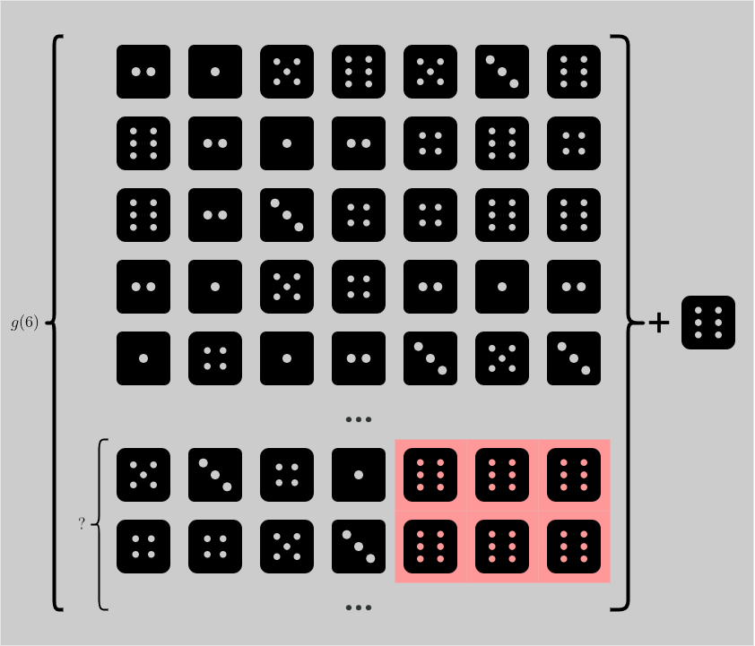
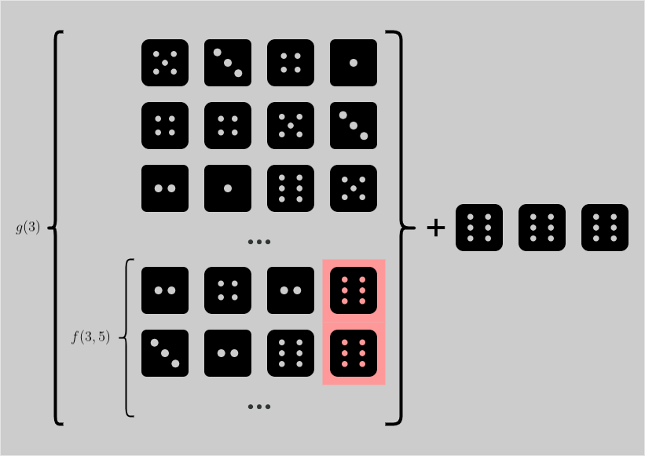

# O(n) | Detailed Explanation | Kotlin

**Author:** dummkopf
**Votes:** 0
**Link:** [https://leetcode.com/problems/dice-roll-simulation/solutions/3219902/](https://leetcode.com/problems/dice-roll-simulation/solutions/3219902/)

---

# Intuition
<!-- Describe your first thoughts on how to solve this problem. -->
Let's call a sequence _valid_ if it satisfies the constraint given in the problem. Suppose that you know all the valid sequences up to length $n-1$, how can you extend these sequences to length $n$, but still maintain the validity?
# Approach
<!-- Describe your approach to solving the problem. -->
## Definitions
For any integer $i$ and $j$ such that $0\\leq i\\lt n$ and $0\\leq j\\lt 6$:
- Let $g(i)$ be the number of valid sequences of length $i+1$.
- Let $f(i, j)$ be the number of valid sequences of length $i+1$, whose last value is $j+1$.

We can see that $g(i) = f(i,0) + f(i,1) + \\dots + f(i,5)$. Of course, because if you count all the possible endings, you obtain $g(i)$. And the answer for our problem is $g(n)$.

## Dynamic programming
### Base case
For any $0\\leq j\\lt 6$, we have $f(0, j) = 1$, because there's only one sequence of length 1 that ends with $j$, and they are naturally valid. We can thus deduce that $g(0) = 6$, always.

### Recurrence Formula
Now we will come up with a formula for $f(i,j)$ where $1\\leq i\\lt n$. First, let's take some examples.

---
**Example 1**

Consider this test case: `n = 8, rollMax = [1,1,1,2,2,3]`. How many sequences of length 8 that end with a $6$? Note that $6$ cannot occur at least four times in a row, otherwise the sequence will be invalid.

A good estimate is to take all the valid sequences of length 7 and append a number $6$ at the end of them. However, you will break the validity if you pick the sequences that already end with 3 number $6$, because then you will end up with 4 number $6$ in a row.




So now we're asking, how many valid sequences of length 7 that end with 3 number $6$? These sequences can be created by grabbing any valid sequences of length 4 that don't end with $6$, and add 3 number $6$ at the end. In total, there are $g(3) - f(3,5)$ sequences.




Now, to calculate the number of valid sequences of length 8 that end with a $6$, which is $f(7,5)$, you take the number of valid sequences of length 7, which is $g(6)$, minus the number of such sequences ending with 3 number $6$, which is $g(3)-f(3,5)$. Therefore we have:

$$f(7,5) = g(6) - (g(3) - f(3,5))$$

---

**Example 2**

Consider the test case in Example 1. How many valid sequences of length 4 that end with a $6$? Applying the same logic as above, you take all valid sequences of length 3 that doesn't end with 3 number $6$, which is all of them except one. Therefore we have:

$$f(3,5) = g(2) - 1$$

---

**Example 3**

Consider the test case in Example 1. How many valid sequences of length 3 that end with a $6$? The problem is now even easier, because you no longer need to exclude any sequences. Just take any valid sequences of length 2 and add $6$ at the end! Therefore we have:

$f(2,5) = g(1)$

---

Generalize Example 1 above with $i=7$ and $j=5$, we have the formula:

$f(i,j)=g(i-1)-g(i - \	exttt{rollMax[j+1]}-1) +f(i - \	exttt{rollMax[j+1]}-1, j)$

When $i = \	exttt{rollMax[j+1]}$ like in Example 2, we have the formula:

$f(i,j)=g(i-1) - 1$

And of course, in other cases where $i < \	exttt{rollMax[j+1]}$ like Example 3, we have the formula:

$f(i,j) = g(i-1)$

Denote `r` short for `rollMax`, we arrive at this conclusion:

$f(i,j)=g(i-1) - \\Biggr\\{ \\begin{matrix}
g(i - \	exttt{r[j+1]}-1) +f(i - \	exttt{r[j+1]}-1, j) & & i>\	exttt{r[j+1]}\\\\ 
1 & & i=\	exttt{r[j+1]}\\\\ 
0 & & i<\	exttt{r[j+1]}
\\end{matrix}$

# Complexity
- Time complexity: We only need two loops to calculate the values of $f$ and $g$: loop $i$ for $0\\leq i\\lt n$ and loop $j$ for $0\\leq j\\lt 6$ (constant), it's easy to see that the complexity is $O(n)$.
<!-- Add your time complexity here, e.g. $$O(n)$$ -->

- Space complexity: It's also straightforward here that we only need to store $7n$ integers for the values of $f$ and $g$, therefore $O(n)$.
<!-- Add your space complexity here, e.g. $$O(n)$$ -->

# Code

Please note that while `rollMax` in the problem statement is 1-indexed, in the code it is 0-indexed.

```
class Solution {
    fun dieSimulator(n: Int, rollMax: IntArray): Int {
        val f = Array(n) { Array(6) { 0L } }
        val g = Array(n) { 0L }
        for (j in 0 until 6) f[0][j] = 1
        g[0] = 6
        for (i in 1 until n) {
            for (j in 0 until 6) {
                f[i][j] = g[i - 1]
                if (i == rollMax[j])
                    f[i][j] -= 1L
                else if (i > rollMax[j])
                    f[i][j] -= g[i - rollMax[j] - 1] - f[i - rollMax[j] - 1][j]
                if (f[i][j] < 0) f[i][j] += 1000000007L
                g[i] += f[i][j]
                g[i] %= 1000000007L
            }
        }
        return g[n - 1].toInt()
    }
}
```