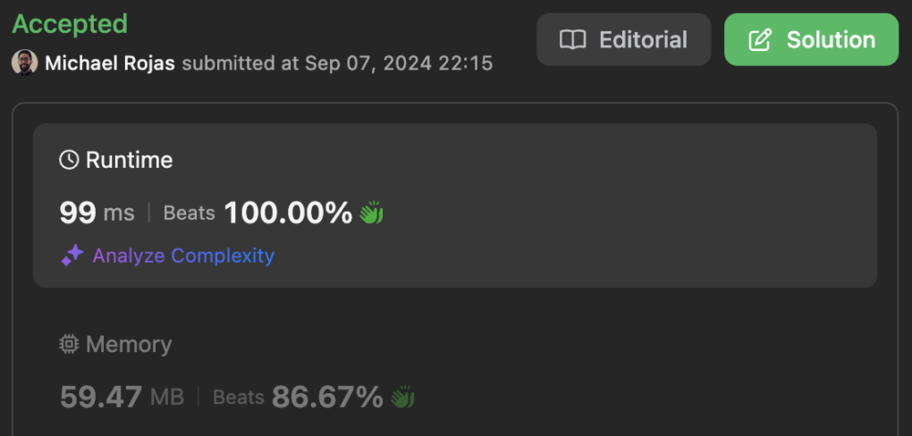
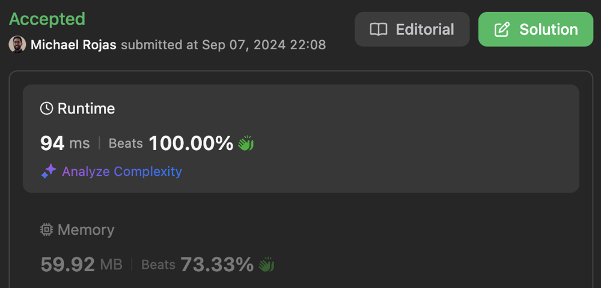
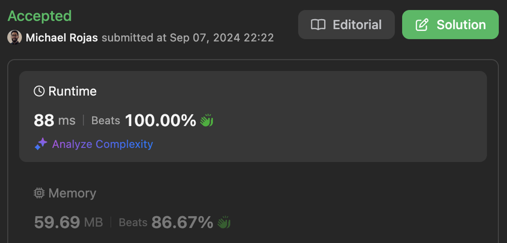

# 100% | 2 Pointers | Time: O(MlogM + NlogN) | Space: O(1)

**Author:** rojas
**Votes:** 0
**Link:** [https://leetcode.com/problems/meeting-scheduler/solutions/5753119/](https://leetcode.com/problems/meeting-scheduler/solutions/5753119/)

---

# Complexity

Where `M = slots1.length` and `N = slots2.length`:

- Time complexity: $$O(M\\log{M} + N\\log{N})$$

- Space complexity: $$O(1)$$
    Not including space used by `Array.sort`

# Solutions

## Code I

[Typescript Submission](https://leetcode.com/problems/meeting-scheduler/submissions/1382636256/)



```typescript []
function minAvailableDuration(slots1: number[][], slots2: number[][], duration: number): number[] {
    slots1.sort((slotA, slotB) => slotA[0] - slotB[0]);
    slots2.sort((slotA, slotB) => slotA[0] - slotB[0]);

    const len1 = slots1.length;
    const len2 = slots2.length;
    let i1 = 0;
    let i2 = 0;
    while (i1 < len1 && i2 < len2) {
        if (slots1[i1][1] < slots2[i2][0] || 
            slots1[i1][1] - slots1[i1][0] < duration
        ) {
            ++i1;
            continue;
        }
        if (slots1[i1][0] > slots2[i2][1] || 
            slots2[i2][1] - slots2[i2][0] < duration
        ) {
            ++i2;
            continue;
        }
        const minStart = Math.max(slots1[i1][0], slots2[i2][0]);
        const maxEnd = Math.min(slots1[i1][1], slots2[i2][1]);
        if (maxEnd - minStart >= duration) {
            return [minStart, minStart + duration];
        }
        if (slots1[i1][0] < slots2[i2][0]) {
            ++i1;
        } else if (slots1[i1][0] > slots2[i2][0]) {
            ++i2;
        } else if (slots1[i1][1] < slots2[i2][1]) {
            ++i1;
        } else if (slots1[i1][1] > slots2[i2][1]) {
            ++i2;
        } else {
            ++i1;
            ++i2;
        }
    }

    return [];
};
```

```javascript []
/**
 * @param {number[][]} slots1
 * @param {number[][]} slots2
 * @param {number} duration
 * @return {number[]}
 */
var minAvailableDuration = function(slots1, slots2, duration) {
    slots1.sort((slotA, slotB) => slotA[0] - slotB[0]);
    slots2.sort((slotA, slotB) => slotA[0] - slotB[0]);

    const len1 = slots1.length;
    const len2 = slots2.length;
    let i1 = 0;
    let i2 = 0;
    while (i1 < len1 && i2 < len2) {
        if (slots1[i1][1] < slots2[i2][0] || 
            slots1[i1][1] - slots1[i1][0] < duration
        ) {
            ++i1;
            continue;
        }
        if (slots1[i1][0] > slots2[i2][1] || 
            slots2[i2][1] - slots2[i2][0] < duration
        ) {
            ++i2;
            continue;
        }
        const minStart = Math.max(slots1[i1][0], slots2[i2][0]);
        const maxEnd = Math.min(slots1[i1][1], slots2[i2][1]);
        if (maxEnd - minStart >= duration) {
            return [minStart, minStart + duration];
        }
        if (slots1[i1][0] < slots2[i2][0]) {
            ++i1;
        } else if (slots1[i1][0] > slots2[i2][0]) {
            ++i2;
        } else if (slots1[i1][1] < slots2[i2][1]) {
            ++i1;
        } else if (slots1[i1][1] > slots2[i2][1]) {
            ++i2;
        } else {
            ++i1;
            ++i2;
        }
    }

    return [];
};
```

## Code II

[Typescript Submission](https://leetcode.com/problems/meeting-scheduler/submissions/1382633236/)



```typescript []
function minAvailableDuration(slots1: number[][], slots2: number[][], duration: number): number[] {
    slots1.sort((slotA, slotB) => slotA[0] - slotB[0]);
    slots2.sort((slotA, slotB) => slotA[0] - slotB[0]);

    const len1 = slots1.length;
    const len2 = slots2.length;
    let i1 = 0;
    let i2 = 0;
    while (i1 < len1 && i2 < len2) {
        if (slots1[i1][1] < slots2[i2][0] || 
            slots1[i1][1] - slots1[i1][0] < duration
        ) {
            ++i1;
            continue;
        }
        if (slots1[i1][0] > slots2[i2][1] || 
            slots2[i2][1] - slots2[i2][0] < duration
        ) {
            ++i2;
            continue;
        }
        const minStart = Math.max(slots1[i1][0], slots2[i2][0]);
        if (Math.min(slots1[i1][1], slots2[i2][1]) - minStart >= duration) {
            return [minStart, minStart + duration];
        }
        if (slots1[i1][1] - slots1[i1][0] <= slots2[i2][1] - slots2[i2][0]) {
            ++i1;
        } else {
            ++i2;
        }
    }

    return [];
};
```

```javascript []
/**
 * @param {number[][]} slots1
 * @param {number[][]} slots2
 * @param {number} duration
 * @return {number[]}
 */
var minAvailableDuration = function(slots1, slots2, duration) {
    slots1.sort((slotA, slotB) => slotA[0] - slotB[0]);
    slots2.sort((slotA, slotB) => slotA[0] - slotB[0]);

    const len1 = slots1.length;
    const len2 = slots2.length;
    let i1 = 0;
    let i2 = 0;
    while (i1 < len1 && i2 < len2) {
        if (slots1[i1][1] < slots2[i2][0] || 
            slots1[i1][1] - slots1[i1][0] < duration
        ) {
            ++i1;
            continue;
        }
        if (slots1[i1][0] > slots2[i2][1] || 
            slots2[i2][1] - slots2[i2][0] < duration
        ) {
            ++i2;
            continue;
        }
        const minStart = Math.max(slots1[i1][0], slots2[i2][0]);
        if (Math.min(slots1[i1][1], slots2[i2][1]) - minStart >= duration) {
            return [minStart, minStart + duration];
        }
        if (slots1[i1][1] - slots1[i1][0] <= slots2[i2][1] - slots2[i2][0]) {
            ++i1;
        } else {
            ++i2;
        }
    }

    return [];
};
```

## Code III

[Typescript Submission](https://leetcode.com/problems/meeting-scheduler/submissions/1382639474/)



```typescript []
function minAvailableDuration(slots1: number[][], slots2: number[][], duration: number): number[] {
    slots1.sort((slotA, slotB) => slotA[0] - slotB[0]);
    slots2.sort((slotA, slotB) => slotA[0] - slotB[0]);

    const len1 = slots1.length;
    const len2 = slots2.length;
    let i1 = 0;
    let i2 = 0;
    while (i1 < len1 && i2 < len2) {
        const minStart = Math.max(slots1[i1][0], slots2[i2][0]);
        if (Math.min(slots1[i1][1], slots2[i2][1]) - minStart >= duration) {
            return [minStart, minStart + duration];
        }
        const diff = +(slots1[i1][1] < slots2[i2][1]);
        i1 += diff;
        i2 += diff ^ 1;
    }

    return [];
};
```

```javascript []
/**
 * @param {number[][]} slots1
 * @param {number[][]} slots2
 * @param {number} duration
 * @return {number[]}
 */
var minAvailableDuration = function(slots1, slots2, duration) {
    slots1.sort((slotA, slotB) => slotA[0] - slotB[0]);
    slots2.sort((slotA, slotB) => slotA[0] - slotB[0]);

    const len1 = slots1.length;
    const len2 = slots2.length;
    let i1 = 0;
    let i2 = 0;
    while (i1 < len1 && i2 < len2) {
        const minStart = Math.max(slots1[i1][0], slots2[i2][0]);
        if (Math.min(slots1[i1][1], slots2[i2][1]) - minStart >= duration) {
            return [minStart, minStart + duration];
        }
        const diff = +(slots1[i1][1] < slots2[i2][1]);
        i1 += diff;
        i2 += diff ^ 1;
    }

    return [];
};
```