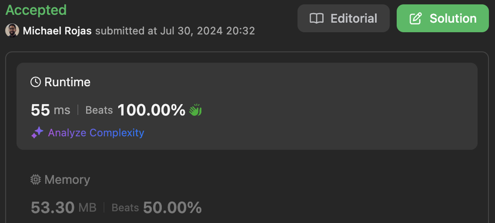

# DP | Time: O(NT) | Space: O(T)

**Author:** rojas
**Votes:** 0
**Link:** [https://leetcode.com/problems/toss-strange-coins/solutions/5561113/](https://leetcode.com/problems/toss-strange-coins/solutions/5561113/)

---

[Submission](https://leetcode.com/problems/toss-strange-coins/submissions/1339004355)



# Complexity

- Time complexity: $O(NT)$

- Space complexity: $O(T)$

Where `T = target`

# Code

```typescript []
function probabilityOfHeads(probs: number[], target: number): number {
    const N = probs.length;
    const dp = new Array(target + 1).fill(0);
    dp[target] = 1;

    for (let i = 0; i < N; ++i) {
        let j = Math.max(0, target - i - 1);
        while (j < target) {
            dp[j] *= 1 - probs[i];
            dp[j] += dp[j + 1] * probs[i];
            ++j;
        }
        dp[target] *= 1 - probs[i];
    }

    return dp[0];
};
```

```javascript []
function probabilityOfHeads(probs, target) {
    const N = probs.length;
    const dp = new Array(target + 1).fill(0);
    dp[target] = 1;

    for (let i = 0; i < N; ++i) {
        let j = Math.max(0, target - i - 1);
        while (j < target) {
            dp[j] *= 1 - probs[i];
            dp[j] += dp[j + 1] * probs[i];
            ++j;
        }
        dp[target] *= 1 - probs[i];
    }

    return dp[0];
};
```