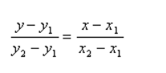

# [Java] [Python3] [CPP] | Simple code with explanation | 100% fast | O(1) space

**Author:** logan138
**Votes:** 215
**Link:** [https://leetcode.com/problems/check-if-it-is-a-straight-line/solutions/620096/](https://leetcode.com/problems/check-if-it-is-a-straight-line/solutions/620096/)

---


**The point is  if we take points p1(x, y), p2(x1, y1), p3(x3, y3),  slopes of any two pairs is same then p1, p2, p3 lies on same line.
     slope from p1 and p2 is  y - y1 / x - x1
     slope from p2 and p3 is  y2 - y1 / x2 - x1
if these two slopes equal, then p1, p2, p3 lies on same line.**

**IF YOU HAVE ANY DOUBTS, FEEL FREE TO ASK**
**IF YOU UNDERSTAND, DON'T FORGET TO UPVOTE**




I have started a series on solid principles and design patterns. If anyone is interested, please check [it](https://medium.com/@bhanu150138/mastering-solid-principles-and-design-patterns-a-blog-series-for-writing-clean-scalable-code-aae3809310db) out.
```
JAVA:-  

class Solution {
    public boolean onLine(int[] p1, int[] p2, int[] p3){
        int x = p1[0], y = p1[1], x1 = p2[0], y1 = p2[1], x2 = p3[0], y2 = p3[1];
        return ((y - y1) * (x2 - x1) == (y2 - y1) * (x - x1));
    }
    public boolean checkStraightLine(int[][] coordinates) {
        // base case:- there are only two points, return true
        // otherwise, check each point lies on line using above equation.
		
        for(int i=2;i<coordinates.length;i++){
            if(!onLine(coordinates[i], coordinates[0], coordinates[1]))
                return false;
        }
        return true;
    }
}


Python3:-

class Solution:
    def checkStraightLine(self, coordinates: List[List[int]]) -> bool:
        (x1, y1), (x2, y2) = coordinates[:2]
        for i in range(2, len(coordinates)):
            (x, y) = coordinates[i]
            if((y2 - y1) * (x1 - x) != (y1 - y) * (x2 - x1)):
                return False
        return True		

CPP:-
\u200Bclass Solution {
public:
    bool checkStraightLine(vector<vector<int>>& coordinates) {
        if(coordinates.size() <= 2) return true;
        int x1 = coordinates[0][0];
        int y1 = coordinates[0][1];
        int x2 = coordinates[1][0];
        int y2 = coordinates[1][1];
        for(int i=2;i<coordinates.size();i++){
            int x = coordinates[i][0];
            int y = coordinates[i][1];
            if((y2 - y1) * (x1 - x) != (y1 - y) * (x2 - x1))
                return false;
        }
        return true;
    }
};
```
