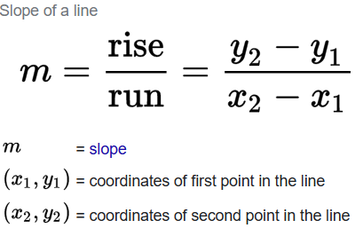
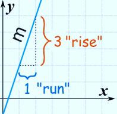
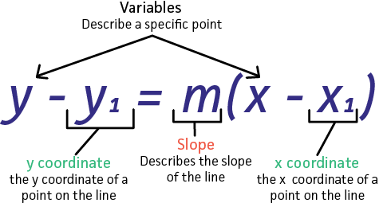
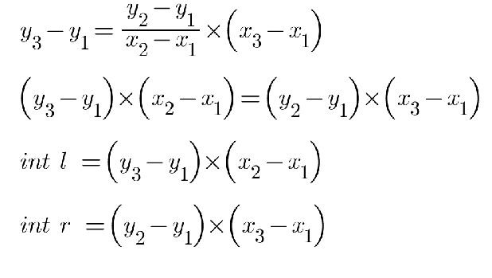

# Only Math, explained.

**Author:** ThunderG
**Votes:** 10
**Link:** [https://leetcode.com/problems/check-if-it-is-a-straight-line/solutions/3079000/](https://leetcode.com/problems/check-if-it-is-a-straight-line/solutions/3079000/)

---


# Explanations
Every straight line has a constant slope, and the slope of a line gives the measure of its steepness and direction(in this problem we do not need direction).
we can calculate the slope of a line (which we name it as m) as follow:

rise mean changes in y axis and run mean changes in x axis:

so at first I started to compare the slopes or m that are made by each two points and check if they are the same(in this case I should return true because it means all the points are on a straight line) but the problem was when the run is equal to zero,it means that I was asking the program to divide an integer by zero which led me to an error. so what I did was trying to find a way that there is no need to divide by zero. so I went to the point-slope linear equation formula and used a third point as a variable.

then I turned this into:

 
P.S. : each two points can be on a straight line so that is why of the array length is two I return true.
Feel free to ask if you have any questions.


# Code
```
public class Solution {
    public bool CheckStraightLine(int[][] coordinates) {
        if(coordinates.Length==2)return true;
        for (int i = 0; i < coordinates.Length-2; i++)
            {
                int l = (coordinates[i+2][1] -coordinates[i][1]) * (coordinates[i+1][0] - coordinates[i][0]);
                int r = (coordinates[i+1][1] - coordinates[i][1]) * (coordinates[i+2][0] -coordinates[i][0]);
                if (l != r) return false;
            }
        return true;
    }
}
```