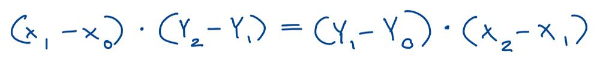
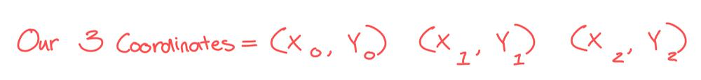
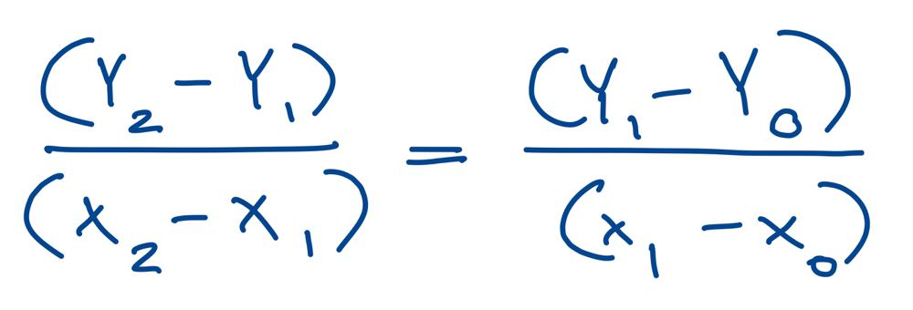
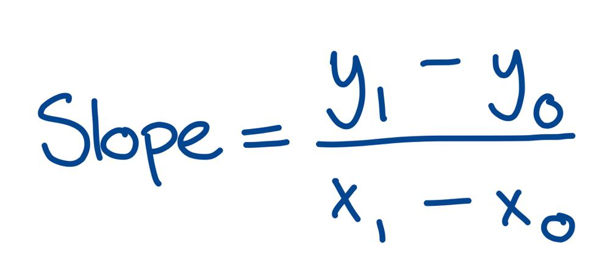

# Golang solution 100%, 100% with explanation

**Author:** nathannaveen
**Votes:** 13
**Link:** [https://leetcode.com/problems/check-if-it-is-a-straight-line/solutions/1176782/](https://leetcode.com/problems/check-if-it-is-a-straight-line/solutions/1176782/)

---

`time = 100%, O(n)`
`space = 100%, O(1)`

[1232. Check If It Is a Straight Line](https://leetcode.com/problems/check-if-it-is-a-straight-line/)

The idea of this solution is we use `3` points to find whether two slopes are equal. We can use the equation:
 where `x0, x1, x2, y0, y1, y2` are all coordinates: 
 You might not understand the equation, so we can multiply divide both sides by `(x1 - x0)` and `(x2 - x1)` and we can get: 
 The equation above is based off of a familar slope equation: 
 The reason we are doing the original equation instead of the where we have divided both sides by `(x1 - x0)` and `(x2 - x1)` is we don't have to worry about dividing by `0` such as when we divide both sides by `(x1 - x0)` and `(x2 - x1)` but `(x1 - x0) = 0` or `(x2 - x1) = 0` we have to contumplate what to do. 

**The Code:**

``` go
func checkStraightLine(coordinates [][]int) bool {
    x0, x1, := coordinates[0][0], coordinates[1][0]
    y0, y1 := coordinates[0][1], coordinates[1][1]

    for i := 1; i < len(coordinates); i++ {
        x2, y2 := coordinates[i][0], coordinates[i][1]
        if (x1 - x0) * (y2 - y1) != (y1 - y0) * (x2 - x1) {
            return false
        }
    }
    return true
}
```