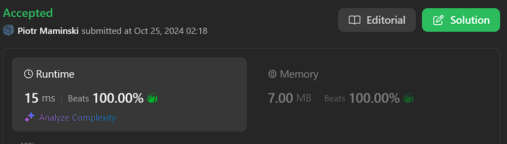
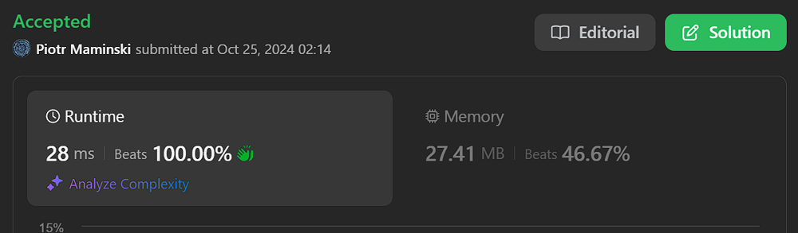

# ✅ Explained step by step | Beats 100% | ✅ Working 25.10.2024

**Author:** Piotr_Maminski
**Votes:** 146
**Link:** [https://leetcode.com/problems/remove-sub-folders-from-the-filesystem/solutions/5964641/](https://leetcode.com/problems/remove-sub-folders-from-the-filesystem/solutions/5964641/)

---


```python3 []
class Solution:
    def removeSubfolders(self, folder: List[str]) -> List[str]:
        # Sort the folders lexicographically so parent folders come before their subfolders
        folder.sort()
        
        # Initialize result list with the first folder
        ans = [folder[0]]
        
        # Iterate through remaining folders starting from index 1
        for i in range(1, len(folder)):
            # Get the last added folder path and add a trailing slash
            last_folder = ans[-1] + '/'
            
            # Check if current folder starts with last_folder
            # If it doesn't start with last_folder, then it's not a subfolder
            if not folder[i].startswith(last_folder):
                ans.append(folder[i])
        
        return ans
```

```cpp []
class Solution {
public:
    vector<string> removeSubfolders(vector<string>& folder) {
        // Sort the folders lexicographically so parent folders come before their subfolders
        sort(folder.begin(), folder.end());

        // Initialize result vector with the first folder
        vector<string> ans;
        ans.push_back(folder[0]);

        // Iterate through remaining folders starting from index 1
        for(int i = 1; i < folder.size(); i++) {
            // Get the last added folder path and add a trailing slash
            // This helps in comparing if current folder is a subfolder
            string lastFolder = ans.back();
            lastFolder.push_back('/');

            // Compare current folder with last added folder
            // compare(0, lastFolder.size(), lastFolder) checks if folder[i] starts with lastFolder
            // If it doesn't start with lastFolder (returns != 0), then it's not a subfolder
            if(folder[i].compare(0, lastFolder.size(), lastFolder) != 0) {
                // If not a subfolder, add to result
                ans.push_back(folder[i]);
            }
        }

        return ans;
    }
};
```
```java []
class Solution {
    public List<String> removeSubfolders(String[] folder) {
        // Sort the folders lexicographically so parent folders come before their subfolders
        Arrays.sort(folder);
        
        // Initialize result list with the first folder
        List<String> ans = new ArrayList<>();
        ans.add(folder[0]);
        
        // Iterate through remaining folders starting from index 1
        for (int i = 1; i < folder.length; i++) {
            // Get the last added folder path and add a trailing slash
            String lastFolder = ans.get(ans.size() - 1) + "/";
            
            // Check if current folder starts with lastFolder
            // If it doesn't start with lastFolder, then it's not a subfolder
            if (!folder[i].startsWith(lastFolder)) {
                ans.add(folder[i]);
            }
        }
        
        return ans;
    }
}
```
```csharp []
public class Solution {
    public IList<string> RemoveSubfolders(string[] folder) {
        // Sort the folders lexicographically so parent folders come before their subfolders
        Array.Sort(folder);
        
        // Initialize result list with the first folder
        IList<string> ans = new List<string>();
        ans.Add(folder[0]);
        
        // Iterate through remaining folders starting from index 1
        for (int i = 1; i < folder.Length; i++) {
            // Get the last added folder path and add a trailing slash
            string lastFolder = ans[ans.Count - 1] + "/";
            
            // Check if current folder starts with lastFolder
            // If it doesn't start with lastFolder, then it's not a subfolder
            if (!folder[i].StartsWith(lastFolder)) {
                ans.Add(folder[i]);
            }
        }
        
        return ans;
    }
}
```
```golang []
func removeSubfolders(folder []string) []string {
    // Sort the folders lexicographically so parent folders come before their subfolders
    sort.Strings(folder)
    
    // Initialize result slice with the first folder
    ans := []string{folder[0]}
    
    // Iterate through remaining folders starting from index 1
    for i := 1; i < len(folder); i++ {
        // Get the last added folder path and add a trailing slash
        lastFolder := ans[len(ans)-1] + "/"
        
        // Check if current folder starts with lastFolder
        // If it doesn't start with lastFolder, then it's not a subfolder
        if !strings.HasPrefix(folder[i], lastFolder) {
            ans = append(ans, folder[i])
        }
    }
    
    return ans
}
```
```swift []
class Solution {
    func removeSubfolders(_ folder: [String]) -> [String] {
        // Sort the folders lexicographically so parent folders come before their subfolders
        let sortedFolders = folder.sorted()
        
        // Initialize result array with the first folder
        var ans = [sortedFolders[0]]
        
        // Iterate through remaining folders starting from index 1
        for i in 1..<sortedFolders.count {
            // Get the last added folder path and add a trailing slash
            let lastFolder = ans.last! + "/"
            
            // Check if current folder starts with lastFolder
            // If it doesn't start with lastFolder, then it's not a subfolder
            if !sortedFolders[i].hasPrefix(lastFolder) {
                ans.append(sortedFolders[i])
            }
        }
        
        return ans
    }
}
```
```javascript [JS]
/**
 * @param {string[]} folder
 * @return {string[]}
 */
const removeSubfolders = function(folder) {
    // Sort the folders lexicographically so parent folders come before their subfolders
    folder.sort();
    
    // Initialize result array with the first folder
    const ans = [folder[0]];
    
    // Iterate through remaining folders starting from index 1
    for (let i = 1; i < folder.length; i++) {
        // Get the last added folder path and add a trailing slash
        const lastFolder = ans[ans.length - 1] + '/';
        
        // Check if current folder starts with lastFolder
        // If it doesn't start with lastFolder, then it's not a subfolder
        if (!folder[i].startsWith(lastFolder)) {
            ans.push(folder[i]);
        }
    }
    
    return ans;
};
```
```typescript [TS]
function removeSubfolders(folder: string[]): string[] {
    // Sort the folders lexicographically so parent folders come before their subfolders
    folder.sort();
    
    // Initialize result array with the first folder
    const ans: string[] = [folder[0]];
    
    // Iterate through remaining folders starting from index 1
    for (let i = 1; i < folder.length; i++) {
        // Get the last added folder path and add a trailing slash
        const lastFolder = ans[ans.length - 1] + '/';
        
        // Check if current folder starts with lastFolder
        // If it doesn't start with lastFolder, then it's not a subfolder
        if (!folder[i].startsWith(lastFolder)) {
            ans.push(folder[i]);
        }
    }
    
    return ans;
}
```
```rust []
impl Solution {
    pub fn remove_subfolders(folder: Vec<String>) -> Vec<String> {
        // Create a mutable copy of the input vector for sorting
        let mut folders = folder;
        folders.sort();
        
        // Initialize result vector with the first folder
        let mut ans = vec![folders[0].clone()];
        
        // Iterate through remaining folders starting from index 1
        for i in 1..folders.len() {
            // Get the last added folder path and add a trailing slash
            let last_folder = ans.last().unwrap().clone() + "/";
            
            // Check if current folder starts with last_folder
            // If it doesn't start with last_folder, then it's not a subfolder
            if !folders[i].starts_with(&last_folder) {
                ans.push(folders[i].clone());
            }
        }
        
        ans
    }
}
```
```ruby []
def remove_subfolders(folder)
    # Sort the folders lexicographically so parent folders come before their subfolders
    folder.sort!
    
    # Initialize result array with the first folder
    ans = [folder[0]]
    
    # Iterate through remaining folders starting from index 1
    (1...folder.length).each do |i|
        # Get the last added folder path and add a trailing slash
        last_folder = ans[-1] + "/"
        
        # Check if current folder starts with last_folder
        # If it doesn't start with last_folder, then it's not a subfolder
        if !folder[i].start_with?(last_folder)
            ans << folder[i]
        end
    end
    
    ans
end
```


### Complexity 
- Time complexity: O(n log n)

- Space complexity: O(n)

## Explained step by step

---


1. Input Understanding:

```
def removeSubfolders(self, folder: List[str]) -> List[str]:
```

- Takes a list of folder paths as input
- Returns a list of folder paths with all subfolders removed
- Example input: ["/a","/a/b","/c/d","/c/d/e","/c"]


2. Sorting Step:
```
folder.sort()

```

- Sorts folders lexicographically
- This ensures parent folders come before their subfolders
- Example after sort: ["/a", "/a/b", "/c", "/c/d", "/c/d/e"]


3. Initialize Result:
```
ans = [folder[0]]
```

- Starts the result list with the first folder
- First folder can't be a subfolder of anything since list is sorted


4. Iteration and Checking:
```
for i in range(1, len(folder)):
    last_folder = ans[-1] + '/'
    if not folder[i].startswith(last_folder):
        ans.append(folder[i])

```
- Iterates through remaining folders
- For each folder:
    - Gets the last added folder and adds '/' to it
    - Checks if current folder starts with last_folder path
    - If it doesn't start with last_folder, it's not a subfolder and gets added

5. How the Check Works:

- Example with "/a" as last_folder:
    - "/a/" + "b" would be a subfolder (starts with "/a/")
    - "/c" would not be a subfolder (doesn't start with "/a/")


**Example walkthrough:**
 ```
["/a","/a/b","/c/d","/c/d/e","/c"]
After sort: ["/a", "/a/b", "/c", "/c/d", "/c/d/e"]

Steps:
1. Add "/a" to ans
2. "/a/b" starts with "/a/" -> skip
3. "/c" doesn't start with "/a/" -> add to ans
4. "/c/d" starts with "/c/" -> skip
5. "/c/d/e" starts with "/c/" -> skip

Result: ["/a", "/c"]
```
The key insight is that by sorting first, we ensure parent folders are processed before their subfolders, allowing us to skip all subfolders of a parent folder we've already added.

---
##  [Interview Questions and Answers Repository](https://github.com/RooTinfinite/Interview-questions-and-answers)

# Interview Priorities

| Patterns                | Difficulty | Interview Frequently           |
|----------------------|---------------------|----------------------|
| **Two Pointers**         | **Easy**                | **High**                 |
| **Sliding Window**       | **Easy**                | **High**                 |
| **Breadth-First Search** | **Easy**                | **High**                 |
| **Depth-First Search**   | **Medium**              | **High**                 |
| **[Backtracking](https://leetcode.com/problems/letter-combinations-of-a-phone-number/solutions/5976064/complex-backtracking-interview-prepare-list-of-backtracking-questions-beats-100)**         | **High**                | **High**                 |
| Heap                 | Medium              | Medium               |
| Binary Search        | Easy                | Medium               |
| [Dynamic Programming](https://leetcode.com/problem-list/atwflvk7/)  | High                | Medium               |
| Divide and Conquer   | Medium              | Low                  |
| Trie                 | Medium              | Low                  |
| Union Find           | Medium              | Low                  |
| Greedy               | High                | Low                  |




