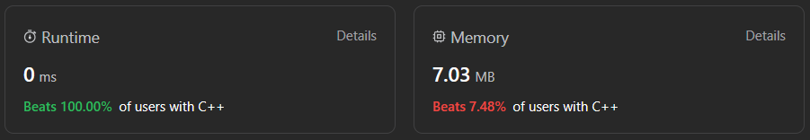

# ✅☑Beats 100% Users || [C++/Java/Python/JavaScript] || DP || EXPLAINED🔥

**Author:** MarkSPhilip31
**Votes:** 34
**Link:** [https://leetcode.com/problems/maximum-profit-in-job-scheduling/solutions/4514706/](https://leetcode.com/problems/maximum-profit-in-job-scheduling/solutions/4514706/)

---

# PLEASE UPVOTE IF IT HELPED

---



---
# Approaches
(Also explained in the code)
1. The `jobScheduling` function initializes vectors to store job details and a dynamic programming array (`dp`) to memoize the results for subproblems.

1. Each job's details (start time, end time, and profit) are stored in the `job` vector and sorted based on their start times. The start times vector is also sorted.

1. The `find` function implements a recursive approach with memoization to calculate the maximum profit. It takes into account whether a job is selected or not, considering the conditions and constraints of overlapping time intervals.

1. It uses the `lower_bound` function to find the next compatible job (based on the end time) and recursively explores both scenarios: selecting the current job or not, updating the maximum profit accordingly.

1. The memoization array `dp` stores the maximum profit obtainable at each step `i`.

1. The final result returned is the maximum profit achievable by selecting the best combination of non-overlapping jobs.


# Complexity
- Time complexity:
   $$O(nlogn)$$
    

- Space complexity:
   $$O(n)$$
    


# Code
```C++ []
class Solution {
public:

    int find(int i, vector<vector<int>>&job, vector<int>&startTime, int n,vector<int>&dp){
        if(i>=n)return 0;
        if(dp[i]!=-1)return dp[i];
        
        int index = lower_bound(startTime.begin(),startTime.end(),job[i][1])-startTime.begin();
        int pick = job[i][2] + find(index,job,startTime,n,dp);
        int notpick = find(i+1,job,startTime,n,dp);
        return dp[i] = max(pick,notpick);

    }

    int jobScheduling(vector<int>& startTime, vector<int>& endTime, vector<int>& profit) {
        
        int n = startTime.size();
        vector<vector<int>>job;
        vector<int>dp(n,-1);
        for(int i =0;i<n;i++){
            job.push_back({startTime[i],endTime[i],profit[i]});
        }
        sort(job.begin(),job.end());
        sort(startTime.begin(),startTime.end());
        return find(0,job,startTime,n,dp);
        }
};


```
```Java []
import java.util.*;

class Solution {
    public int find(int i, int[][] job, int[] startTime, int n, int[] dp) {
        if (i >= n) return 0;
        if (dp[i] != -1) return dp[i];

        int index = Arrays.binarySearch(startTime, job[i][1]);
        if (index < 0) index = -index - 1;

        int pick = job[i][2] + find(index, job, startTime, n, dp);
        int notpick = find(i + 1, job, startTime, n, dp);
        return dp[i] = Math.max(pick, notpick);
    }

    public int jobScheduling(int[] startTime, int[] endTime, int[] profit) {
        int n = startTime.length;
        int[][] job = new int[n][3];
        int[] dp = new int[n];
        Arrays.fill(dp, -1);

        for (int i = 0; i < n; i++) {
            job[i][0] = startTime[i];
            job[i][1] = endTime[i];
            job[i][2] = profit[i];
        }

        Arrays.sort(job, Comparator.comparingInt(a -> a[1]));
        Arrays.sort(startTime);

        return find(0, job, startTime, n, dp);
    }
}


```
```python3 []

class Solution:
    def find(self, i, job, startTime, n, dp):
        if i >= n:
            return 0
        if dp[i] != -1:
            return dp[i]

        index = startTime.index(job[i][1])

        pick = job[i][2] + self.find(index, job, startTime, n, dp)
        notpick = self.find(i + 1, job, startTime, n, dp)
        dp[i] = max(pick, notpick)
        return dp[i]

    def jobScheduling(self, startTime, endTime, profit):
        n = len(startTime)
        job = [[startTime[i], endTime[i], profit[i]] for i in range(n)]
        dp = [-1] * n

        job.sort(key=lambda x: x[1])
        startTime.sort()

        return self.find(0, job, startTime, n, dp)


```
```javascript []
class Solution {
    find(i, job, startTime, n, dp) {
        if (i >= n) return 0;
        if (dp[i] !== -1) return dp[i];

        const index = startTime.indexOf(job[i][1]);

        const pick = job[i][2] + this.find(index, job, startTime, n, dp);
        const notpick = this.find(i + 1, job, startTime, n, dp);
        dp[i] = Math.max(pick, notpick);
        return dp[i];
    }

    jobScheduling(startTime, endTime, profit) {
        const n = startTime.length;
        const job = Array.from({ length: n }, (_, i) => [startTime[i], endTime[i], profit[i]]);
        const dp = new Array(n).fill(-1);

        job.sort((a, b) => a[1] - b[1]);
        startTime.sort((a, b) => a - b);

        return this.find(0, job, startTime, n, dp);
    }
}


```

---


# PLEASE UPVOTE IF IT HELPED

---
---


---