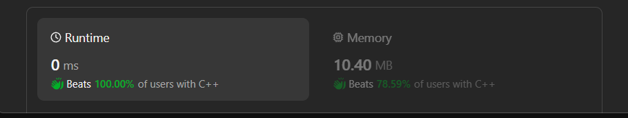

# ✅Beats 100% - 2 Approaches - C++/Java/Python/JS - Explained with [ Video ]- DFS and Bit Manipulation

**Author:** lancertech6
**Votes:** 141
**Link:** [https://leetcode.com/problems/maximum-length-of-a-concatenated-string-with-unique-characters/solutions/4611457/](https://leetcode.com/problems/maximum-length-of-a-concatenated-string-with-unique-characters/solutions/4611457/)

---



# YouTube Video Explanation:

<!-- **If you want a video for this question please write in the comments** -->

<!-- https://www.youtube.com/watch?v=ujU-jeO1v-k -->

https://youtu.be/igAztpYfTOg

**\uD83D\uDD25 Please like, share, and subscribe to support our channel's mission of making complex concepts easy to understand.**

Subscribe Link: https://www.youtube.com/@leetlogics/?sub_confirmation=1

*Subscribe Goal: 1600 Subscribers*
*Current Subscribers: 1557*

---

# Approach 1: Bit Operation

## Intuition:
1. The idea is to use bit manipulation to represent the presence of characters in a string.
2. We use an integer to represent a set of characters where each bit corresponds to the presence of a character.
3. By using bitwise operations, we can efficiently check for duplicate characters in a string.
4. We iterate through the given array of strings, updating our bitset and checking for uniqueness.
5. We maintain a dynamic programming list (`dp`) to store the bitsets of valid subsequences.

## Approach:
1. Initialize `dp` list with a single element 0 (empty string).
2. For each string `s` in the input array:
   a. Initialize variables `a` and `dup`.
   b. Iterate through characters in `s`:
      - Update `dup` using bitwise OR to check for duplicate characters.
      - Update `a` using bitwise OR to represent the set of characters in `s`.
   c. If `dup > 0`, continue to the next iteration as `s` has duplicate characters.
   d. Iterate through `dp` in reverse and update it by adding new bitsets.
   e. Update the result by finding the maximum length among valid subsequences.

## Complexity Analysis:
- Time Complexity: O(N * M), where N is the number of strings in the array and M is the maximum length of a string in the array.
- Space Complexity: O(2^M), where M is the maximum length of a string. The `dp` list can have up to 2^M elements.

## Code
```java []
class Solution {
    public int maxLength(List<String> arr) {
        List<Integer> dp = new ArrayList<>();
        dp.add(0);
        int res = 0;
        for (String s : arr) {
            int a = 0, dup = 0;
            for (char c : s.toCharArray()) {
                dup |= a & (1 << (c - 'a'));
                a |= 1 << (c - 'a');
            }
            if (dup > 0)    continue;
            for (int i = dp.size() - 1; i >= 0; i--) {
                if ((dp.get(i) & a) > 0) continue;
                dp.add(dp.get(i) | a);
                res = Math.max(res, Integer.bitCount(dp.get(i) | a));
            }
            
        }
        return res;
    }
}
```
```C++ []
class Solution {
public:
    int maxLength(vector<string>& arr) {
        vector<int> dp = {0};
        int res = 0;
        
        for (const string& s : arr) {
            int a = 0, dup = 0;
            for (char c : s) {
                dup |= a & (1 << (c - 'a'));
                a |= 1 << (c - 'a');
            }
            
            if (dup > 0)
                continue;
            
            for (int i = dp.size() - 1; i >= 0; i--) {
                if ((dp[i] & a) > 0)
                    continue;
                dp.push_back(dp[i] | a);
                res = max(res, __builtin_popcount(dp[i] | a));
            }
        }
        
        return res;
    }
};
```
```Python []
class Solution:
    def maxLength(self, arr: List[str]) -> int:
        dp = [0]
        res = 0
        
        for s in arr:
            a, dup = 0, 0
            for c in s:
                dup |= a & (1 << (ord(c) - ord('a')))
                a |= 1 << (ord(c) - ord('a'))
            
            if dup > 0:
                continue
            
            for i in range(len(dp) - 1, -1, -1):
                if (dp[i] & a) > 0:
                    continue
                dp.append(dp[i] | a)
                res = max(res, bin(dp[i] | a).count('1'))
        
        return res
```
```Javascript []
class Solution:
    def maxLength(self, arr: List[str]) -> int:
        dp = [0]
        res = 0
        
        for s in arr:
            a, dup = 0, 0
            for c in s:
                dup |= a & (1 << (ord(c) - ord('a')))
                a |= 1 << (ord(c) - ord('a'))
            
            if dup > 0:
                continue
            
            for i in range(len(dp) - 1, -1, -1):
                if (dp[i] & a) > 0:
                    continue
                dp.append(dp[i] | a)
                res = max(res, bin(dp[i] | a).count('1'))
        
        return res
```

# Approach 2: DFS

## Intuition:
1. The idea is to use Depth-First Search (DFS) to explore all possible combinations of strings in the array.
2. At each step, we concatenate a string to the existing path and check for uniqueness.
3. We keep track of the maximum length of valid subsequences during the DFS traversal.

## Approach:
1. Initialize the result variable to 0.
2. Define a DFS function that takes the array, current path, and current index as parameters.
3. In the DFS function:
   a. Check if the current path has unique characters using a helper function `isUniqueChars`.
   b. If the path is unique, update the result with the maximum length.
   c. If the current index is equal to the array size or the path is not unique, return.
   d. Iterate through the array starting from the current index and make recursive calls to the DFS function.
4. Call the DFS function with the initial parameters.

## Complexity Analysis:
- Time Complexity: Exponential, O(2^M), where M is the maximum length of a string in the array. The DFS explores all possible combinations.
- Space Complexity: O(M), where M is the maximum length of a string. The space is used for the recursive call stack.

## Code
```Java []
class Solution {
    private int result = 0;
    public int maxLength(List<String> arr) {
            if (arr == null || arr.size() == 0)    return 0;

        dfs(arr, "", 0);
        return result;
    }

    private void dfs(List<String> arr, String path, int idx) {
        boolean isUniqueChar = isUniqueChars(path);

        if (isUniqueChar) {
        result = Math.max(path.length(), result);
        }

        if (idx == arr.size() || !isUniqueChar) {
        return;
        }

        for (int i = idx; i < arr.size(); i++) {
        dfs(arr, path + arr.get(i), i + 1);
        }

    }

    private boolean isUniqueChars(String s) {
        Set<Character> set = new HashSet<>();
        for (char c : s.toCharArray()) {
        if (set.contains(c)) {
            return false;
        }
        set.add(c);
        }
        return true;
    }
}
```
```C++ []
class Solution {
public:
    int maxLength(vector<string>& arr) {
        int result = 0;
        dfs(arr, "", 0, result);
        return result;
    }

private:
    void dfs(const vector<string>& arr, const string& path, int idx, int& result) {
        if (isUniqueChars(path)) {
            result = max(result, static_cast<int>(path.length()));
        }

        if (idx == arr.size() || !isUniqueChars(path)) {
            return;
        }

        for (int i = idx; i < arr.size(); i++) {
            dfs(arr, path + arr[i], i + 1, result);
        }
    }

    bool isUniqueChars(const string& s) {
        unordered_set<char> set;
        for (char c : s) {
            if (set.count(c)) {
                return false;
            }
            set.insert(c);
        }
        return true;
    }
};
```
```Python []
class Solution:
    def maxLength(self, arr: List[str]) -> int:
        result = [0]
        self.dfs(arr, "", 0, result)
        return result[0]

    def dfs(self, arr, path, idx, result):
        if self.isUniqueChars(path):
            result[0] = max(result[0], len(path))

        if idx == len(arr) or not self.isUniqueChars(path):
            return

        for i in range(idx, len(arr)):
            self.dfs(arr, path + arr[i], i + 1, result)

    def isUniqueChars(self, s):
        char_set = set()
        for c in s:
            if c in char_set:
                return False
            char_set.add(c)
        return True
```
```Javascript []
/**
 * @param {string[]} arr
 * @return {number}
 */
var maxLength = function(arr) {
    let result = [0];
    dfs(arr, "", 0, result);
    return result[0];
};

function dfs(arr, path, idx, result) {
    if (isUniqueChars(path)) {
        result[0] = Math.max(result[0], path.length);
    }

    if (idx === arr.length || !isUniqueChars(path)) {
        return;
    }

    for (let i = idx; i < arr.length; i++) {
        dfs(arr, path + arr[i], i + 1, result);
    }
}

function isUniqueChars(s) {
    let charSet = new Set();
    for (let c of s) {
        if (charSet.has(c)) {
            return false;
        }
        charSet.add(c);
    }
    return true;
}
```

# Conclusion:
- Both approaches aim to find the maximum length of a concatenated string with unique characters.
- The bit manipulation approach uses dynamic programming to efficiently store and update valid subsequences.
- The DFS approach explores all possible combinations of strings to find the maximum length.
- The bit manipulation approach has a better time complexity but may require more space.
- The DFS approach has a higher time complexity but consumes less space.


