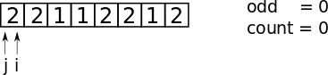
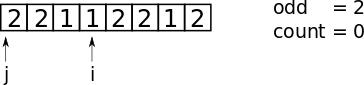
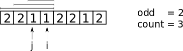
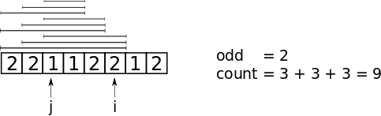
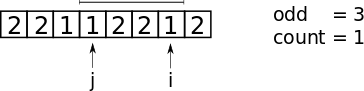

# C++: Visual explanation. O(1) space. Two pointers

**Author:** andnik
**Votes:** 441
**Link:** [https://leetcode.com/problems/count-number-of-nice-subarrays/solutions/508217/](https://leetcode.com/problems/count-number-of-nice-subarrays/solutions/508217/)

---

##### Algorithm
The best way to explain this approach is to look at the example:
Let's say **k = 2** and we have the following array:



We only going to work with numbers `1` and `2` because we are only interested in if number is odd or even, we don't care what the actual value is.
1. Using `i` iterate over the array counting **only odd** numbers:



2. When **odd** is equal to **k**, we can analyse our **left part** and count how many subarrays with **odd == k** we can produce.
We are doing it with `j` iterating until we get to **odd number**.



We can see that there are `3` subarrays we can produce with **odd == k**.

3. Continue with `i` again. Since **odd >= k** then every next **even number** we meet is going to **double previous count**. Let's see:



4. When we meet **odd number** again we need to reset `count=1` and repeat step (2) with `j` again. In our example there's going to be only one subarray:



5. And finish with counting last **even number** as in step (3).

Since we are reseting `count` variable to 0, we are adding sum of all subarrays in `total` variable.

##### Code
```
class Solution {
public:
    int numberOfSubarrays(vector<int>& nums, int k) {
        int j = 0, odd = 0, count = 0, total = 0;
        for (int i = 0; i < nums.size(); i++) {
            if (nums[i] & 1) {
                odd++;
                if (odd >= k) {
                    count = 1;
                    while (!(nums[j++] & 1)) count++;
                    total += count;
                }
            } else if (odd >= k) total += count;
        }
        return total;
    }
};
```