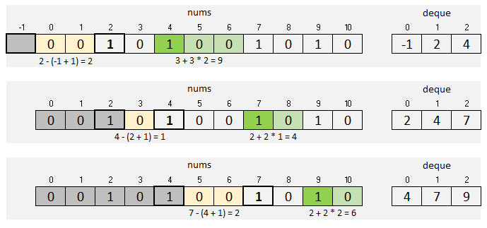

# Deque with Picture

**Author:** votrubac
**Votes:** 203
**Link:** [https://leetcode.com/problems/count-number-of-nice-subarrays/solutions/419545/](https://leetcode.com/problems/count-number-of-nice-subarrays/solutions/419545/)

---

#### Intuition
This is similar to [992. Subarrays with K Different Integers](https://leetcode.com/problems/subarrays-with-k-different-integers/discuss/235235/C%2B%2BJava-with-picture-prefixed-sliding-window).

When we find `k` odd numbers, we have one nice subarray, plus an additional subarray for each even number preceding the first odd number. This is also true for each even number that follows.

For example, in the picture below we found `k == 2` odd numbers at index `4`. We have 3 nice subarrays therefore: `[2, 4], [1, 4], [0, 4]`. For even number at index `5`, we also have 3 nice subarrays: `[2, 5], [1, 5], [0, 5]`. Plus 3 subarrays for index `6`.

When we encounter `k + 1` odd number at index `7`, we need to get rid of the first odd number (at index `2`) to have exactly `k` odd numbers. So, we count nice subarrays as if the array starts at index `3`. 



#### Approach 1: Deque
We do not have to use `deque`, but it makes tracking the window easier (comparing to moving pointers). Note that in Java, the deque interface does not provide a random access, so we'll just use `LinkedList` instead.

**Java**
```java
public int numberOfSubarrays(int[] nums, int k) {
  LinkedList<Integer> deq = new LinkedList();
  deq.add(-1);
  int res = 0;
  for (int i = 0; i < nums.length; ++i) {
    if (nums[i] % 2 == 1) 
        deq.add(i);
    if (deq.size() > k + 1) 
        deq.pop();
    if (deq.size() == k + 1) 
        res += deq.get(1) - deq.get(0);
  }
  return res;
}
```
**C++**
```cpp
int numberOfSubarrays(vector<int>& nums, int k, int res = 0) {
  deque<int> deq = { -1 };
  for (int i = 0; i < nums.size(); ++i) {
    if (nums[i] % 2)
        deq.push_back(i);
    if (deq.size() > k + 1)
        deq.pop_front();
    if (deq.size() == k + 1)
        res += deq[1] - deq[0];
  }
  return res;
}
```
**Complexity Analysis**
- Time: O(n).
- Memory: O(k) for the deque.