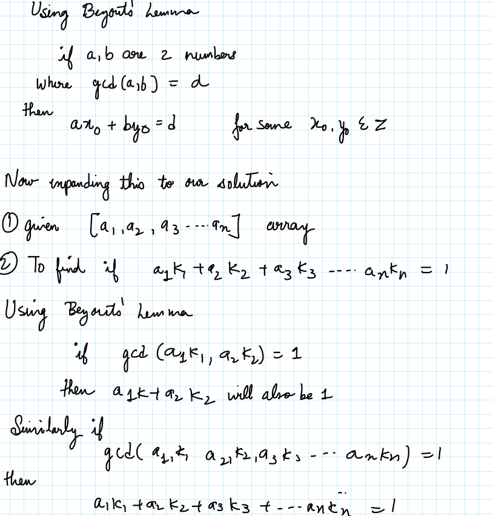
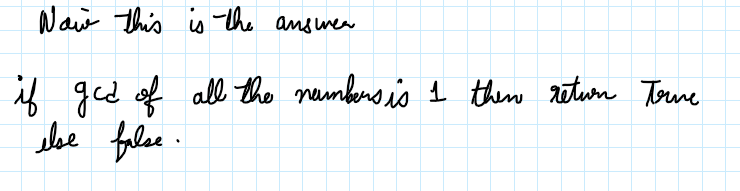

# Hand Written Easy Explanation with Bézout's  Lemma

**Author:** _helios
**Votes:** 4
**Link:** [https://leetcode.com/problems/check-if-it-is-a-good-array/solutions/3418220/](https://leetcode.com/problems/check-if-it-is-a-good-array/solutions/3418220/)

---





# Code
```
class Solution:
    def isGoodArray(self, nums: List[int]) -> bool:
        ans=nums[0]
        for i in range (1,len(nums)):
            ans=math.gcd(ans,nums[i])
        return ans==1
```

Please Upvote the solution is you like it.