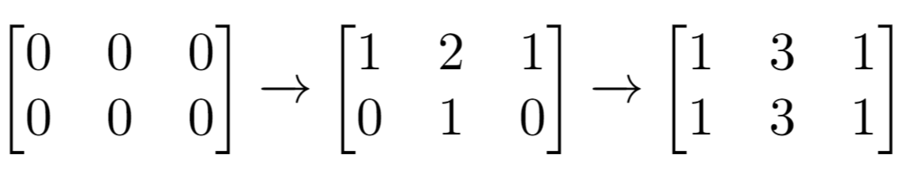
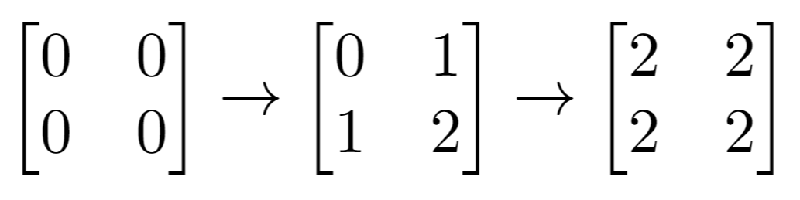

# [1252. Cells with Odd Values in a Matrix](https://leetcode.com/problems/cells-with-odd-values-in-a-matrix/)

| Category | Difficulty | Likes | Dislikes |
| :------: | :--------: | :---: | :------: |
| Algorithms | Easy | 1319 | 1555 |

**Tags:** [`array`](https://leetcode.com/tag/array), [`math`](https://leetcode.com/tag/math), [`simulation`](https://leetcode.com/tag/simulation)

**Companies:** `google`

## Description

There is an `m x n` matrix that is initialized to all `0`'s. There is also a 2D array `indices` where each `indices[i] = [r_i, c_i]` represents a **0-indexed location** to perform some increment operations on the matrix.

For each location `indices[i]`, do **both** of the following:

	- Increment **all** the cells on row `r_i`.

	- Increment **all** the cells on column `c_i`.

Given `m`, `n`, and `indices`, return *the **number of odd-valued cells** in the matrix after applying the increment to all locations in *`indices`.

 

**Example 1:**


```

Input: m = 2, n = 3, indices = [[0,1],[1,1]]
Output: 6
Explanation: Initial matrix = [[0,0,0],[0,0,0]].
After applying first increment it becomes [[1,2,1],[0,1,0]].
The final matrix is [[1,3,1],[1,3,1]], which contains 6 odd numbers.

```

**Example 2:**


```

Input: m = 2, n = 2, indices = [[1,1],[0,0]]
Output: 0
Explanation: Final matrix = [[2,2],[2,2]]. There are no odd numbers in the final matrix.

```

 

**Constraints:**

	- `1 <= m, n <= 50`

	- `1 <= indices.length <= 100`

	- `0 <= r_i < m`

	- `0 <= c_i < n`

 

**Follow up:** Could you solve this in `O(n + m + indices.length)` time with only `O(n + m)` extra space?

---

**Links:** [Submissions](https://leetcode.com/problems/cells-with-odd-values-in-a-matrix/) | [Solutions](https://leetcode.com/problems/cells-with-odd-values-in-a-matrix/)
