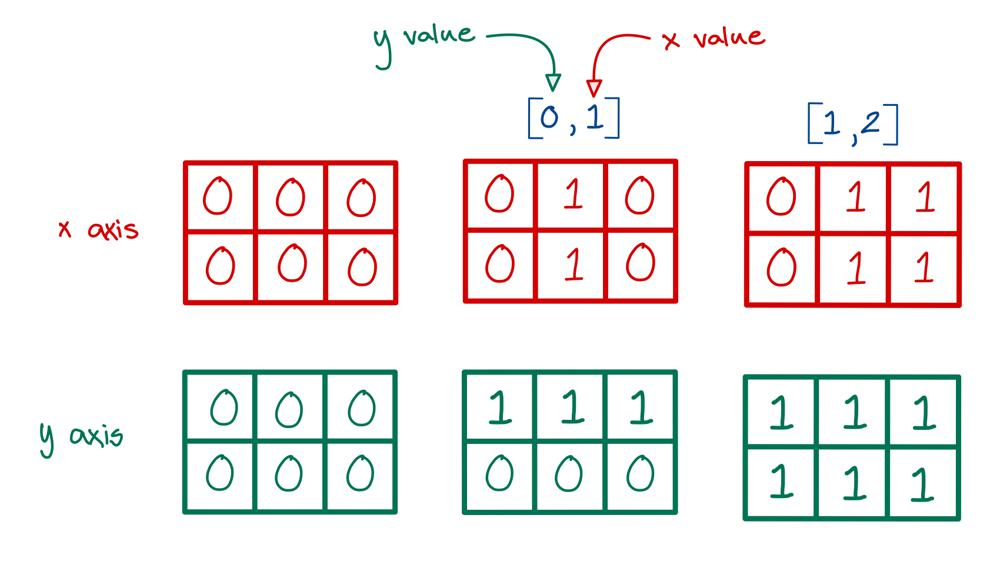
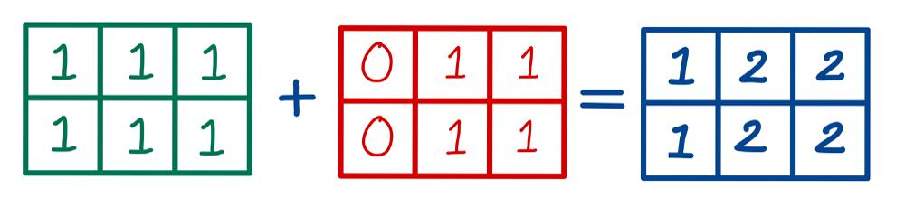

# Golang solution faster than 100% with explanation and images

**Author:** nathannaveen
**Votes:** 6
**Link:** [https://leetcode.com/problems/cells-with-odd-values-in-a-matrix/solutions/1208519/](https://leetcode.com/problems/cells-with-odd-values-in-a-matrix/solutions/1208519/)

---

[1252. Cells with Odd Values in a Matrix](https://leetcode.com/problems/cells-with-odd-values-in-a-matrix/)

The idea of this solution is to use two maps, `x`, and `y`, and we can add all the values of indices to `x`, and `y` (`index[0]` to `x`, and `index[1]` to `y`). 

Then we can check whether all the `x`'s plus all the `y`'s is odd. If so, we know that we can add one to the result.

If you don't understand we can take an example:

`n = 3, m = 2, indices = [[0, 1],[1, 2]]`




> Note: You might have noticed that the position is in the format `(y, x)` instead of the average `(x, y)`. I don't know why this is. If anybody knows, could you please comment?
> 
> Continuing with the example, we find the rows and columns and fill them up. After that, we can find the sum of each position:




You might be wondering why this code uses `2` maps instead of `1` map or instead of `1` matrix. This code uses `2` maps instead of `1` map because it is not a matrix. The maps store all the `x` values and all the `y` values. If we put both maps together, we could get a matrix, but a matrix makes the space `O(m * n)` while the space of two maps is `O(m + n)`.

``` go
func oddCells(n int, m int, indices [][]int) int {
	x := make(map[int]int)
	y := make(map[int]int)
	counter := 0
	for _, index := range indices {
		y[index[0]]++
		x[index[1]]++
	}

	for i := 0; i < n; i++ {
		for j := 0; j < m; j++ {
			if (y[i] + x[j]) % 2 == 1 {
				counter++
			}
		}
	}
	return counter
}
```