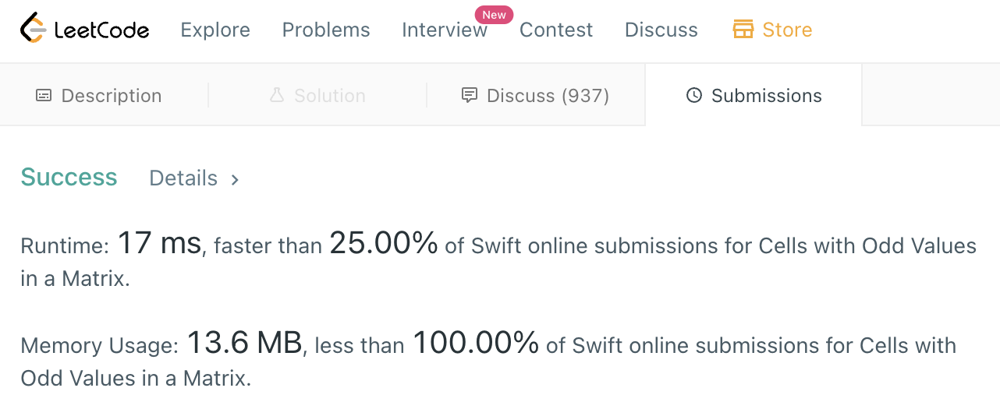

# [Swift] memory 100% easy-understanding Solution

**Author:** danielsychoo
**Votes:** 1
**Link:** [https://leetcode.com/problems/cells-with-odd-values-in-a-matrix/solutions/2227309/](https://leetcode.com/problems/cells-with-odd-values-in-a-matrix/solutions/2227309/)

---

```swift
class Solution {
    func oddCells(_ m: Int, _ n: Int, _ indices: [[Int]]) -> Int {
		// make matrix (n x m)
        let inner = [Int](repeating: 0, count: n)
        var matrix = [[Int]](repeating: inner, count: m)

		// do indices logic
        for item in indices {
            let r = item[0]
            let c = item[1]

            matrix[r] = matrix[r].map { $0 + 1 }

            for i in 0 ..< matrix.count {
                matrix[i][c] += 1
            }
        }

		// find odd count in matrix
        var result = 0
        for item in matrix {
            result += item.filter { $0 % 2 != 0 }.count
        }

        return result
    }
}
```

