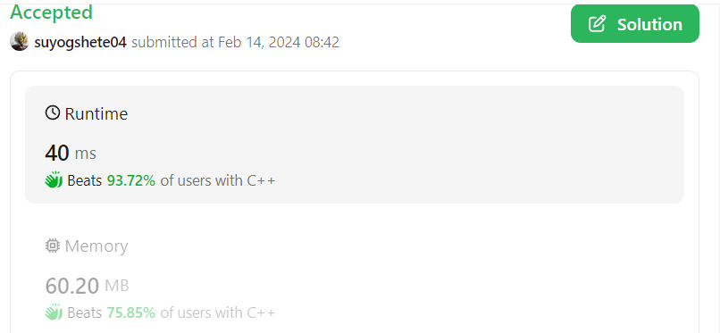

# 🔥Beats 93.72%🔥✅Easiest (C++/Java/Python) Solution With Detailed Explanation✅

**Author:** suyogshete04
**Votes:** 2
**Link:** [https://leetcode.com/problems/reconstruct-a-2-row-binary-matrix/solutions/4724032/](https://leetcode.com/problems/reconstruct-a-2-row-binary-matrix/solutions/4724032/)

---

# Intuition
The intuition for reconstructing a 2D matrix involves first checking if the total upper and lower row sums match the required column sums, then allocating 1s to each row based on column sum values, prioritizing columns with a sum of 2, followed by distributing the remaining 1s between the two rows while respecting the upper and lower limits.




# Approach

1. **Initialization**: The code initializes variables to keep track of the number of columns that should have a sum of 1 and 2, based on the `colsum` array. It also calculates the initial sums for the upper and lower rows after accommodating columns with a sum of 2.

2. **Feasibility Check**: Before attempting to construct the matrix, the code checks if the desired configuration is possible by comparing the total sum of `upper` and `lower` with the total sum required by `colsum`. If the total sum doesn't match, or if the adjusted sums for upper or lower rows (after accounting for columns with a sum of 2) are negative, the function immediately returns an empty matrix, indicating that reconstruction is not possible.

3. **Matrix Construction**: The algorithm then proceeds to construct the matrix row by row, column by column. For columns with a `colsum` of 2, it places a 1 in both the upper and lower rows. For columns with a `colsum` of 1, it prefers to place a 1 in the upper row until the upper sum is fully allocated, after which any remaining columns with a `colsum` of 1 are allocated to the lower row. This step continues until all columns are processed.

4. **Result**: If the algorithm can successfully allocate the sums according to the `colsum` while respecting the `upper` and `lower` constraints, it returns the constructed matrix. Otherwise, it has already returned an empty matrix in the feasibility check step.


# Complexity
1. **Time Complexity**: The overall time complexity is \\(O(n)\\), where \\(n\\) is the length of the `colsum` array. This is because the algorithm iterates through the `colsum` array exactly once to construct the matrix, and the initial counting of 1s and 2s in `colsum` also requires a single pass through the array.

2. **Space Complexity**: The space complexity is \\(O(n)\\) due to the storage requirements of the resulting 2D matrix, which has 2 rows and `n` columns. The rest of the variables used for counting and tracking the sum allocations are of constant space, not dependent on the input size.

# Code
```C++ []
class Solution {
public:
    vector<vector<int>> reconstructMatrix(int upper, int lower,
                                          vector<int>& colsum) {
        int n = colsum.size();

        int count1 = 0;
        int count2 = 0;

        for (int i = 0; i < n; i++) {
            if (colsum[i] == 1)
                count1++;

            if (colsum[i] == 2)
                count2 += 2;
        }

        if (((upper + lower) - (count1 + count2)) != 0)
            return {};

        int upp = upper-(count2/2);
        int low = lower-(count2/2);

        if (upp < 0 || low < 0)
            return {};

        vector<vector<int>> res(2, vector<int>(n, 0));

        for (int i = 0; i < n; i++) {
            if (colsum[i] == 2) {
                res[0][i] = 1;
                res[1][i] = 1;
            }
            else if (colsum[i] == 1 && upp) {
                res[0][i] = 1;
                upp--;
            }
            else if (colsum[i] == 1 && low)
            {
                res[1][i] = 1;
                low--;
            }
        }

        return res;
    }
};
```
```Java []
import java.util.ArrayList;
import java.util.Arrays;
import java.util.List;

public class Solution {
    public List<List<Integer>> reconstructMatrix(int upper, int lower, int[] colsum) {
        int n = colsum.length;
        int count1 = 0;
        int count2 = 0;

        for (int i = 0; i < n; i++) {
            if (colsum[i] == 1) count1++;
            if (colsum[i] == 2) count2 += 2;
        }

        if ((upper + lower) - (count1 + count2) != 0) return new ArrayList<>();

        int upp = upper - count2 / 2;
        int low = lower - count2 / 2;

        if (upp < 0 || low < 0) return new ArrayList<>();

        List<List<Integer>> res = new ArrayList<>();
        res.add(new ArrayList<>());
        res.add(new ArrayList<>());

        for (int i = 0; i < n; i++) {
            if (colsum[i] == 2) {
                res.get(0).add(1);
                res.get(1).add(1);
            } else if (colsum[i] == 1) {
                if (upp > 0) {
                    res.get(0).add(1);
                    res.get(1).add(0);
                    upp--;
                } else {
                    res.get(0).add(0);
                    res.get(1).add(1);
                    low--;
                }
            } else {
                res.get(0).add(0);
                res.get(1).add(0);
            }
        }

        return res;
    }
}

```
```Python []
from typing import List

class Solution:
    def reconstructMatrix(self, upper: int, lower: int, colsum: List[int]) -> List[List[int]]:
        n = len(colsum)
        
        # Check if the total sum matches the desired row sums
        if upper + lower != sum(colsum):
            return []
        
        # Initialize the result matrix
        res = [[0 for _ in range(n)] for _ in range(2)]
        
        for i in range(n):
            # If colsum[i] is 2, both rows must have a 1 in the i-th column
            if colsum[i] == 2:
                if upper > 0 and lower > 0:
                    res[0][i], res[1][i] = 1, 1
                    upper -= 1
                    lower -= 1
                else:
                    return []  # Not enough sums to distribute
            # If colsum[i] is 1, distribute it to either row according to the remaining sums
            elif colsum[i] == 1:
                if upper > lower:
                    res[0][i] = 1
                    upper -= 1
                elif lower >= upper:
                    res[1][i] = 1
                    lower -= 1
                else:
                    return []  # Not a valid scenario
        
        # Check if we correctly distributed all sums
        if upper == 0 and lower == 0:
            return res
        else:
            return []  # Sums were not correctly distributed

```