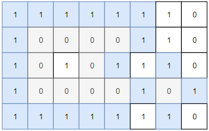

# ✅ [C++] Easy Intuitive Solution using DFS | Explained

**Author:** biT_Legion
**Votes:** 25
**Link:** [https://leetcode.com/problems/number-of-closed-islands/solutions/2050406/](https://leetcode.com/problems/number-of-closed-islands/solutions/2050406/)

---

This problem is easy. You just need to figure out the fact that any island will be "surrounded" if it can't reach the boundary. Let me explain. 
So we know that once we start DFS from any cell, it will move in all four directions provided they are `unvisited` and have a `0`, and it will stop if it meets an `unvisited` or a `1`. So, if DFS call from a cell is not reaching any of the matrix's boundary, that means there must have been a `1` in its way. Therefore, if it can't reach any of the boundaries, then that states that there are `1` in its way terminating the DFS call for that connected component, and thus that connected component becomes a land which is surrounded by water from all sides. You can refer to the example image. 


Here, you can see that once you start DFS call from cell `(1,1)`, it will track down all the 0s which are in the same connected component and when it encounters `1` in its way, it halts. 
The zeros, or the connected components that can reach to any of the four boundaries can never be fully closed by water. Therefore, in the above example, we can only have two closed islands. 

**NOTE** : In this problem, there is only one thing different from normal DFS. Since we need to check if any dfs call reaches any of the four corner or not, therefore we need to have a boolean return type of dfs function. That creates an issue that if we just do `return fun(move left) && fun(move right) && fun(move up) && fun(move down)`, then it could happen that `fun(move left)` return false, due to which the remaining three calls will not be done. This creates an issue because it will not cover all the cells of a connected component, since we just moved in one direction from a cell and got false, so we returned. Therefore, to tackle this, we store the result of all the four calls in four different variables and then return their combined result. This way, we will mark all the cells of a connected component as visited.   
In case you did not get this NOTE, you can refer to the cases below the code. 
  

```
class Solution {
public:
    int dx[4] = {1,0,-1,0};
    int dy[4] = {0,1,0,-1};
    
    int closedIsland(vector<vector<int>>& grid) {
        int m = grid.size(), n = grid[0].size();
        vector <vector <int>> visited(m, vector <int>(n,0));
        
        int count = 0;
        for(int i = 0; i<m; i++){
            for(int j = 0; j<n; j++){
                if(grid[i][j]==0 and visited[i][j]==0)
                    if(dfs(i,j,grid,visited)) count++;
            }
        }
        return count;
    }
protected:
    bool isvalid(int x, int y, int m, int n, vector <vector <int>>&grid, vector <vector <int>>&visited){
        if(visited[x][y] or grid[x][y]) return false;
        return true;
    }
    bool dfs(int x, int y, vector <vector <int>>&grid, vector <vector <int>>&visited){
        if(!isvalid(x,y,grid.size(),grid[0].size(),grid,visited)) return true;
        
        if(x==grid.size()-1 or x==0 or y==grid[0].size()-1 or y==0) return false;
        
        visited[x][y] = 1;
        
        bool left = dfs(x,y-1,grid,visited);
        bool right = dfs(x,y+1,grid,visited);
        bool up = dfs(x-1,y,grid,visited);
        bool down = dfs(x+1,y,grid,visited);
        
        return left and right and up and down;
    }
};
/*
[[0,0,1,1,0,1,0,0,1,0],[1,1,0,1,1,0,1,1,1,0],[1,0,1,1,1,0,0,1,1,0],[0,1,1,0,0,0,0,1,0,1],[0,0,0,0,0,0,1,1,1,0],[0,1,0,1,0,1,0,1,1,1],[1,0,1,0,1,1,0,0,0,1],[1,1,1,1,1,1,0,0,0,0],[1,1,1,0,0,1,0,1,0,1],[1,1,1,0,1,1,0,1,1,0]]
[[1,1,0,1,1,1,1,1,1,1],[0,0,1,0,0,1,0,1,1,1],[1,0,1,0,0,0,1,0,1,0],[1,1,1,1,1,0,0,1,0,0],[1,0,1,0,1,1,1,1,1,0],[0,0,0,0,1,1,0,0,0,0],[1,0,1,0,0,0,0,1,1,0],[1,1,0,0,1,1,0,0,0,0],[0,0,0,1,1,0,1,1,1,0],[1,1,0,1,0,1,0,0,1,0]]
*/
```