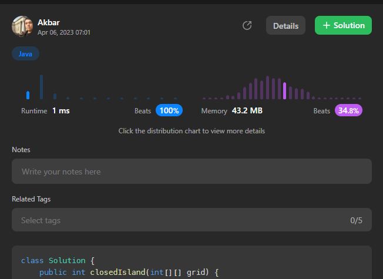

# ✅[Python3//C++//Java]✅ Easy and understand DFS solution(Beats 100%)

**Author:** abdullayev_akbar
**Votes:** 149
**Link:** [https://leetcode.com/problems/number-of-closed-islands/solutions/3384821/](https://leetcode.com/problems/number-of-closed-islands/solutions/3384821/)

---

The DFS function takes a position (i, j) and recursively checks its neighboring cells. If the cell is out of bounds or has a value of 1, it returns True. Otherwise, it marks the cell as visited and continues to recursively check its neighbors. If any of the neighboring cells are not closed islands (i.e., not completely surrounded by 1s), it returns False. If all neighbors are closed islands, it returns True.

The main function iterates through each cell in the grid and checks if it is a 0 and a closed island. If it is, it increments the count.
# Please Upvote \uD83D\uDE07
# Python3
<iframe src="https://leetcode.com/playground/LyFhxP5m/shared" frameBorder="0" width="1000" height="600"></iframe>

