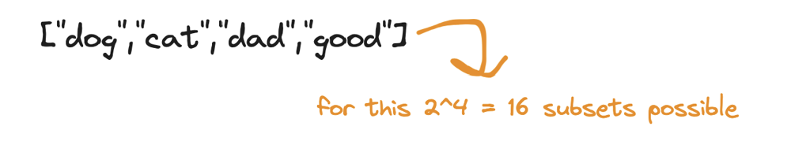

# Step By Step Explanation 😳😨😱🤯

**Author:** hi-malik
**Votes:** 78
**Link:** [https://leetcode.com/problems/maximum-score-words-formed-by-letters/solutions/5199428/](https://leetcode.com/problems/maximum-score-words-formed-by-letters/solutions/5199428/)

---

Let's understand with an example, 
```
Input: words = ["dog","cat","dad","good"], letters = ["a","a","c","d","d","d","g","o","o"], score = [1,0,9,5,0,0,3,0,0,0,0,0,0,0,2,0,0,0,0,0,0,0,0,0,0,0]
Output: 23
```
First understand the input : 
* First we have 4 words : **dog, cat, dad, good**
* 9 Alphabets are given, which can be repeatable **"a","a","c","d","d","d","g","o","o"**
* Now, what is this? **[1,0,9,5,0,0,3,0,0,0,0,0,0,0,2,0,0,0,0,0,0,0,0,0,0,0]**, this is the score of every character, from **a to z**! What I mean is :
```
[1,0,9,5,0,0,3,0,0,0,0,0,0,0,2,0,0,0,0,0,0,0,0,0,0,0]
 a b c d ------------------------------------------z
```

Now we have to tell the sets of these words,


We have to tell the sets of words, maybe **{dog, dad}** such that, their frequency of the alphabets should be in constrains. What I mean is, in the **{dog, dad}** the **d** is repeating 3 times and the **letters** array has the frequency of **d** is `3` too, so it is allowed. Or with one more example we can't take **{dog, dad, good}** together because in the **letters** array has the frequency of **o** `2` times and **d** `3` times but in the set, **d** is coming `4` times and **o** `3` times!

So, we have to create a set in the way such that. There the letter frequency remains in the constrains given! 
Now what we have to return is, how many sets like this will be possible and among them, which one score is high! Now what **score** means over here is as taken an example **dog**, the word **d** has score of `5`, **g** has score of `3` and so and so forth, and in the end just add there **score**, among these, which one score is high. Return it!
```
Let's solve this problem using backtracking
```
Now what backtracking is, if you know and don't know, doesn't matter just **read my words**. Backtracking is just like us our life, for example in our life we have a goal to achieve, we walk on the path to achieve it! But we find some difficulty on this path, just walk little back 1-2 steps and change the path, but never change the goal! In the same way, backtracking is. 
* Do the work, if it's not working
* Undo the work and again start the work

Sorry, back to the problem!

To solve this problem,
* First we will create an array to have the count of the character
```
vector<int> count(26, 0)
```
* What ever value present in letter, just get into the count
```
for(auto &c : letters){
            count[c - 'a']++;
        }
```
* We want a final answer, let's initalise that too :
```
int ans = 0;
```
* Let's create a backtracking function and we going to pass, **score**, **words** and **count** not letters, because we already have in count and one more **position** and we going to have one **temporary** answer and **final** answer :
```
backtracking(words, score, count, 0, 0, ans);
return ans;
```
* The function will be a void function,
```
void backtracking(vector<string>& words, vector<int>& score, vector<int>& count, int pos, int temp, int &ans){
        
    }
```
* First we going to create a base condition, which will help us in terminating from this function! So, our base consition says! Whenever **count** increase compare to the **letters** present. We will terminate it. For example in **cat** `t` is present but in our **letters** `t` isn't there, we will terminate it!
* And let's add in the function too,
```
void backtracking(vector<string>& words, vector<int>& score, vector<int>& count, int pos, vector<int>& lettersCount, int temp, int &ans){
        
    }
```
* Back to base condition,
```
for(int i = 0; i < 26; i++){
            if(lettersCount[i] > count[i]) return;
        }
```
* Now we will have the **maximum score ans** with the **current score** temp if temp is greater, ans keeps track of the highest score found so far during the backtracking process.
```
ans = max(ans, temp);
```
* Let's create a for loop iterates through the words vector starting from the current position pos. The pos parameter ensures that each word is considered only once in any combination to avoid repetition of words.
```
for(int i = pos; i < words.size(); i++){

}
```
* Inside it, create a nested for loop iterates through each character c of the current word words[i].
For each character **c**:
Increment the corresponding count in **lettersCount** to reflect that this character is being used.
Add the score of the character to temp using the score vector.
```
for(auto& c : words[i]){
    lettersCount[c - 'a']++;
    temp += score[c - 'a'];
}
```
* After adding the current word to the combination, make a recursive call to the **backtracking** function.
The parameters are updated as follows:
**i + 1** ensures that the next call will start from the next word, preventing the reuse of the current word.
The updated lettersCount and **temp** reflect the current state after adding the word.
```
backtracking(words, score, count, lettersCount, i + 1, temp, ans);
```
* Now, the for loop undoes the changes made by adding the current word to the combination.
For each character **c** of the current word **words[i]**:
Decrement the corresponding count in **lettersCount** to reflect that this character is no longer being used.
Subtract the score of the character from **temp**.
```
for(auto& c : words[i]){
    lettersCount[c - 'a']--;
    temp -= score[c - 'a'];
}
```

Finally, let me explain you the purpose of the code : 
**The purpose of this code is to explore all possible combinations** of words that can be formed using the given letters. By recursively adding and then removing each word. This backtracking approach allows the algorithm to find the maximum possible score by evaluating all valid combinations.

Without any further due, let's code it up : **ladies n gentlemen**

**C++**
```
class Solution {
public:
    int maxScoreWords(vector<string>& words, vector<char>& letters, vector<int>& score) {
        vector<int> count(26, 0); 
        vector<int> lettersCount(26, 0);
        for(auto &c : letters){
            count[c - 'a']++;
        }
        int ans = 0;
        backtracking(words, score, count, lettersCount, 0, 0, ans);
        return ans;
    }
    void backtracking(vector<string>& words, vector<int>& score, vector<int>& count, vector<int>& lettersCount, int pos, int temp, int &ans){
        for(int i = 0; i < 26; i++){
            if(lettersCount[i] > count[i]) return;
        }
        ans = max(ans, temp);
        for(int i = pos; i < words.size(); i++){
            for(auto& c : words[i]){
                lettersCount[c - 'a']++;
                temp+=score[c - 'a'];
            }
            backtracking(words, score, count, lettersCount, i + 1, temp, ans);
            for(auto& c : words[i]){
                lettersCount[c - 'a']--;
                temp-=score[c - 'a'];
            }
        }
    }
};
```
**JAVA**
```
public class Solution {
    public int maxScoreWords(String[] words, char[] letters, int[] score) {
        int[] count = new int[26];
        int[] lettersCount = new int[26];
        
        for (char c : letters) {
            count[c - 'a']++;
        }
        
        int ans = 0;
        ans = backtracking(words, score, count, lettersCount, 0, 0, ans);
        return ans;
    }
    
    private int backtracking(String[] words, int[] score, int[] count, int[] lettersCount, int pos, int temp, int ans) {
        for (int i = 0; i < 26; i++) {
            if (lettersCount[i] > count[i]) return ans;
        }
        
        ans = Math.max(ans, temp);
        
        for (int i = pos; i < words.length; i++) {
            for (char c : words[i].toCharArray()) {
                lettersCount[c - 'a']++;
                temp += score[c - 'a'];
            }
            
            ans = backtracking(words, score, count, lettersCount, i + 1, temp, ans);
            
            for (char c : words[i].toCharArray()) {
                lettersCount[c - 'a']--;
                temp -= score[c - 'a'];
            }
        }
        
        return ans;
    }
}
```
**PYTHON**
```
class Solution:
    def maxScoreWords(self, words: List[str], letters: List[str], score: List[int]) -> int:
        count = [0] * 26
        letters_count = [0] * 26
        
        for c in letters:
            count[ord(c) - ord('a')] += 1
        
        self.ans = 0
        self.backtracking(words, score, count, letters_count, 0, 0)
        return self.ans
    
    def backtracking(self, words, score, count, letters_count, pos, temp):
        for i in range(26):
            if letters_count[i] > count[i]:
                return
        
        self.ans = max(self.ans, temp)
        
        for i in range(pos, len(words)):
            for c in words[i]:
                letters_count[ord(c) - ord('a')] += 1
                temp += score[ord(c) - ord('a')]
            
            self.backtracking(words, score, count, letters_count, i + 1, temp)
            
            for c in words[i]:
                letters_count[ord(c) - ord('a')] -= 1
                temp -= score[ord(c) - ord('a')]
```

---
Complexity Analysis

---
* **Time Complexity:-** BigO(2^N x L)


* **Space Complexity:-** BigO(N)

Here, \uD835\uDC5B is the number of words, and \uD835\uDC3F is the total number of letters across all words.