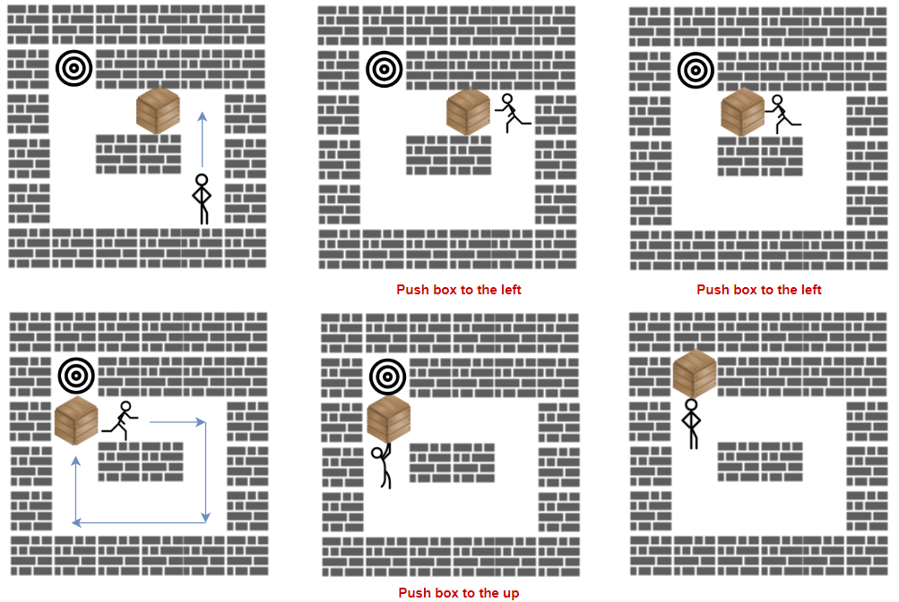

# [1263. Minimum Moves to Move a Box to Their Target Location](https://leetcode.com/problems/minimum-moves-to-move-a-box-to-their-target-location/)

| Category | Difficulty | Likes | Dislikes |
| :------: | :--------: | :---: | :------: |
| Algorithms | Hard | 882 | 59 |

**Tags:** [`array`](https://leetcode.com/tag/array), [`breadth-first-search`](https://leetcode.com/tag/breadth-first-search), [`heap-priority-queue`](https://leetcode.com/tag/heap-priority-queue), [`matrix`](https://leetcode.com/tag/matrix)

**Companies:** `google`

## Description

A storekeeper is a game in which the player pushes boxes around in a warehouse trying to get them to target locations.

The game is represented by an `m x n` grid of characters `grid` where each element is a wall, floor, or box.

Your task is to move the box `'B'` to the target position `'T'` under the following rules:

	- The character `'S'` represents the player. The player can move up, down, left, right in `grid` if it is a floor (empty cell).

	- The character `'.'` represents the floor which means a free cell to walk.

	- The character `'#'` represents the wall which means an obstacle (impossible to walk there).

	- There is only one box `'B'` and one target cell `'T'` in the `grid`.

	- The box can be moved to an adjacent free cell by standing next to the box and then moving in the direction of the box. This is a **push**.

	- The player cannot walk through the box.

Return *the minimum number of **pushes** to move the box to the target*. If there is no way to reach the target, return `-1`.

 

**Example 1:**


```

Input: grid = [[&quot;#&quot;,&quot;#&quot;,&quot;#&quot;,&quot;#&quot;,&quot;#&quot;,&quot;#&quot;],
               [&quot;#&quot;,&quot;T&quot;,&quot;#&quot;,&quot;#&quot;,&quot;#&quot;,&quot;#&quot;],
               [&quot;#&quot;,&quot;.&quot;,&quot;.&quot;,&quot;B&quot;,&quot;.&quot;,&quot;#&quot;],
               [&quot;#&quot;,&quot;.&quot;,&quot;#&quot;,&quot;#&quot;,&quot;.&quot;,&quot;#&quot;],
               [&quot;#&quot;,&quot;.&quot;,&quot;.&quot;,&quot;.&quot;,&quot;S&quot;,&quot;#&quot;],
               [&quot;#&quot;,&quot;#&quot;,&quot;#&quot;,&quot;#&quot;,&quot;#&quot;,&quot;#&quot;]]
Output: 3
Explanation: We return only the number of times the box is pushed.
```

**Example 2:**

```

Input: grid = [[&quot;#&quot;,&quot;#&quot;,&quot;#&quot;,&quot;#&quot;,&quot;#&quot;,&quot;#&quot;],
               [&quot;#&quot;,&quot;T&quot;,&quot;#&quot;,&quot;#&quot;,&quot;#&quot;,&quot;#&quot;],
               [&quot;#&quot;,&quot;.&quot;,&quot;.&quot;,&quot;B&quot;,&quot;.&quot;,&quot;#&quot;],
               [&quot;#&quot;,&quot;#&quot;,&quot;#&quot;,&quot;#&quot;,&quot;.&quot;,&quot;#&quot;],
               [&quot;#&quot;,&quot;.&quot;,&quot;.&quot;,&quot;.&quot;,&quot;S&quot;,&quot;#&quot;],
               [&quot;#&quot;,&quot;#&quot;,&quot;#&quot;,&quot;#&quot;,&quot;#&quot;,&quot;#&quot;]]
Output: -1

```

**Example 3:**

```

Input: grid = [[&quot;#&quot;,&quot;#&quot;,&quot;#&quot;,&quot;#&quot;,&quot;#&quot;,&quot;#&quot;],
               [&quot;#&quot;,&quot;T&quot;,&quot;.&quot;,&quot;.&quot;,&quot;#&quot;,&quot;#&quot;],
               [&quot;#&quot;,&quot;.&quot;,&quot;#&quot;,&quot;B&quot;,&quot;.&quot;,&quot;#&quot;],
               [&quot;#&quot;,&quot;.&quot;,&quot;.&quot;,&quot;.&quot;,&quot;.&quot;,&quot;#&quot;],
               [&quot;#&quot;,&quot;.&quot;,&quot;.&quot;,&quot;.&quot;,&quot;S&quot;,&quot;#&quot;],
               [&quot;#&quot;,&quot;#&quot;,&quot;#&quot;,&quot;#&quot;,&quot;#&quot;,&quot;#&quot;]]
Output: 5
Explanation: push the box down, left, left, up and up.

```

 

**Constraints:**

	- `m == grid.length`

	- `n == grid[i].length`

	- `1 <= m, n <= 20`

	- `grid` contains only characters `'.'`, `'#'`, `'S'`, `'T'`, or `'B'`.

	- There is only one character `'S'`, `'B'`, and `'T'` in the `grid`.

---

**Links:** [Submissions](https://leetcode.com/problems/minimum-moves-to-move-a-box-to-their-target-location/) | [Solutions](https://leetcode.com/problems/minimum-moves-to-move-a-box-to-their-target-location/)
