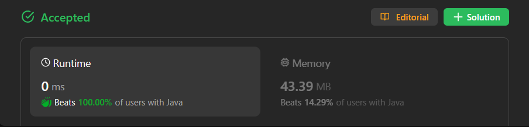

# ✅ Beats 100% - C++/Java/Python/JS - Chebyshev distance - Visualized Too

**Author:** lancertech6
**Votes:** 77
**Link:** [https://leetcode.com/problems/minimum-time-visiting-all-points/solutions/4355634/](https://leetcode.com/problems/minimum-time-visiting-all-points/solutions/4355634/)

---



# YouTube Video Explanation:

[https://youtu.be/eVrCF1KE9p8](https://youtu.be/eVrCF1KE9p8)
<!-- **If you want a video for this question please write in the comments** -->

**\uD83D\uDD25 Please like, share, and subscribe to support our channel's mission of making complex concepts easy to understand.**

Subscribe Link: https://www.youtube.com/@leetlogics/?sub_confirmation=1

*Current Subscribers: 553*
*Subscribe Goal: 600 Subscribers*

---

# Example Explanation
Let's create a step-by-step explanation using tables.

**Step 1: Define Helper Function**

| Function Name | Parameters | Description |
| --- | --- | --- |
| `toTime` | `from` (int[]), `to` (int[]) | Calculates time to move from one point to another. Returns max(abs(xDiff), abs(yDiff)). |

**Step 2: Initialize Variables**

| Variable | Description |
| --- | --- |
| `time` | Accumulated time for traversal, initialized to 0. |

**Step 3: Traverse Points**

| Iteration | Current Points | Time Calculation | Accumulated Time |
| --- | --- | --- | --- |
| Initial | - | - | 0 |
| 1st | [1,1] to [3,4] | max(abs(1-3), abs(1-4)) = 3 | 3 |
| 2nd | [3,4] to [-1,0] | max(abs(3-(-1)), abs(4-0)) = 4 | 7 |

**Step 4: Result**

The accumulated time after traversing all points is 7, which is the minimum time to visit all points.

---

# Intuition
<!-- Describe your first thoughts on how to solve this problem. -->
The problem essentially asks for the minimum time to traverse a sequence of points on a 2D plane following specific movement rules. We can calculate the time it takes to move between consecutive points and sum these times to get the total time.

# Approach
<!-- Describe your approach to solving the problem. -->
1. We define a helper function `toTime` that calculates the time to move from one point to another. The time is the maximum of the absolute differences in x and y coordinates.
2. We iterate through the points, starting from the second point (index 1), and accumulate the time using the `toTime` function.
3. The final accumulated time is the answer.

# Complexity
- The time complexity is O(n), where n is the number of points, as we iterate through the points once.
- The space complexity is O(1) as we use a constant amount of extra space.

# Code
```Java []
class Solution {
    
    public int toTime(int[] from, int[] to) {
        int xDiff = Math.abs(from[0] - to[0]);
        int yDiff = Math.abs(from[1] - to[1]);
        
        return Math.max(xDiff, yDiff);
    }
    
    public int minTimeToVisitAllPoints(int[][] points) {
        int time = 0;
    
        for (int i = 1; i < points.length; i++) {
            time += toTime(points[i - 1], points[i]);
        }
        
        return time;
    }
}
```
```C++ []
class Solution {
public:
    int toTime(std::vector<int>& from, std::vector<int>& to) {
        int xDiff = std::abs(from[0] - to[0]);
        int yDiff = std::abs(from[1] - to[1]);
        
        return std::max(xDiff, yDiff);
    }

    int minTimeToVisitAllPoints(std::vector<std::vector<int>>& points) {
        int time = 0;

        for (int i = 1; i < points.size(); i++) {
            time += toTime(points[i - 1], points[i]);
        }

        return time;
    }
};
```
```Python []
class Solution(object):
    def toTime(self, from_point, to_point):
        x_diff = abs(from_point[0] - to_point[0])
        y_diff = abs(from_point[1] - to_point[1])

        return max(x_diff, y_diff)

    def minTimeToVisitAllPoints(self, points):
        time = 0

        for i in range(1, len(points)):
            time += self.toTime(points[i - 1], points[i])

        return time
        
```
```JavaScript []
var toTime = function(from, to) {
    var xDiff = Math.abs(from[0] - to[0]);
    var yDiff = Math.abs(from[1] - to[1]);

    return Math.max(xDiff, yDiff);
};
var minTimeToVisitAllPoints = function(points) {
    var time = 0;

    for (var i = 1; i < points.length; i++) {
        time += toTime(points[i - 1], points[i]);
    }

    return time;
};
```

