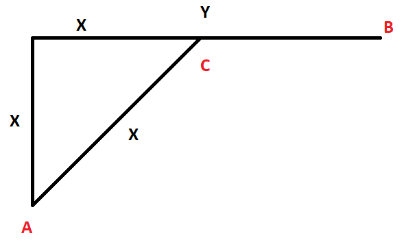

# Rust/Python linear solution with explanation of the distance

**Author:** SalvadorDali
**Votes:** 1
**Link:** [https://leetcode.com/problems/minimum-time-visiting-all-points/solutions/4358919/](https://leetcode.com/problems/minimum-time-visiting-all-points/solutions/4358919/)

---

# Intuition

The hardest part here is to understand how to find the distance between points. Once you found this you just iterate over all pairs of points and sum the distances.

So now lets find the distance. Lets look at this situation:



We need to come from A to B. The fastest part is to move from A -> C (cost is `x`) and from C -> B (cost is `y - x`). 

So the total cost is `y` where `y` is the biggest cathetus of your triangle. So you need to find two cathetus and find their maximum: `max(abs(x1 - x2), abs(y1 - y2))`

# Complexity
- Time complexity: $O(n)$
- Space complexity: $O(1)$

# Code
```Rust []
impl Solution {
  pub fn min_time_to_visit_all_points(points: Vec<Vec<i32>>) -> i32 {
    let mut res = 0;
    let (mut prev_x, mut prev_y) = (points[0][0], points[0][1]);

    for i in 1 .. points.len() {
      let (x, y) = (points[i][0], points[i][1]);
      res += (x - prev_x).abs().max((y - prev_y).abs());
      prev_x = x;
      prev_y = y;
    }

    return res;
  }
}
```
```python []
class Solution:
  def distance(self, x1, y1, x2, y2):
    return max(abs(x1 - x2), abs(y1 - y2))
    
    
  def minTimeToVisitAllPoints(self, points: List[List[int]]) -> int:
    res = 0
    
    for i in range(len(points) - 1):
      (x1, y1), (x2, y2) = points[i], points[i + 1]
      res += self.distance(x1, y1, x2, y2)
    
    return res
```
