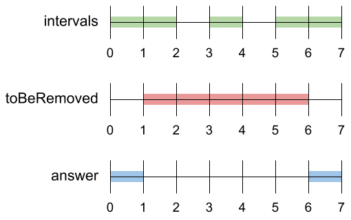
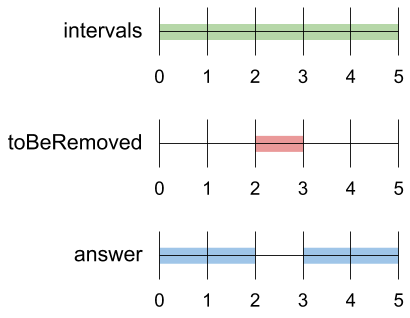

# [1272. Remove Interval](https://leetcode.com/problems/remove-interval/)

| Category | Difficulty | Likes | Dislikes |
| :------: | :--------: | :---: | :------: |
| Algorithms | Medium | 479 | 36 |

**Tags:** [`array`](https://leetcode.com/tag/array)

**Companies:** `google`

## Description

A set of real numbers can be represented as the union of several disjoint intervals, where each interval is in the form `[a, b)`. A real number `x` is in the set if one of its intervals `[a, b)` contains `x` (i.e. `a <= x < b`).

You are given a **sorted** list of disjoint intervals `intervals` representing a set of real numbers as described above, where `intervals[i] = [a_i, b_i]` represents the interval `[a_i, b_i)`. You are also given another interval `toBeRemoved`.

Return *the set of real numbers with the interval *`toBeRemoved`* **removed** from** *`intervals`*. In other words, return the set of real numbers such that every *`x`* in the set is in *`intervals`* but **not** in *`toBeRemoved`*. Your answer should be a **sorted** list of disjoint intervals as described above.*

 

**Example 1:**


```

Input: intervals = [[0,2],[3,4],[5,7]], toBeRemoved = [1,6]
Output: [[0,1],[6,7]]

```

**Example 2:**


```

Input: intervals = [[0,5]], toBeRemoved = [2,3]
Output: [[0,2],[3,5]]

```

**Example 3:**

```

Input: intervals = [[-5,-4],[-3,-2],[1,2],[3,5],[8,9]], toBeRemoved = [-1,4]
Output: [[-5,-4],[-3,-2],[4,5],[8,9]]

```

 

**Constraints:**

	- `1 <= intervals.length <= 10^4`

	- `-10^9 <= a_i < b_i <= 10^9`

---

**Links:** [Submissions](https://leetcode.com/problems/remove-interval/) | [Solutions](https://leetcode.com/problems/remove-interval/)
