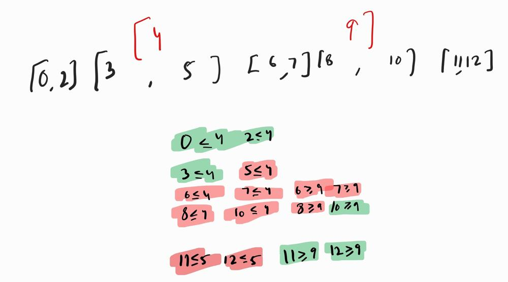

# C++ | Free Left | Free Right || Partial Left or Partial Right || With Image

**Author:** Akshatkamboj37
**Votes:** 0
**Link:** [https://leetcode.com/problems/remove-interval/solutions/5535016/](https://leetcode.com/problems/remove-interval/solutions/5535016/)

---

```
Input
[[0,2],[3,5],[6,7],[8,10],[11,12]]
[4,9]

Output
[[0,2],[3,4],[9,10],[11,12]]
```

```
class Solution {
public:
    vector<vector<int>> removeInterval(vector<vector<int>>& intervals, vector<int>& toBeRemoved) {
        vector<vector<int>> res;
        int x = toBeRemoved[0], y = toBeRemoved[1];
        for(auto i:intervals){
            // free left or free right 
            if(i[1]<=x || i[0]>=y)
                res.push_back(i);
            else{
                //Partial Left
                if(i[0]<x)
                    res.push_back({i[0],x});
                // Partial right
                if(i[1]>y)
                    res.push_back({y,i[1]});
            }
        }
        return res;
    }
};
```


