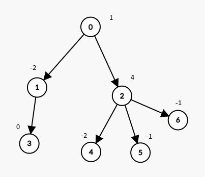

# [1273. Delete Tree Nodes](https://leetcode.com/problems/delete-tree-nodes/)

| Category | Difficulty | Likes | Dislikes |
| :------: | :--------: | :---: | :------: |
| Algorithms | Medium | 235 | 66 |

**Tags:** [`array`](https://leetcode.com/tag/array), [`tree`](https://leetcode.com/tag/tree), [`depth-first-search`](https://leetcode.com/tag/depth-first-search), [`breadth-first-search`](https://leetcode.com/tag/breadth-first-search)

**Companies:** `microsoft`

## Description

A tree rooted at node 0 is given as follows:

	- The number of nodes is `nodes`;

	- The value of the `i^th` node is `value[i]`;

	- The parent of the `i^th` node is `parent[i]`.

Remove every subtree whose sum of values of nodes is zero.

Return *the number of the remaining nodes in the tree*.

 

**Example 1:**


```

Input: nodes = 7, parent = [-1,0,0,1,2,2,2], value = [1,-2,4,0,-2,-1,-1]
Output: 2

```

**Example 2:**

```

Input: nodes = 7, parent = [-1,0,0,1,2,2,2], value = [1,-2,4,0,-2,-1,-2]
Output: 6

```

 

**Constraints:**

	- `1 <= nodes <= 10^4`

	- `parent.length == nodes`

	- `0 <= parent[i] <= nodes - 1`

	- `parent[0] == -1` which indicates that `0` is the root.

	- `value.length == nodes`

	- `-10^5 <= value[i] <= 10^5`

	- The given input is **guaranteed** to represent a **valid tree**.

---

**Links:** [Submissions](https://leetcode.com/problems/delete-tree-nodes/) | [Solutions](https://leetcode.com/problems/delete-tree-nodes/)
