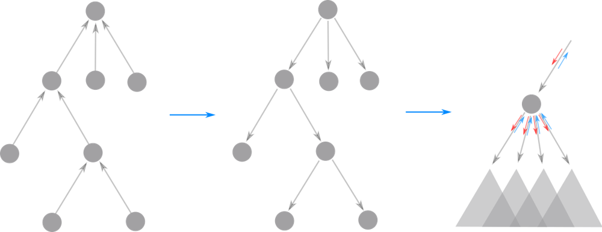
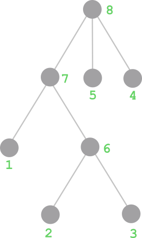

# 2 solutions ^^

**Author:** andrii_khlevniuk
**Votes:** 0
**Link:** [https://leetcode.com/problems/delete-tree-nodes/solutions/2881422/](https://leetcode.com/problems/delete-tree-nodes/solutions/2881422/)

---

**Solution 1**
**dfs / postorder traversal (visit all children first than consider the root)**



```
class Solution 
{
    unordered_map<int, vector<int>> c;
    int dfs(int r, vector<int>& v)
    {
        int n{};
        for_each(begin(c[r]), end(c[r]), [&](auto & i){ n+=dfs(i, v); v[r]+=v[i]; });
        return v[r] ? n+1 : 0;
    }
public:
    int deleteTreeNodes(int n, vector<int>& p, vector<int>& v)
    {
        for(int i{}; i<n; ++i) c[p[i]].push_back(i);
        return dfs(c[-1][0], v);
    }
};
```
**Notation:**
`c` - children;
`r` - root of the subtree;

**Solution2**
**topological sort / Kahn's algorithm**



```
int deleteTreeNodes(int n, vector<int>& p, vector<int>& v)
{
	vector e(n, 0);
	for(int i{}; i<n; ++i)
		if(p[i]>-1) e[p[i]]++;

	stack<int> s;
	for(int i{}; i<n; ++i)
		if(!e[i]) s.push(i);

	for(vector N(n,1); !empty(s); )
	{
		auto t = s.top(); s.pop();
		if(!v[t]) n-=N[t], N[t]=0;
		if(p[t]>-1)
		{
			v[p[t]] += v[t];
			N[p[t]] += N[t];
			if(!--e[p[t]]) s.push(p[t]);
		}
	}
	return n;
}
```
**Notation:**
`e` - number of edges;
`N` - number of nodes in the subtree.