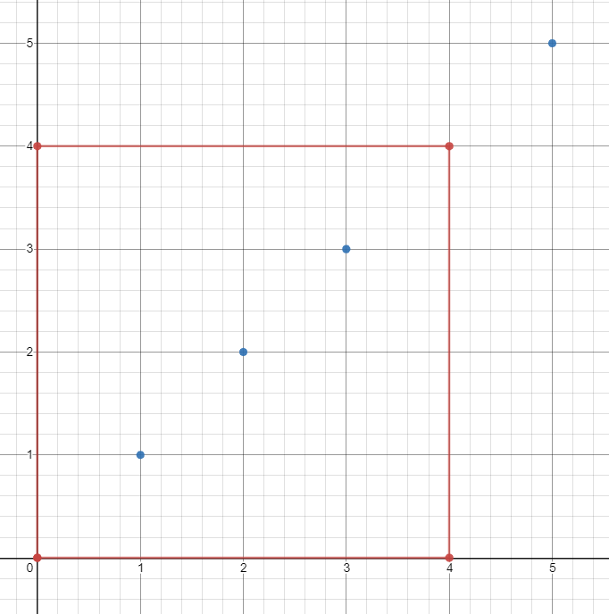

# [1274. Number of Ships in a Rectangle](https://leetcode.com/problems/number-of-ships-in-a-rectangle/)

| Category | Difficulty | Likes | Dislikes |
| :------: | :--------: | :---: | :------: |
| Algorithms | Hard | 536 | 68 |

**Tags:** [`array`](https://leetcode.com/tag/array), [`divide-and-conquer`](https://leetcode.com/tag/divide-and-conquer), [`interactive`](https://leetcode.com/tag/interactive)

**Companies:** `bloomberg`

## Description

*(This problem is an **interactive problem**.)*

Each ship is located at an integer point on the sea represented by a cartesian plane, and each integer point may contain at most 1 ship.

You have a function `Sea.hasShips(topRight, bottomLeft)` which takes two points as arguments and returns `true` If there is at least one ship in the rectangle represented by the two points, including on the boundary.

Given two points: the top right and bottom left corners of a rectangle, return the number of ships present in that rectangle. It is guaranteed that there are **at most 10 ships** in that rectangle.

Submissions making **more than 400 calls** to `hasShips` will be judged *Wrong Answer*. Also, any solutions that attempt to circumvent the judge will result in disqualification.

 

**Example :**


```

Input: 
ships = [[1,1],[2,2],[3,3],[5,5]], topRight = [4,4], bottomLeft = [0,0]
Output: 3
Explanation: From [0,0] to [4,4] we can count 3 ships within the range.

```

**Example 2:**

```

Input: ans = [[1,1],[2,2],[3,3]], topRight = [1000,1000], bottomLeft = [0,0]
Output: 3

```

 

**Constraints:**

	- On the input `ships` is only given to initialize the map internally. You must solve this problem "blindfolded". In other words, you must find the answer using the given `hasShips` API, without knowing the `ships` position.

	- `0 <= bottomLeft[0] <= topRight[0] <= 1000`

	- `0 <= bottomLeft[1] <= topRight[1] <= 1000`

	- `topRight != bottomLeft`

---

**Links:** [Submissions](https://leetcode.com/problems/number-of-ships-in-a-rectangle/) | [Solutions](https://leetcode.com/problems/number-of-ships-in-a-rectangle/)
