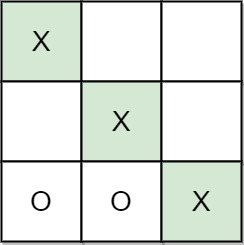
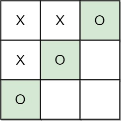
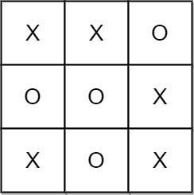

# [1275. Find Winner on a Tic Tac Toe Game](https://leetcode.com/problems/find-winner-on-a-tic-tac-toe-game/)

| Category | Difficulty | Likes | Dislikes |
| :------: | :--------: | :---: | :------: |
| Algorithms | Easy | 1612 | 367 |

**Tags:** [`array`](https://leetcode.com/tag/array), [`hash-table`](https://leetcode.com/tag/hash-table), [`matrix`](https://leetcode.com/tag/matrix), [`simulation`](https://leetcode.com/tag/simulation)

**Companies:** `facebook`, `amazon`, `microsoft`, `google`, `apple`, `bloomberg`, `zoho`

## Description

**Tic-tac-toe** is played by two players `A` and `B` on a `3 x 3` grid. The rules of Tic-Tac-Toe are:

	- Players take turns placing characters into empty squares `' '`.

	- The first player `A` always places `'X'` characters, while the second player `B` always places `'O'` characters.

	- `'X'` and `'O'` characters are always placed into empty squares, never on filled ones.

	- The game ends when there are **three** of the same (non-empty) character filling any row, column, or diagonal.

	- The game also ends if all squares are non-empty.

	- No more moves can be played if the game is over.

Given a 2D integer array `moves` where `moves[i] = [row_i, col_i]` indicates that the `i^th` move will be played on `grid[row_i][col_i]`. return *the winner of the game if it exists* (`A` or `B`). In case the game ends in a draw return `"Draw"`. If there are still movements to play return `"Pending"`.

You can assume that `moves` is valid (i.e., it follows the rules of **Tic-Tac-Toe**), the grid is initially empty, and `A` will play first.

 

**Example 1:**


```

Input: moves = [[0,0],[2,0],[1,1],[2,1],[2,2]]
Output: &quot;A&quot;
Explanation: A wins, they always play first.

```

**Example 2:**


```

Input: moves = [[0,0],[1,1],[0,1],[0,2],[1,0],[2,0]]
Output: &quot;B&quot;
Explanation: B wins.

```

**Example 3:**


```

Input: moves = [[0,0],[1,1],[2,0],[1,0],[1,2],[2,1],[0,1],[0,2],[2,2]]
Output: &quot;Draw&quot;
Explanation: The game ends in a draw since there are no moves to make.

```

 

**Constraints:**

	- `1 <= moves.length <= 9`

	- `moves[i].length == 2`

	- `0 <= row_i, col_i <= 2`

	- There are no repeated elements on `moves`.

	- `moves` follow the rules of tic tac toe.

---

**Links:** [Submissions](https://leetcode.com/problems/find-winner-on-a-tic-tac-toe-game/) | [Solutions](https://leetcode.com/problems/find-winner-on-a-tic-tac-toe-game/)
