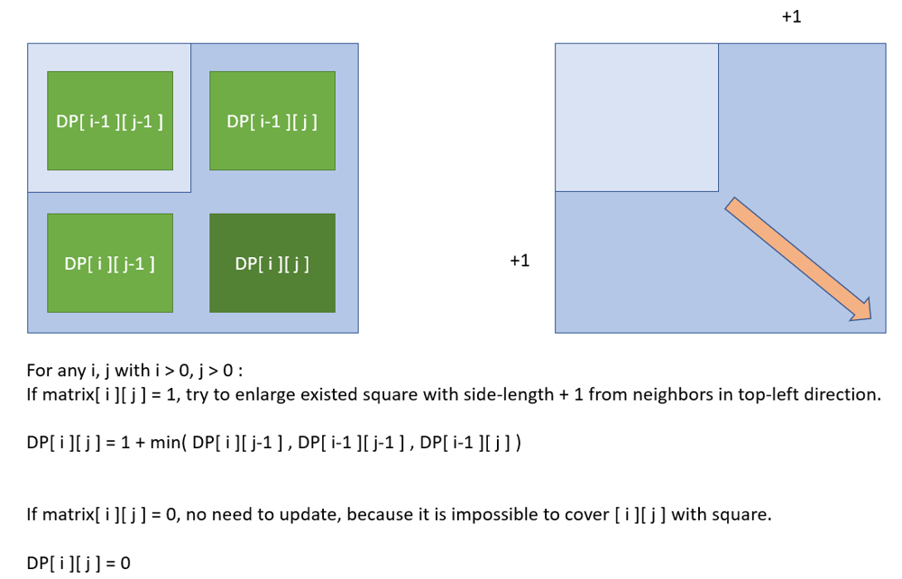
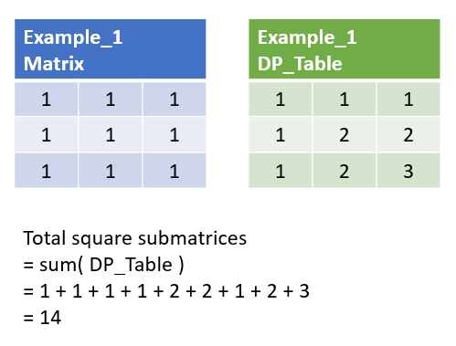
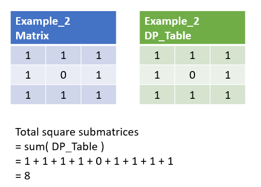
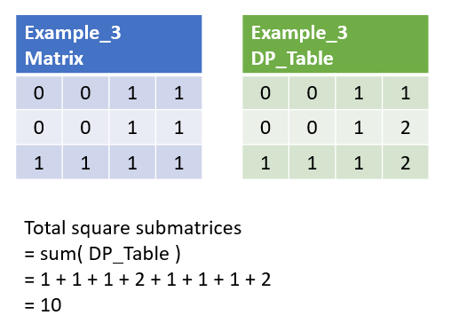

# Python/JS/C++ O( m*n ) sol by DP [w/ Demo]

**Author:** brianchiang_tw
**Votes:** 62
**Link:** [https://leetcode.com/problems/count-square-submatrices-with-all-ones/solutions/518072/](https://leetcode.com/problems/count-square-submatrices-with-all-ones/solutions/518072/)

---

Python O( m * n ) sol. by dynamic programming

---

**Hint** & **Algorithm**:

Think of the **dynamic programming** technique.

Like what we did in [Leetcode #221 Maximal Square](https://leetcode.com/problems/maximal-square/), 
we had a dynamic programming approach to find the **maximum side length of square** for each matrix cell.

Similarly, this time, we can use same technique again.

First, **find** the **max side length of square for each matrix cell** by dynamic programming with optimal substructure (this will be described later).

Second, compute the **summation of dynamic programming table**, and we get the **number of all square submatrices** of given input matrix.

---

**Optimal substructure**: for maximum side length of square, in dynamic programming.

Let DP[ *i* ][ *j* ] denote the max side length, and **[ *i* ][ *j* ]** as the **anchor point** (i.e., bottom-right point) of square

For any i, j with i > 0 and j > 0:
DP[ *i* ][ *j* ] = 1 + min( DP[ *i* ][ *j* - 1 ] , DP[ *i* - 1 ][ *j* - 1 ] , DP[ *i* ][ *j* - 1 ] ), if matrix[ *i* ][ *j* ] = 1

DP[ *i* ][ *j* ] = matrix[ *i* ][ *j* ] = 0, Otherwise.

---

**Abstract model** for update with optimal substructure:




---

**Demo**:



---



---



---

**Implementation**:
Out-of-place update, with O( m * n ) space, O( m * n ) time

Python:

```
from itertools import chain

class Solution:
    def countSquares(self, matrix: List[List[int]]) -> int:
        
        # DP[y][x] denotes the largest edge length of square, whose bottom right point is [y][x]
        dp_table = [ list(row) for row in matrix ]
        
        h, w = len(matrix), len(matrix[0])
        
        # Visit each matrix cell, except for row_0 and column_0
        for y in range(1, h):
            for x in range(1, w):
                
                if matrix[y][x]:
                    
                    # Make sure matrix[y][x] is 1, thus square can cover current matrix cell.
                    # Update largest edge length of sqaure, whose bottom right point is [y][x]
                    
                    dp_table[y][x] = 1 + min(dp_table[y][x-1],dp_table[y-1][x-1],dp_table[y-1][x])
        
        return sum( chain(*dp_table) )
```

---

Javascript:

```
var countSquares = function(matrix) {
    
    
    // DP[y][x] denotes the largest edge length of square, whose bootom right point is [y][x]
    
    // shallow copy of matrix
    dp_table = [...matrix];
    
    let [h, w]=[matrix.length, matrix[0].length];
    
    // counter of square submatrices with all ones
    let counter = 0;
    
    // Visit each matrix cell, except for row_0 and column_0
    for( let y=0 ; y < h ; y++){
        for( let x=0 ; x < w ; x++){
            
            if( y && x && matrix[y][x] ){
                // Make sure matrix[y][x] is 1, thus square can cover current matrix cell.
                // Update largest edge length of sqaure, whose bottom right point is [y][x]
                dp_table[y][x] = 1 + Math.min( dp_table[y][x-1], dp_table[y-1][x],dp_table[y-1][x-1] );
            } 
            
            counter += matrix[y][x];
        }
    }
    
    return counter;

};

```

---

C++:

```
class Solution {
public:
    int countSquares(vector<vector<int>>& matrix) {
        
         // DP[y][x] denotes the largest edge length of square, whose bootom right point is [y][x]
        vector< vector<int> > dp_table(matrix);
        
        int h=matrix.size(), w=matrix[0].size();
        
        // counter of square submatrices with all ones
        int counter = 0;
        
        // Visit each matrix cell, except for row_0 and column_0
        for(size_t y = 0 ; y < h ; y++){
            for(size_t x = 0 ; x < w ; x++){
                
                if( y && x && dp_table[y][x] ){
                    
                    // Make sure matrix[y][x] is 1, thus square can cover current matrix cell.
                    // Update largest edge length of sqaure, whose bottom right point is [y][x]
                    dp_table[y][x] = 1 + min( { dp_table[y][x-1], dp_table[y-1][x],dp_table[y-1][x-1] }  );
                }
                
                counter += dp_table[y][x];
            }
        }
        
        return counter;
    }
};

```

---

Advanced **follow-up**:

Since the update direction is from top to bottom, and from left to right in row-major,
we can update in-place in matrix without losing needed informaion.

Therefore, we can reduce space cost from O( m * n ) down to O( 1 ) by in-place update.

---
**Implementation**:
In-place update, with O( 1 ) space, O( m * n ) time

Python:

```
from itertools import chain

class Solution:
    def countSquares(self, matrix: List[List[int]]) -> int:
        
        # DP[y][x] denotes the largest edge length of square, whose bootom right point is [y][x]
        dp_table = matrix
        
        h, w = len(matrix), len(matrix[0])
        
        # Visit each matrix cell, except for row_0 and column_0
        for y in range(1, h):
            for x in range(1, w):
                
                if matrix[y][x]:
                    
                    # Make sure matrix[y][x] is 1, thus square can cover current matrix cell.
                    # Update largest edge length of sqaure, whose bottom right point is [y][x]
                    
                    dp_table[y][x] = 1 + min(dp_table[y][x-1],dp_table[y-1][x-1],dp_table[y-1][x])
        
        return sum( chain(*dp_table) )
        
```

---

Javascript:

```
var countSquares = function(matrix) {
    
    
    // DP[y][x] denotes the largest edge length of square, whose bootom right point is [y][x]
    let dp_table = matrix;
    
    let [h, w]=[matrix.length, matrix[0].length];
    
    // counter of square submatrices with all ones
    let counter = 0;
    
    // Visit each matrix cell, except for row_0 and column_0
    for( let y=0 ; y < h ; y++){
        for( let x=0 ; x < w ; x++){
            
            if( y && x && matrix[y][x] ){
                // Make sure matrix[y][x] is 1, thus square can cover current matrix cell.
                // Update largest edge length of sqaure, whose bottom right point is [y][x]
                dp_table[y][x] = 1 + Math.min( dp_table[y][x-1], dp_table[y-1][x],dp_table[y-1][x-1] );
            } 
            
            counter += dp_table[y][x];
        }
    }

    return counter;

};
```

---

C++

```
class Solution {
public:
    int countSquares(vector<vector<int>>& matrix) {
        
         // DP[y][x] denotes the largest edge length of square, whose bootom right point is [y][x]
        auto& dp_table = matrix;;
        
        int h=matrix.size(), w=matrix[0].size();
        
        // counter of square submatrices with all ones
        int counter = 0;
        
        // Visit each matrix cell, except for row_0 and column_0
        for(size_t y = 0 ; y < h ; y++){
            for(size_t x = 0 ; x < w ; x++){
                
                if( y && x && dp_table[y][x] ){
                    
                    // Make sure matrix[y][x] is 1, thus square can cover current matrix cell.
                    // Update largest edge length of sqaure, whose bottom right point is [y][x]
                    dp_table[y][x] = 1 + min( { dp_table[y][x-1], dp_table[y-1][x],dp_table[y-1][x-1] }  );
                }
                
                counter += dp_table[y][x];
            }
        }
        
        return counter;
    }
};
```

---

Related leetcode challenge:

[Leetcode #221 Maximal Square](https://leetcode.com/problems/maximal-square/)

[Leetcode #304 Range Sum Query 2D - Immutable](https://leetcode.com/problems/range-sum-query-2d-immutable/)

[Leetcode #661 Image Smoother](https://leetcode.com/problems/image-smoother/)

[Leetcode #1314 Matrix Block Sum](https://leetcode.com/problems/matrix-block-sum/)

---

Reference:

[1] [Wiki: Dynamic programming algorithm framework](https://en.wikipedia.org/wiki/Dynamic_programming#Examples:_Computer_algorithms)

[2] [GfG: Introduction to dynamic programming](https://bit.ly/3bSY3hP)

[3] [Python official docs about list comprehension](https://docs.python.org/3.8/tutorial/datastructures.html?highlight=list%20comprehension#list-comprehensions)

[4] [Python official docs about itertools.chain()](https://docs.python.org/3.8/library/itertools.html#itertools.chain)

---

Thanks for your reading.

Wish you have a nice day.

Meow~\uD83D\uDE3A