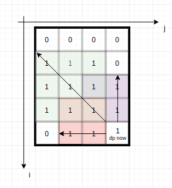

# DP with figure explanation

**Author:** migeater
**Votes:** 173
**Link:** [https://leetcode.com/problems/count-square-submatrices-with-all-ones/solutions/441620/](https://leetcode.com/problems/count-square-submatrices-with-all-ones/solutions/441620/)

---



----
----
## ## Explanation

 `dp[i][j]` represent edge length of the biggest square whose lower right corner element is `matrix[i][j]`. Also there are `dp[i][j]` squares whose lower right corner element are `matrix[i][j]`. The answer of count-square-submatrices-with-all-ones is sum of all `dp[i][j]`.

As Figure, **the square edge length** ( whose lower right corner element is `matrix[i][j]` ) is not greater than  `the minimum of three arrows + 1`. 

Fortunately it can be equal to when `matrix[i][j]==1`. On this condition `dp[i][j]=the minimum of three arrows + 1`;

And when `matrix[i][j]==0` , `dp[i][j]=0`.

So

```py
if matrix[i][j]==1 : 
    if i!=0 and j!=0: 
        dp[i][j] = min(dp[i-1][j], dp[i][j-1], dp[i-1][j-1])+1
    else: 
        dp[i][j] = 0 + 1
else:
    dp[i][j] = 0
```

In the 3rd line, each `dp[i][j]` is reused for 3 times.
If you think there are too many coincidences, please read next paragraph.
Now we can write a top-down recursive algorithm:

----

### ### A top-down DP

time O(m*n), space O(m*n)

```py
class Solution(object):
    def countSquares(self, matrix):
        m, n = len(matrix), len(matrix[0])

        @cache # memorize
        def dp(i,j):
            if matrix[i][j]==1 : 
                if i!=0 and j!=0:
                    return min(dp(i-1,j), dp(i,j-1), dp(i-1,j-1))+1
                else:
                    return 0+1
            else:
                return 0
        
        return sum(dp(i,j) for i in range(m) for j in range(n))
```

After wrtie this we know the call order of the dp function, then we can change it to bottom-up, make sure each dp(i,j) is calculated before dp(i,j+1) and dp(i+1,j) and dp(i+1,j+1). That's the classic iteration order: from left to right and from up to down.

---

### ### A bottom-up DP

time O(m*n), space O(m*n)

Here in order to easily process border condition, use `dp[i+1][j+1]` save edge length of the biggest square whose lower right corner element is `matrix[i][j]`.

```py
class Solution(object):
    def countSquares(self, matrix):
        m, n = len(matrix), len(matrix[0])
        dp = [[0] * (n+1) for _ in range(m+1)] # new int[m+1][n+1];
        ans = 0
        for i in range(m):
            for j in range(n):
                if matrix[i][j]:
                    dp[i+1][j+1] = min(dp[i][j+1], dp[i+1][j], dp[i][j]) + 1
                    ans += dp[i+1][j+1]
        return ans
```

----
----

## ## P.S. 

The same problem: https://leetcode.com/problems/maximal-square/
similar: https://leetcode.com/problems/minimum-path-sum/
extend: https://leetcode.com/problems/count-fertile-pyramids-in-a-land
harder(still can use one dp): https://codeforces.com/contest/1393/problem/D

More about top-down and bottom-up 
https://leetcode.com/explore/learn/card/recursion-i/
https://leetcode.com/explore/learn/card/recursion-ii/
