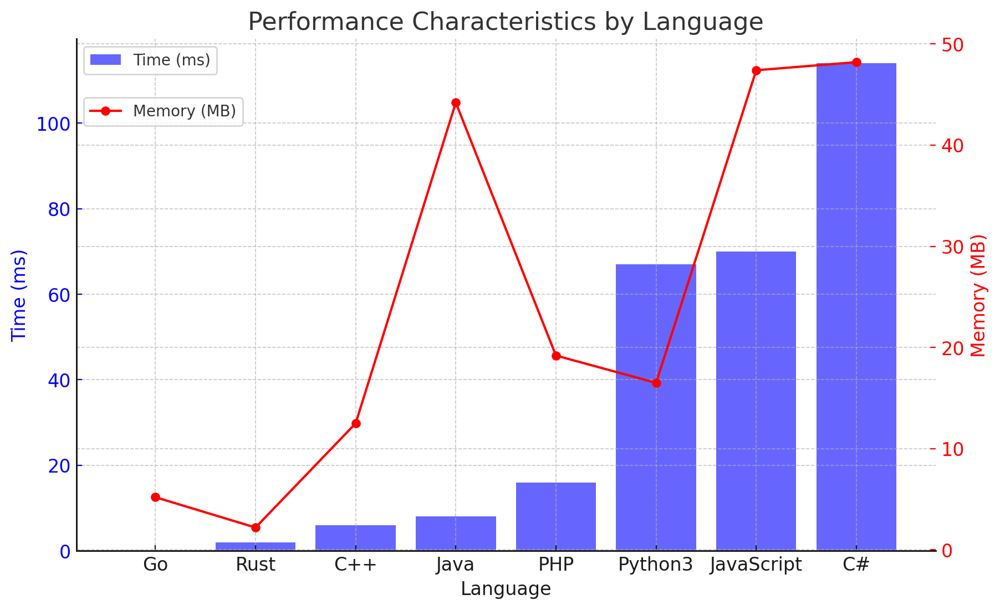

# ✅ 98.55% Greedy & Hash Table

**Author:** vanAmsen
**Votes:** 92
**Link:** [https://leetcode.com/problems/group-the-people-given-the-group-size-they-belong-to/solutions/4028895/](https://leetcode.com/problems/group-the-people-given-the-group-size-they-belong-to/solutions/4028895/)

---

# Comprehensive Guide to Solving "Group the People Given the Group Size They Belong To": Hash Table and Greedy Approaches

## Introduction & Problem Statement

Hello, coding enthusiasts! Today, we're diving into a fascinating problem that deals with grouping people based on certain constraints\u2014aptly named **Group the People Given the Group Size They Belong To**. You are given an array `groupSizes`, where `groupSizes[i]` represents the size of the group that person `i` belongs to. Your task is to return a list of groups such that each person `i` is in a group of size `groupSizes[i]`.

## Key Concepts and Constraints

### What Makes this Problem Unique?

1. **Grouping**:
   Each person is associated with a group size, and they should be grouped accordingly. For example, if `groupSizes[3] = 2`, person 3 must belong to a group of size 2.
   
2. **Multiplicity**:
   There can be multiple groups of the same size. For example, if there are four people with `groupSizes = [2, 2, 2, 2]`, they can be split into two groups of size 2.

3. **Constraints**:
   - The length of `groupSizes`, $$ n $$, is between 1 and 500.
   - The group size for any individual, $$ groupSizes[i] $$, is between 1 and $$ n $$.

---

## Live Coding + Explain + Hash Table
https://youtu.be/hxvHSYMGJ-4?si=VWBoWiD0JgLOFr3r

# Strategies to Tackle the Problem:

## Greedy Algorithm: Grouping on the Fly

### What is a Greedy Algorithm?

Imagine you're putting together a puzzle. Instead of meticulously planning how all the pieces will fit, you start by connecting any two that match. You proceed in this manner, one piece at a time, until the puzzle is complete. This is the essence of a Greedy Algorithm\u2014you make the most logical or straightforward choice at each step without worrying about future implications.

## Detailed Steps

### Step 1: Initialize Temporary Storage (Hash Table)

- **Why use a Hash Table?**  
  A hash table allows you to store and look up group sizes and corresponding members efficiently. For each group size, you'll keep a list of members who should belong to groups of that size.

### Step 2: Iterate and Group

- **Why iterate through `groupSizes`?**  
  For each person $$ i $$ with a group size $$ \	ext{groupSizes}[i] $$, you'll add them to the temporary list associated with that group size in the hash table.

- **When to form a group?**  
  Whenever the temporary list reaches the desired group size, you'll pull those members out and form a group, clearing that list for that size in the hash table.

### Step 3: Return the Groups

- **What is the output?**  
  Once you've iterated through all people, the groups will be formed, and you can return them as a list of lists.

## Time and Space Complexity

- **Time Complexity**: The Greedy Algorithm runs in linear time, $$ O(n) $$, as you only iterate through the list once.

- **Space Complexity**: The space complexity is also $$ O(n) $$, as the hash table stores all the group members before they are grouped.

# Code
``` Python []
class Solution:
    def groupThePeople(self, groupSizes: List[int]) -> List[List[int]]:
        groups = {}
        result = []
        
        for i, size in enumerate(groupSizes):
            if size not in groups:
                groups[size] = []
            groups[size].append(i)
            
            if len(groups[size]) == size:
                result.append(groups[size])
                groups[size] = []
                
        return result

```
``` Go []
func groupThePeople(groupSizes []int) [][]int {
    temp_group := make(map[int][]int)
    var result [][]int
    
    for i, size := range groupSizes {
        temp_group[size] = append(temp_group[size], i)
        
        if len(temp_group[size]) == size {
            result = append(result, temp_group[size])
            temp_group[size] = []int{}
        }
    }
    return result
}
```
``` Rust []
use std::collections::HashMap;

impl Solution {
    pub fn group_the_people(group_sizes: Vec<i32>) -> Vec<Vec<i32>> {
        let mut temp_group: HashMap<i32, Vec<i32>> = HashMap::new();
        let mut result: Vec<Vec<i32>> = Vec::new();
        
        for (i, &size) in group_sizes.iter().enumerate() {
            temp_group.entry(size).or_insert(Vec::new()).push(i as i32);
            
            if temp_group[&size].len() == size as usize {
                result.push(temp_group[&size].clone());
                temp_group.insert(size, Vec::new());
            }
        }
        result
    }
}
```
``` C++ []
class Solution {
public:
    vector<vector<int>> groupThePeople(vector<int>& groupSizes) {
        unordered_map<int, vector<int>> temp_group;
        vector<vector<int>> result;
        
        for(int i = 0; i < groupSizes.size(); ++i) {
            int size = groupSizes[i];
            temp_group[size].push_back(i);
            
            if(temp_group[size].size() == size) {
                result.push_back(temp_group[size]);
                temp_group[size].clear();
            }
        }
        return result;
    }
};
```
``` Java []
public class Solution {
    public List<List<Integer>> groupThePeople(int[] groupSizes) {
        HashMap<Integer, List<Integer>> temp_group = new HashMap<>();
        List<List<Integer>> result = new ArrayList<>();
        
        for(int i = 0; i < groupSizes.length; i++) {
            int size = groupSizes[i];
            temp_group.putIfAbsent(size, new ArrayList<>());
            temp_group.get(size).add(i);
            
            if(temp_group.get(size).size() == size) {
                result.add(new ArrayList<>(temp_group.get(size)));
                temp_group.get(size).clear();
            }
        }
        return result;
    }
}
```
``` C# []
public class Solution {
    public IList<IList<int>> GroupThePeople(int[] groupSizes) {
        Dictionary<int, List<int>> temp_group = new Dictionary<int, List<int>>();
        IList<IList<int>> result = new List<IList<int>>();
        
        for(int i = 0; i < groupSizes.Length; i++) {
            int size = groupSizes[i];
            if (!temp_group.ContainsKey(size)) {
                temp_group[size] = new List<int>();
            }
            temp_group[size].Add(i);
            
            if(temp_group[size].Count == size) {
                result.Add(new List<int>(temp_group[size]));
                temp_group[size].Clear();
            }
        }
        return result;
    }
}
```
``` JavaScript []
/**
 * @param {number[]} groupSizes
 * @return {number[][]}
 */
var groupThePeople = function(groupSizes) {
    const temp_group = {};
    const result = [];
    
    for(let i = 0; i < groupSizes.length; i++) {
        const size = groupSizes[i];
        if (!temp_group[size]) {
            temp_group[size] = [];
        }
        temp_group[size].push(i);
        
        if(temp_group[size].length === size) {
            result.push([...temp_group[size]]);
            temp_group[size] = [];
        }
    }
    return result;
}
```
``` PHP []
class Solution {

    /**
     * @param Integer[] $groupSizes
     * @return Integer[][]
     */
    function groupThePeople($groupSizes) {
        $temp_group = [];
        $result = [];
        
        foreach($groupSizes as $i => $size) {
            if (!isset($temp_group[$size])) {
                $temp_group[$size] = [];
            }
            $temp_group[$size][] = $i;
            
            if(count($temp_group[$size]) === $size) {
                $result[] = $temp_group[$size];
                $temp_group[$size] = [];
            }
        }
        return $result;
    }
}
```

## Performance 

| Language   | Time (ms) | Memory (MB) |
|------------|-----------|-------------|
| Go         | 0         | 5.2         |
| Rust       | 2         | 2.2         |
| C++        | 6         | 12.5        |
| Java       | 8         | 44.2        |
| PHP        | 16        | 19.2        |
| Python3    | 67        | 16.5        |
| JavaScript | 70        | 47.4        |
| C#         | 114       | 48.2        |




## Live Coding in GO
https://youtu.be/SZvr_0ynHf8?si=1D65-wqfhXTwjxqE

## Code Highlights and Best Practices

- The Greedy Algorithm is straightforward and efficient, offering a simple yet powerful way to solve the problem.
- Using a hash table for temporary storage makes the algorithm both easy to understand and efficient.
- The algorithm only iterates through the list once, making it highly efficient in terms of time complexity.

By mastering this Greedy Algorithm approach, you'll be well-equipped to tackle other grouping or partitioning problems, which are common in coding interviews and competitive programming. So, are you ready to group some people? Let's get coding!