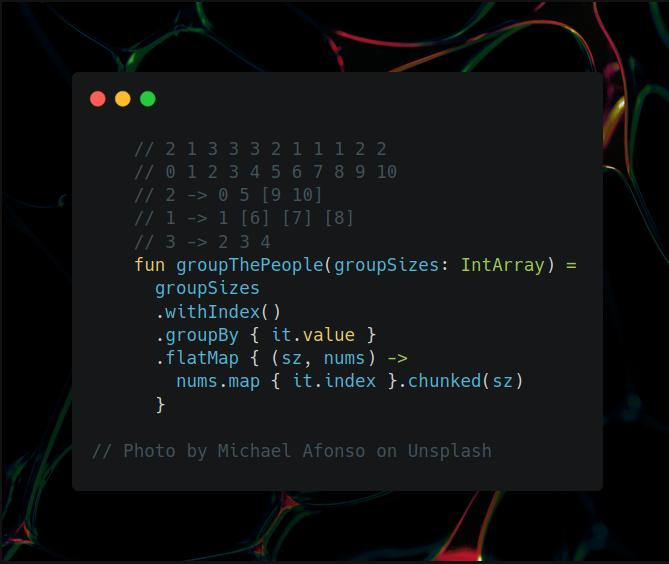

# Kotlin | collections API

**Author:** SamoylenkoDmitry
**Votes:** 2
**Link:** [https://leetcode.com/problems/group-the-people-given-the-group-size-they-belong-to/solutions/4029302/](https://leetcode.com/problems/group-the-people-given-the-group-size-they-belong-to/solutions/4029302/)

---



#### Join me on Telegram

https://t.me/leetcode_daily_unstoppable/336

#### Problem TLDR

Groups from groups sizes array

#### Intuition

First, group by sizes, next, chunk by groups size each.

#### Approach

Let's write it using Kotlin collections API

#### Complexity
- Time complexity:
$$O(n)$$

- Space complexity:
$$O(n)$$

#### Code

```kotlin

    // 2 1 3 3 3 2 1 1 1 2 2
    // 0 1 2 3 4 5 6 7 8 9 10
    // 2 -> 0 5 [9 10]
    // 1 -> 1 [6] [7] [8]
    // 3 -> 2 3 4
    fun groupThePeople(groupSizes: IntArray) =
      groupSizes
      .withIndex()
      .groupBy { it.value }
      .flatMap { (sz, nums) -> 
        nums.map { it.index }.chunked(sz) 
      }

```