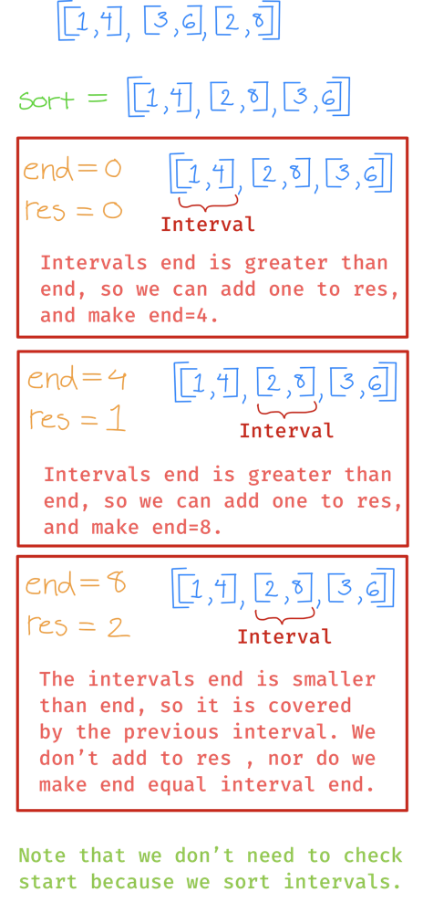

# Two golang solutions with images for explanation

**Author:** nathannaveen
**Votes:** 2
**Link:** [https://leetcode.com/problems/remove-covered-intervals/solutions/1429212/](https://leetcode.com/problems/remove-covered-intervals/solutions/1429212/)

---

In both of these solutions we sort `intervals` by the following:

* If `intervals[i][0]` equals `intervals[j][0]` we can return the decending order of `intervals[i][1]` and `intervals[j][1]`.
* else, we can return the increasing order of `intervals[i][0]`, and `intervals[j][0]`.

Since we sort `intervals` by their start values. For example, we don't have to worry about `c <= a` if we have the intervals `[a, b)`, and `[c, d)`.

And since we have sorted `intervals` by their end values if their start values are equal. All we have to do is check whether `d >= b` if we have the intervals `[a, b)`, and `[c, d)`. 

**Solution One:**
---

In this solution, we remove intervals from `intervals`.


``` go
func removeCoveredIntervals(intervals [][]int) int {
    sort.Slice(intervals, func(i, j int) bool {
        if intervals[i][0] == intervals[j][0] {
            return intervals[i][1] > intervals[j][1]
        }
        return intervals[i][0] < intervals[j][0]
    })
    
    for i := 0; i < len(intervals) - 1; i++ {
        if intervals[i][1] >= intervals[i + 1][1] {
            intervals = append(intervals[:i + 1], intervals[i + 2:]...)
            i--
        }
    }
    return len(intervals)
}
```

**Solution 2:**
---

In this solution, we just count the remaining intervals.



``` go
func removeCoveredIntervals(intervals [][]int) int {
    sort.Slice(intervals, func(i, j int) bool {
        if intervals[i][0] == intervals[j][0] {
            return intervals[i][1] > intervals[j][1]
        }
        return intervals[i][0] < intervals[j][0]
    })
    
    end, res := 0, 0
    
    for _, interval := range intervals {
        if interval[1] > end {
            end = interval[1]
            res++
        }
    }
    
    return res
}
```